# 迁若租赁平台项目架构图

更新时间：2026-10-19

本文根据仓库内维护的 Markdown 需求/设计、Maven 模块、Controller、Feign 契约、网关路由、Docker/Kubernetes 部署清单和数据库 DDL 整理。图中的“已运行”“已建表待实现”“规划”严格区分；具体完成进度见[开发进度快照](../development-progress.md)，订单渠道、批处理、库存工作流、文件配额和协议版本以当前实现与迁移脚本为准。

## 1. 架构基线与图例

### 1.1 事实来源

- [1.0 需求基线与实施差异](./requirements-baseline-and-gaps.md)：最新需求与当前代码/数据模型的差异。
- [平台商户微服务拆分任务](./platform-merchant-service-split.md)：平台端与商户端服务边界。
- [第 1 阶段完成状态](./phase-1-completion-status.md)：当前已实现能力与验证结果。
- [`ry_rental` 与 `ry_business` 数据库边界设计](./rental-database-boundaries.md)：控制面、执行面、数据表归属和迁移遗留收口规则。
- [项目路由清单](../route-catalog.md)：网关、后端和前端路由。
- [RuoYi-Cloud 开发计划](./ruoyi-cloud-development-plan.md)：后续业务服务规划。
- [历史租赁单库 DDL](../../database/mysql/01_rental_schema.sql)：商户控制面表及待退役业务表的早期初始化结构。
- [RuoYi 系统库 DDL](../../backend/ruoyi-cloud/sql/ry_20260321.sql)：平台用户、权限、任务和代码生成表。
- [本地 Docker 编排](../../deploy/docker-compose.local.yml)：当前可部署服务、端口和依赖。

### 1.2 状态定义

| 状态 | 含义 |
| --- | --- |
| 已运行 | 已存在可执行后端模块或独立前端工程，并纳入本地/云端部署清单 |
| 已建表待实现 | DDL 已存在，前端可能已有骨架页面，但当前没有对应独立后端业务服务 |
| 规划 | 最新 1.0 基线或开发计划已定义边界，当前 Maven 工程或数据模型中尚不存在完整实现 |

### 1.3 命名说明

- 物理 Maven 目录：`ruoyi-modules/ruoyi-platform-service`。
- Maven 制品：`ruoyi-platform-service`。
- Spring/Nacos 运行时服务名、Docker 服务名：`platform-service`。
- 商户物理模块和 Maven 制品：`ruoyi-merchant-service`；运行时服务名：`merchant-service`。
- 租赁核心业务物理模块和 Maven 制品：`ruoyi-rental-business`；运行时服务名：`rental-business`，端口 `9220`。
- `tenant_id` 是租户隔离键，`member_id` 是商户主体隔离键；当前租赁库没有独立的租户主表。
- 租赁业务 DDL 主要使用逻辑关联和联合索引，没有为所有关系声明物理外键。下文 ER 图中的 `FK` 表示逻辑引用字段。

## 2. 当前运行架构

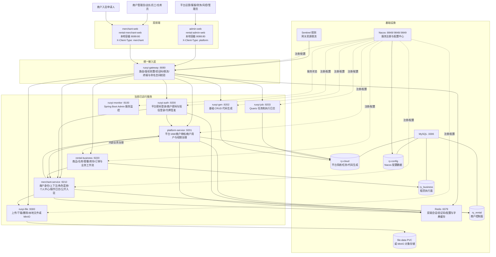

### 2.1 当前部署边界

| 部署单元 | 端口 | 直接数据依赖 | 当前职责 |
| --- | ---: | --- | --- |
| `rental-admin-web` | `8088 -> 80` | 无 | 平台登录、系统管理、商户主体/用户/角色权限管理、任务和代码生成页面 |
| `rental-merchant-web` | `8089 -> 80` | 无 | 商户登录、入驻、个人中心、角色权限、操作日志及第 2 阶段业务骨架 |
| `ruoyi-gateway` | `8080` | Redis、Nacos、Sentinel | 固定双端路由、Token 与终端校验、验证码、限流 |
| `ruoyi-auth` | `9200` | Redis；通过 Feign 访问双服务 | 根据 `X-Client-Type` 选择平台或商户身份源并签发 Token |
| `platform-service` | `9201` | `ry-cloud`、跨库访问 `ry_rental`、Redis | 平台用户权限、平台日志、商户审核和治理 |
| `merchant-service` | `9210` | 仅 `ry_rental`、Redis | 商户身份和数据边界、商户运行角色权限、日志、公开入驻 |
| `rental-business` | `9220` | 仅 `ry_business`、Redis、Nacos，并通过 merchant-service 内部契约校验经营分类 | 维护商品、套餐、SN、配件、仓库、库存和订单；写操作统一经过商户/仓库上下文与软删除校验 |
| `ruoyi-file` | `9300` | 文件卷或 MinIO | 文件上传、下载和删除 |
| `ruoyi-job` | `9203` | `ry-cloud` | Quartz 任务和任务日志 |
| `ruoyi-gen` | `9202` | `ry-cloud` | 表结构读取和 CRUD 代码生成 |
| `ruoyi-monitor` | `9100` | Nacos | Spring Boot Admin 监控 |

数据库账号边界：

- `qianruo_platform`：`ry-cloud` 与 `ry_rental` 的 `SELECT/INSERT/UPDATE/DELETE/EXECUTE`。
- `qianruo_merchant`：仅 `ry_rental` 的 `SELECT/INSERT/UPDATE/DELETE/EXECUTE`。
- `qianruo_business`：仅 `ry_business` 的 `SELECT/INSERT/UPDATE/DELETE/EXECUTE`，不得用于平台或商户身份表。
- 当前本地编排中的 `ruoyi-job`、`ruoyi-gen` 仍使用 MySQL root，是后续需要继续收紧的部署权限。

## 3. 网关路由与服务间调用

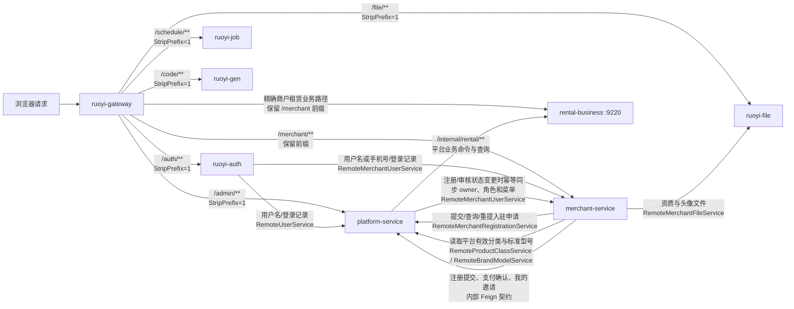

### 3.1 公开与内部接口边界

| 边界 | 外部路径 | 服务内部路径 | 约束 |
| --- | --- | --- | --- |
| 平台接口 | `/admin/**` | 去掉 `/admin` 后进入平台 Controller | 只接受 `platform` 终端和平台 Token |
| 商户接口 | `/merchant/**` | 保留 `/merchant` 前缀 | 只接受 `merchant` 终端和商户 Token；公开入驻除外但仍要求商户端请求头 |
| 认证接口 | `/auth/login`、`/auth/smsLogin`、`/auth/logout`、`/auth/refresh` | `/login`、`/smsLogin` 等 | 登录身份源由可信客户端类型决定 |
| 平台内部用户 | 无外部入口 | `/user/info/{username}`、`/user/recordlogin` | 仅 `from-source: inner` 的 Feign 调用 |
| 商户内部身份 | 无外部入口 | `/internal/merchant/users/**` | 仅内部调用，并强制商户终端标识 |
| 平台内部入驻 | 无外部入口 | `/internal/platform/merchant-registration/**` | 仅 merchant-service 调用 |
| 平台内部分类 | 无外部入口 | `/internal/platform/product-classes` | 只读有效分类 DTO，禁止商户服务跨库调用平台 Mapper |

## 4. Maven 工程模块关系

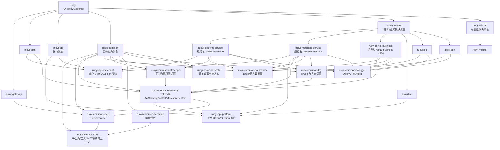

### 4.1 模块职责清单

| 模块 | 类型 | 精确职责 |
| --- | --- | --- |
| `frontend/admin-web` | 前端工程 | 平台 IAM、部门岗位、字典参数、公告日志、在线用户、任务、代码生成、商户主体审核、商户用户和全局商户角色模板 |
| `frontend/merchant-web` | 前端工程 | 商户登录/注册/初始化密码、个人资料、上下文、角色权限、操作日志；订单渠道、库存工作流、批量导入导出、文件配额和协议确认入口已接入 |
| `ruoyi-gateway` | 可执行服务 | 固定路由、客户端类型与 Token 命名空间校验、验证码、黑名单、Sentinel 限流、Swagger 聚合入口 |
| `ruoyi-auth` | 可执行服务 | 平台密码登录、商户密码/短信登录、登出、刷新令牌；不直接读取用户数据库 |
| `ruoyi-api-platform` | 契约库 | `SysUser/LoginUser`、平台用户 Feign、平台日志/文件契约、商户入驻平台内部契约 |
| `ruoyi-api-merchant` | 契约库 | 商户登录身份、登录记录、owner 开通、商户文件最小契约；不暴露平台用户模型 |
| `ruoyi-common-core` | 公共库 | 通用返回、分页、异常、日期、JWT、字符串、文件、客户端上下文等基础能力 |
| `ruoyi-common-redis` | 公共库 | Redis 通用读写和缓存操作 |
| `ruoyi-common-security` | 公共库 | Token 创建/解析/刷新、登录态读取、权限工具、Feign Token 透传、`MerchantContextUtils` |
| `ruoyi-common-log` | 公共库 | `@Log`、操作类型、参数过滤、异步日志切面 |
| `ruoyi-common-datascope` | 公共库 | 平台角色部门数据范围切面，不代替商户 `tenant_id + member_id` 条件 |
| `ruoyi-common-datasource` | 公共库 | Druid 与动态数据源装配 |
| `ruoyi-common-sensitive` | 公共库 | 响应字段脱敏能力 |
| `ruoyi-common-swagger` | 公共库 | SpringDoc/OpenAPI 配置 |
| `ruoyi-common-seata` | 公共库 | Seata 客户端接入；当前部署清单没有 Seata Server |
| `ruoyi-platform-service` | 可执行服务 | 平台用户/角色/菜单/部门/岗位/字典/参数/公告/日志；商户主体审核、商户用户和全局商户角色模板治理 |
| `ruoyi-merchant-service` | 可执行服务 | 商户身份、唯一有效绑定、仓库范围、菜单角色、用户菜单、个人中心、操作日志和公开入驻 |
| `ruoyi-rental-business` | 可执行服务 | 租赁核心业务服务；提供商户主数据、套餐资源池、订单渠道及转移、批处理、库存状态机/预占释放、幂等并发锁、文件配额审计和商户/内部命名空间边界 |
| `ruoyi-file` | 可执行服务 | 文件上传、下载、删除和存储适配 |
| `ruoyi-job` | 可执行服务 | Quartz 任务管理和执行日志 |
| `ruoyi-gen` | 可执行服务 | 数据库表导入、预览和 CRUD 代码生成 |
| `ruoyi-monitor` | 可执行服务 | 服务注册实例、健康状态和 JVM 指标监控 |
| `database` | 数据模块 | RuoYi 系统库、租赁库初始化、种子和幂等迁移 |
| `deploy`、`scripts/deploy.sh` | 运维模块 | 镜像构建、本地 Docker、Kubernetes、数据库初始化/迁移和最小权限账号开通 |

## 5. 认证、会话与数据隔离链路

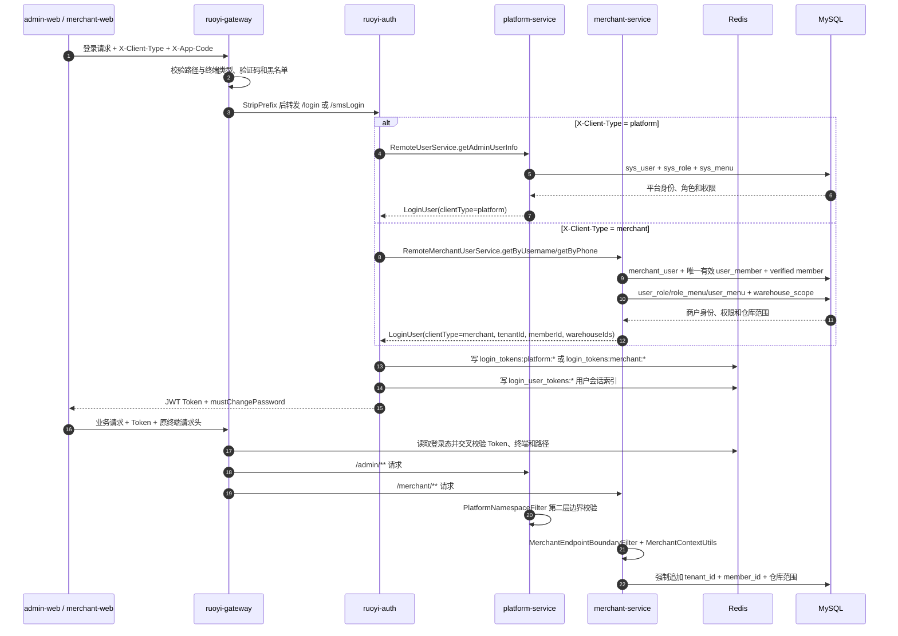

### 5.1 Redis 关键命名空间

| Key 前缀 | 用途 |
| --- | --- |
| `login_tokens:platform:` | 平台登录态 |
| `login_tokens:merchant:` | 商户登录态 |
| `login_user_tokens:` | 用户到全部 Token 的反向索引，用于权限或状态变化后批量失效会话 |
| `captcha_codes:` | 图形/短信验证码缓存 |
| `pwd_err_cnt:` | 密码错误次数与锁定 |
| `sys_config:` | 平台参数缓存 |
| `sys_dict:` | 平台字典缓存 |

### 5.2 全接口审计与软删除保护链路

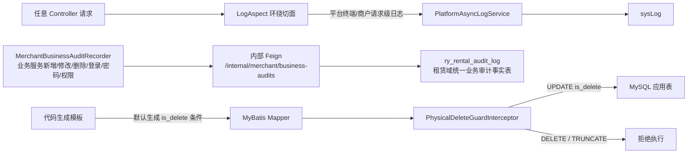

所有接口日志记录终端、操作人、租户/商户、链路 ID、HTTP 状态、URL、结果和耗时；敏感参数统一排除。所有应用表使用 `is_delete`，查询只返回正常记录，关系恢复使用 upsert，运行时不允许物理删除。

## 6. 商户入驻与管理员开通状态机

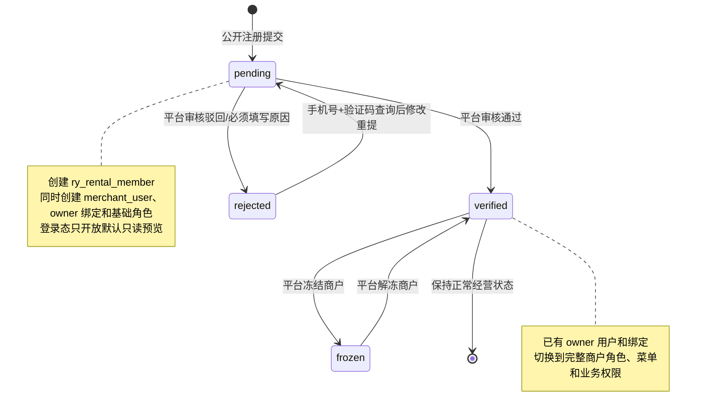

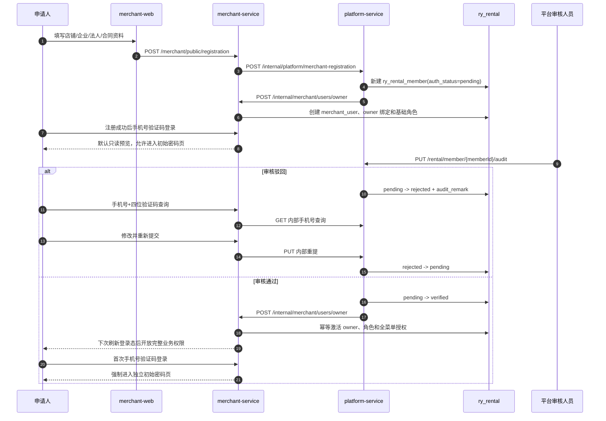

## 7. 数据库所有权与基础设施数据

| 数据域 | 主要表/对象 | 直接所有者 | 访问规则 |
| --- | --- | --- | --- |
| `ry-cloud` 平台 IAM | `sys_user`、`sys_role`、`sys_menu`、`sys_dept`、`sys_post` 及关联表 | `platform-service` | 商户服务禁止访问 |
| `ry-cloud` 平台治理 | `sys_dict_*`、`sys_config`、`sys_notice*`、`sys_oper_log`、`sys_logininfor` | `platform-service` | 商户端使用本地业务常量，不回退平台字典/参数/日志 |
| `ry-cloud` 调度 | `sys_job`、`sys_job_log`、`QRTZ_*` | `ruoyi-job` | 平台前端通过 `/schedule/**` 管理 |
| `ry-cloud` 代码生成 | `gen_table`、`gen_table_column` | `ruoyi-gen` | 仅平台工具入口 |
| `ry_rental` 商户治理 | `member`、`merchant_user`、绑定、菜单、角色、仓库授权范围、商户业务审计日志、商户经营分类 | 平台与商户按表职责协作 | 所有商户查询强制使用可信 `tenant_id + member_id`；仓库范围只保存授权 ID |
| `ry_rental` 平台分类主数据 | `ry_rental_product_class` | `platform-service` | 商户服务只通过内部 Feign 读取有效分类，不直接访问平台 Mapper |
| `ry_business` 租赁执行面 | 仓库、商品、SN、配件、套餐、库存、客户、订单、渠道、物流、配额、协议与业务流水 | `rental-business` | 唯一业务事实源；平台和商户身份服务禁止直连 |
| `ry_rental` 待迁移执行面附属表 | 设备照片、盘点、调货、物流路由、媒体、售后等尚未建立业务库权威结构的表 | 待归属 `rental-business` 或后续领域服务 | 禁止新增引用；建立权威结构并核对数据后白名单退役 |
| 后续独立领域 | 财务、租仓联盟、周转市场等 | 后续 `rental-*` 服务 | 使用独立领域库，不再写入 `ry_rental` |
| `ry-config` | Nacos `config_info*`、`tenant_*`、`users/roles/permissions` | Nacos | 应用只通过 Nacos 客户端访问 |
| Redis | 双端登录态、验证码、错误次数、配置/字典缓存 | gateway/auth/双业务服务 | 平台和商户 Token 前缀互斥 |
| 文件存储 | 本地 PVC 或 MinIO 对象 | `ruoyi-file` | 业务表仅保存 `file_id` 或文件 URL |
| Seata | `global_table`、`branch_table`、`lock_table`、`undo_log` | 规划中的 Seata Server | SQL 和客户端库已存在，当前部署未启动 Seata Server |

后续 ER 图中的 `ry_rental_*` 是租赁领域表名，不代表表都位于 `ry_rental`。商户主体、IAM、分类和型号位于 `ry_rental`；仓库、商品、库存、订单及其执行流水位于 `ry_business`。跨数据库连线均为应用层逻辑引用，不是物理外键。

## 8. 平台系统库数据关系

```mermaid
erDiagram
    sys_dept {
        bigint dept_id PK
        bigint parent_id FK
        varchar ancestors
        char status
    }
    sys_user {
        bigint user_id PK
        bigint dept_id FK
        varchar user_name
        varchar password
        boolean must_change_password
        char status
    }
    sys_post {
        bigint post_id PK
        varchar post_code UK
        char status
    }
    sys_role {
        bigint role_id PK
        varchar role_key
        char data_scope
        char status
    }
    sys_menu {
        bigint menu_id PK
        bigint parent_id FK
        varchar perms
        varchar client_type
        char menu_type
    }
    sys_user_role {
        bigint user_id PK,FK
        bigint role_id PK,FK
    }
    sys_role_menu {
        bigint role_id PK,FK
        bigint menu_id PK,FK
    }
    sys_role_dept {
        bigint role_id PK,FK
        bigint dept_id PK,FK
    }
    sys_user_post {
        bigint user_id PK,FK
        bigint post_id PK,FK
    }
    sys_notice {
        bigint notice_id PK
        varchar notice_type
        char status
    }
    sys_notice_read {
        bigint user_id PK,FK
        bigint notice_id PK,FK
        datetime read_time
    }
    sys_dict_type {
        bigint dict_id PK
        varchar dict_type UK
    }
    sys_dict_data {
        bigint dict_code PK
        varchar dict_type FK
        varchar dict_value
    }
    sys_job {
        bigint job_id PK
        varchar job_name
        varchar job_group
        char status
    }
    sys_job_log {
        bigint job_log_id PK
        varchar job_name FK
        varchar job_group FK
        char status
    }
    gen_table {
        bigint table_id PK
        varchar table_name
    }
    gen_table_column {
        bigint column_id PK
        bigint table_id FK
        varchar column_name
    }
    sys_oper_log {
        bigint oper_id PK
        varchar oper_name
        int business_type
        int status
    }
    sys_logininfor {
        bigint info_id PK
        varchar user_name
        char status
    }
    sys_config {
        bigint config_id PK
        varchar config_key UK
        varchar config_value
    }

    sys_dept ||--o{ sys_dept : "父子部门"
    sys_dept ||--o{ sys_user : "所属部门"
    sys_user ||--o{ sys_user_role : "用户角色"
    sys_role ||--o{ sys_user_role : "角色用户"
    sys_role ||--o{ sys_role_menu : "角色菜单"
    sys_menu ||--o{ sys_role_menu : "菜单角色"
    sys_role ||--o{ sys_role_dept : "自定义数据范围"
    sys_dept ||--o{ sys_role_dept : "角色可见部门"
    sys_user ||--o{ sys_user_post : "用户岗位"
    sys_post ||--o{ sys_user_post : "岗位用户"
    sys_menu ||--o{ sys_menu : "父子菜单"
    sys_user ||--o{ sys_notice_read : "阅读记录"
    sys_notice ||--o{ sys_notice_read : "公告阅读"
    sys_dict_type ||--o{ sys_dict_data : "字典项"
    sys_job ||--o{ sys_job_log : "按任务名和组记录执行"
    gen_table ||--o{ gen_table_column : "生成字段"
```

平台日志表 `sys_oper_log`、登录日志表 `sys_logininfor` 以操作者名称记录审计信息，没有声明到 `sys_user.user_id` 的物理外键；`sys_config` 为独立键值配置表。

## 9. 商户身份、权限与仓库数据关系

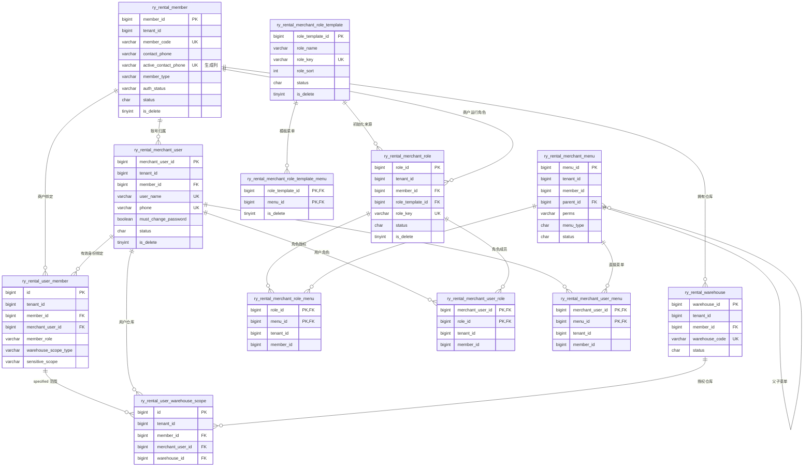

关键约束：

1. 商户登录必须命中唯一有效 `ry_rental_user_member` 绑定。
2. 主体必须为 `auth_status = verified`、未冻结、未删除，账号才允许登录。
3. 平台角色模板只定义所有商户可用的角色和菜单上限，不携带商户归属；商户实际菜单是当前商户运行角色菜单与用户直接菜单的并集，所有运行时关联同时校验 `tenant_id + member_id`。
4. `warehouse_scope_type = all` 不写指定仓库明细；`specified` 必须至少有一条当前商户的启用仓库记录。
5. owner 固定拥有全部仓库范围；权限、状态、密码或仓库范围变化后通过用户 Token 索引失效已有会话。

## 10. 商品、设备与套餐数据关系（分类、标准型号、主数据和资源池已实现）

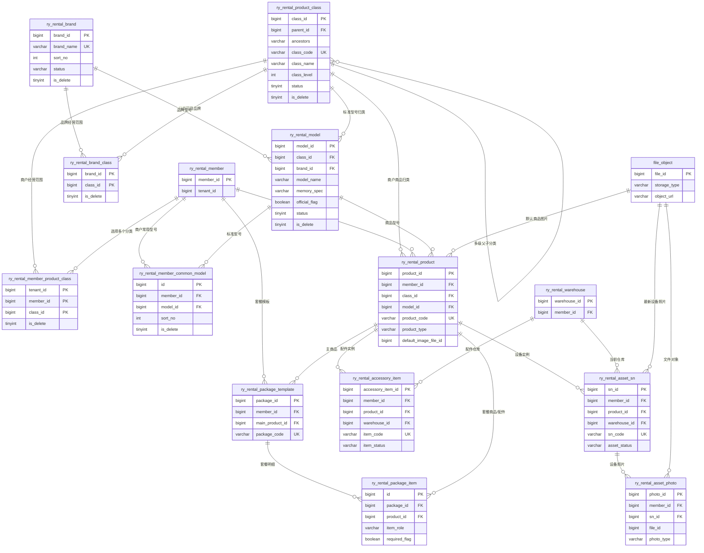

`file_object` 是对 `ruoyi-file` 存储对象的逻辑表示，不是当前 `ry_rental` 中的物理表。

分类主数据由平台服务维护，商户只保存 `tenant_id + member_id + class_id` 选择关系。品牌主数据由 `ry_rental_brand` 维护，品牌与分类通过 `ry_rental_brand_class` 多对多关系绑定；型号主数据由独立的 `ry_rental_model` 维护，通过 `brand_id + class_id` 关联，不保存品牌名称快照。商户只保存 `tenant_id + member_id + model_id` 常用关系。商品和套餐业务必须先通过商户经营范围校验，商户端页面只调用商户服务的分类和常用型号接口，不能直接读取平台全量主数据。

### 10.1 商品与套餐资源池模型（已实现）

当前 `asset_sn/accessory_item/package_item/inventory_reservation` 由 `ry_business` 的资源池、版本化 BOM、库存余额、逐件单元和预占明细承载，支持通用配件共享和多套餐并发约束。实现以[商品与套餐库存数据结构设计](./product-package-inventory-data-model.md)为准，不保留业务层双写或兼容读取。

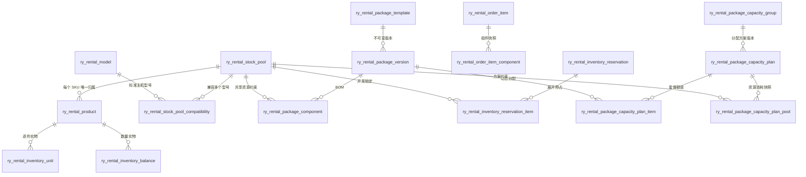

核心计算边界：

- 套餐容量是 `min(floor(资源池可用量 / BOM 单位需求))` 的计算值，不是库存余额。
- 通用配件兼容多个型号时仍只属于一个资源池，所有套餐共同竞争该池。
- 单套餐独立容量不可直接相加；跨套餐总容量按整数约束 `sum(BOM需求 × 套餐数量) <= 资源池可用量` 计算。
- 容量方案只分配套餐可销售额度，可在 `5+10`、`10+5` 等合法组合之间原子切换；旧方案保留审计，不绑定具体实物。
- 订单在事务内展开并预占所有资源池，任一资源不足时整单回滚。

### 10.2 订单渠道、批处理、配额和协议关系

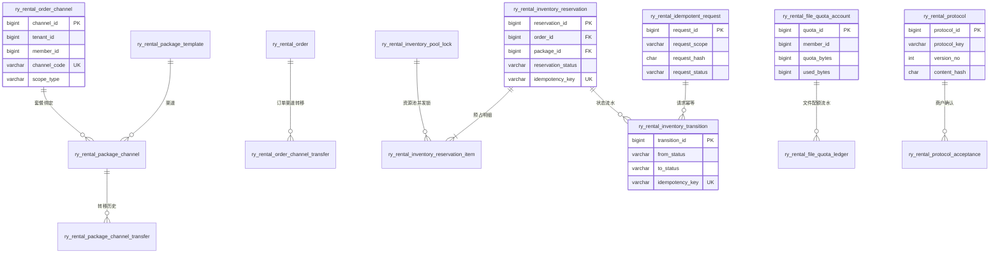

订单主表通过 `channel_id BIGINT` 关联订单渠道表，渠道编码和名称仅从渠道表读取；订单渠道转移记录通过 `from_channel_id`、`to_channel_id` 保存不可变的主键关系。订单、订单明细、订单备注、物流记录以及套餐渠道关系的 `create_by`、`update_by` 统一为 `BIGINT`，逻辑关联 `ry_rental.ry_rental_merchant_user.merchant_user_id`，不关联平台 `sys_user`；历史无法可靠匹配的操作账号保留为空。库存预占按资源池展开，库存状态迁移和文件配额流水均为追加记录；协议正文以版本和哈希固定，商户确认不覆盖平台版本。

## 11. 订单、库存、物流与售后数据关系（订单基础已建表，渠道和库存工作流已实现）

> 审计字段约定：订单及其附属记录的 `create_by`、`update_by` 为 `BIGINT`，关联商户库 `ry_rental.ry_rental_merchant_user.merchant_user_id`，不关联平台用户表。
>
> 数据库归属：本节中的商品、仓库、客户、订单、订单明细、订单备注、订单编辑日志、设备照片、库存流水、库存预占、库存快照、盘点单、盘点明细、调货单、物流单均以 `ry_business` 为权威库；`ry_rental_member` 仍属于控制面。物流路由、媒体、售后等尚未完成接口切换的表仍保留在 `ry_rental`，不得新增跨服务直连引用。

```mermaid
erDiagram
    ry_rental_member {
        bigint member_id PK
        bigint tenant_id
    }
    ry_rental_customer {
        bigint customer_id PK
        bigint member_id FK
        varchar phone
    }
    ry_rental_warehouse {
        bigint warehouse_id PK
        bigint member_id FK
    }
    ry_rental_product {
        bigint product_id PK
        bigint member_id FK
    }
    ry_rental_package_template {
        bigint package_id PK
        bigint member_id FK
    }
    ry_rental_asset_sn {
        bigint sn_id PK
        bigint product_id FK
        bigint warehouse_id FK
    }
    ry_rental_accessory_item {
        bigint accessory_item_id PK
        bigint product_id FK
        bigint warehouse_id FK
    }
    ry_rental_order {
        bigint order_id PK
        bigint member_id FK
        bigint customer_id FK
        bigint warehouse_id FK
        bigint return_warehouse_id FK
        bigint source_order_id FK
        varchar order_no UK
        varchar order_status
        varchar pay_status
    }
    ry_rental_order_item {
        bigint order_item_id PK
        bigint order_id FK
        bigint product_id FK
        bigint package_id FK
        bigint sn_id FK
        varchar item_status
    }
    ry_rental_order_edit_log {
        bigint log_id PK
        bigint order_id FK
        bigint operator_id
    }
    ry_rental_order_note {
        bigint note_id PK
        bigint order_id FK
        boolean pinned_flag
    }
    ry_rental_inventory_reservation {
        bigint reservation_id PK
        bigint order_id FK
        bigint product_id FK
        bigint package_id FK
        bigint warehouse_id FK
        varchar reservation_status
    }
    ry_rental_inventory_ledger {
        bigint ledger_id PK
        bigint warehouse_id FK
        bigint product_id FK
        bigint sn_id FK
        bigint accessory_item_id FK
        varchar change_type
        varchar ref_type
        bigint ref_id
    }
    ry_rental_inventory_snapshot {
        bigint snapshot_id PK
        bigint warehouse_id FK
        bigint product_id FK
        bigint package_id FK
        date snapshot_date
    }
    ry_rental_transfer_order {
        bigint transfer_id PK
        bigint from_warehouse_id FK
        bigint to_warehouse_id FK
        bigint ref_order_id FK
        varchar transfer_no UK
        varchar transfer_status
    }
    ry_rental_stocktaking {
        bigint stocktaking_id PK
        bigint warehouse_id FK
        varchar stocktaking_no UK
        varchar stocktaking_status
    }
    ry_rental_stocktaking_item {
        bigint item_id PK
        bigint stocktaking_id FK
        bigint sn_id FK
        varchar matched_ref_type
        bigint matched_ref_id
    }
    ry_rental_logistics_order {
        bigint logistics_id PK
        bigint order_id FK
        bigint warehouse_id FK
        varchar tracking_no UK
        varchar route_status
    }
    ry_rental_logistics_route {
        bigint route_id PK
        bigint logistics_id FK
        varchar route_status
        datetime route_time
    }
    ry_rental_media_asset {
        bigint media_id PK
        bigint order_id FK
        bigint sn_id FK
        bigint file_id
        varchar media_type
        varchar match_status
    }
    ry_rental_after_sales_case {
        bigint case_id PK
        bigint order_id FK
        varchar case_no UK
        varchar case_type
        varchar case_status
    }
    file_object {
        bigint file_id PK
        varchar storage_type
        varchar object_url
    }

    ry_rental_member ||--o{ ry_rental_customer : "商户客户"
    ry_rental_member ||--o{ ry_rental_order : "商户订单"
    ry_rental_customer ||--o{ ry_rental_order : "下单客户"
    ry_rental_warehouse ||--o{ ry_rental_order : "发货仓/归还仓"
    ry_rental_order ||--o{ ry_rental_order : "转寄来源订单"
    ry_rental_order ||--|{ ry_rental_order_item : "订单明细"
    ry_rental_product ||--o{ ry_rental_order_item : "商品"
    ry_rental_package_template ||--o{ ry_rental_order_item : "套餐"
    ry_rental_asset_sn ||--o{ ry_rental_order_item : "绑定 SN"
    ry_rental_order ||--o{ ry_rental_order_edit_log : "编辑审计"
    ry_rental_order ||--o{ ry_rental_order_note : "批注"
    ry_rental_order ||--o{ ry_rental_inventory_reservation : "库存预占"
    ry_rental_product ||--o{ ry_rental_inventory_reservation : "预占商品"
    ry_rental_warehouse ||--o{ ry_rental_inventory_reservation : "预占仓库"
    ry_rental_warehouse ||--o{ ry_rental_inventory_ledger : "库存流水"
    ry_rental_product ||--o{ ry_rental_inventory_ledger : "商品流水"
    ry_rental_asset_sn ||--o{ ry_rental_inventory_ledger : "SN 流水"
    ry_rental_accessory_item ||--o{ ry_rental_inventory_ledger : "配件流水"
    ry_rental_warehouse ||--o{ ry_rental_inventory_snapshot : "仓库快照"
    ry_rental_product ||--o{ ry_rental_inventory_snapshot : "商品快照"
    ry_rental_warehouse ||--o{ ry_rental_transfer_order : "调出仓/调入仓"
    ry_rental_order ||--o{ ry_rental_transfer_order : "订单调货"
    ry_rental_warehouse ||--o{ ry_rental_stocktaking : "仓库盘点"
    ry_rental_stocktaking ||--|{ ry_rental_stocktaking_item : "盘点明细"
    ry_rental_asset_sn ||--o{ ry_rental_stocktaking_item : "扫描 SN"
    ry_rental_order ||--o{ ry_rental_logistics_order : "订单物流"
    ry_rental_warehouse ||--o{ ry_rental_logistics_order : "物流发货仓"
    ry_rental_logistics_order ||--o{ ry_rental_logistics_route : "物流轨迹"
    ry_rental_order ||--o{ ry_rental_media_asset : "订单媒体"
    ry_rental_asset_sn ||--o{ ry_rental_media_asset : "设备媒体"
    file_object ||--o{ ry_rental_media_asset : "媒体文件"
    ry_rental_order ||--o{ ry_rental_after_sales_case : "售后案件"
```

`ry_rental_inventory_ledger.ref_type + ref_id` 和 `ry_rental_stocktaking_item.matched_ref_type + matched_ref_id` 是多态业务引用，数据库不声明单一目标外键。

## 12. 财务、增长、联盟和市场数据关系（已建表待实现）

```mermaid
erDiagram
    ry_rental_member {
        bigint member_id PK
        bigint tenant_id
    }
    ry_rental_order {
        bigint order_id PK
        bigint member_id FK
    }
    ry_rental_customer {
        bigint customer_id PK
        bigint member_id FK
    }
    ry_rental_finance_ledger {
        bigint ledger_id PK
        bigint member_id FK
        bigint original_ledger_id FK
        varchar ledger_no UK
        varchar biz_type
        varchar ref_type
        bigint ref_id
        varchar ledger_status
    }
    ry_rental_service_subscription {
        bigint subscription_id PK
        bigint member_id FK
        varchar service_code
        varchar plan_code
        varchar subscription_status
    }
    ry_rental_promotion_invite {
        bigint invite_id PK
        bigint promoter_member_id FK
        bigint invitee_member_id FK
        varchar invite_code
        varchar effective_status
    }
    ry_rental_alliance {
        bigint alliance_id PK
        bigint owner_member_id FK
        varchar alliance_status
    }
    ry_rental_alliance_member {
        bigint id PK
        bigint alliance_id FK
        bigint member_id FK
        varchar member_status
    }
    ry_rental_alliance_order {
        bigint alliance_order_id PK
        bigint alliance_id FK
        bigint source_order_id FK
        bigint initiator_member_id FK
        bigint receiver_member_id FK
        varchar alliance_order_status
    }
    ry_rental_market_post {
        bigint post_id PK
        bigint member_id FK
        varchar post_no UK
        varchar board_type
        varchar post_status
    }
    ry_rental_market_message {
        bigint message_id PK
        bigint post_id FK
        bigint from_member_id FK
        bigint to_member_id FK
        boolean risk_flag
    }
    ry_rental_market_report {
        bigint report_id PK
        bigint post_id FK
        bigint reporter_member_id FK
        bigint reported_member_id FK
        bigint reviewer_id
        varchar report_status
    }
    ry_rental_market_deposit_ledger {
        bigint deposit_ledger_id PK
        bigint member_id FK
        varchar ref_type
        bigint ref_id
        varchar ledger_status
    }
    ry_rental_miniapp_auth {
        bigint auth_id PK
        bigint member_id FK
        varchar phone
        boolean consent_flag
    }
    ry_rental_share_log {
        bigint share_id PK
        bigint member_id FK
        bigint order_id FK
        varchar share_type
    }
    ry_rental_deposit_free_code {
        bigint code_id PK
        bigint member_id FK
        bigint order_id FK
        bigint customer_id FK
        varchar deposit_free_code UK
        varchar code_status
    }
    ry_rental_idempotent_request {
        bigint request_id PK
        bigint tenant_id
        bigint member_id FK
        varchar idempotent_key UK
        varchar request_status
    }
    ry_rental_audit_log {
        bigint audit_id PK
        bigint tenant_id FK
        bigint member_id FK
        bigint actor_id
        varchar actor_name
        varchar actor_type
        varchar action_code
        varchar business_module
        varchar operation_type
        varchar object_type
        varchar object_id
        varchar target_name
        varchar description
        json before_json
        json after_json
        tinyint sensitive_flag
        varchar client_ip
        tinyint status
        varchar error_message
        varchar trace_id
        datetime create_time
    }

    ry_rental_member ||--o{ ry_rental_finance_ledger : "商户财务流水"
    ry_rental_finance_ledger ||--o{ ry_rental_finance_ledger : "冲正/退款原流水"
    ry_rental_member ||--o{ ry_rental_service_subscription : "增值服务订阅"
    ry_rental_member ||--o{ ry_rental_promotion_invite : "推广方/被邀请方"
    ry_rental_member ||--o{ ry_rental_alliance : "联盟盟主"
    ry_rental_alliance ||--o{ ry_rental_alliance_member : "联盟成员"
    ry_rental_member ||--o{ ry_rental_alliance_member : "成员商户"
    ry_rental_alliance ||--o{ ry_rental_alliance_order : "联盟协作单"
    ry_rental_order ||--o{ ry_rental_alliance_order : "来源订单"
    ry_rental_member ||--o{ ry_rental_alliance_order : "发起方/承接方"
    ry_rental_member ||--o{ ry_rental_market_post : "市场帖子"
    ry_rental_market_post ||--o{ ry_rental_market_message : "站内私信"
    ry_rental_member ||--o{ ry_rental_market_message : "发送方/接收方"
    ry_rental_market_post ||--o{ ry_rental_market_report : "帖子举报"
    ry_rental_member ||--o{ ry_rental_market_report : "举报方/被举报方"
    ry_rental_member ||--o{ ry_rental_market_deposit_ledger : "市场保证金"
    ry_rental_member ||--o{ ry_rental_miniapp_auth : "小程序授权"
    ry_rental_member ||--o{ ry_rental_share_log : "转发审计"
    ry_rental_order ||--o{ ry_rental_share_log : "订单转发"
    ry_rental_member ||--o{ ry_rental_deposit_free_code : "免押码"
    ry_rental_order ||--o{ ry_rental_deposit_free_code : "订单免押"
    ry_rental_customer ||--o{ ry_rental_deposit_free_code : "客户免押"
    ry_rental_member ||--o{ ry_rental_idempotent_request : "商户幂等请求"
    ry_rental_member ||--o{ ry_rental_audit_log : "商户业务审计"
```

财务流水、市场保证金流水禁止直接覆盖历史记录；退款、冲正、冻结和解冻必须追加新流水。`ref_type + ref_id`、`object_type + object_id` 为多态引用。

### 12.1 跨域与多态引用

| 来源字段 | 逻辑目标 | 约束方式 |
| --- | --- | --- |
| `ry_rental_product.default_image_file_id`、`ry_rental_asset_sn.latest_photo_file_id`、`ry_rental_asset_photo.file_id`、`ry_rental_media_asset.file_id` | `ruoyi-file` 管理的文件对象 | 应用层校验文件归属和访问权限；租赁库不保存文件实体外键 |
| `ry_rental_order_edit_log.operator_id`、`ry_rental_inventory_ledger.operator_id` | 通常为 `ry_rental_merchant_user.merchant_user_id` | 操作时从可信登录态写入，历史日志不因用户删除而级联删除 |
| `ry_rental_market_report.reviewer_id` | 平台 `sys_user.user_id` | 跨库逻辑引用，由平台审核服务写入 |
| `ry_rental_inventory_ledger.ref_type + ref_id` | 订单、调货、盘点、售后等业务对象 | 类型与主键成对校验，不声明单一外键 |
| `ry_rental_stocktaking_item.matched_ref_type + matched_ref_id` | SN、配件或其他扫码对象 | 盘点服务根据类型解析 |
| `ry_rental_finance_ledger.ref_type + ref_id` | 订单、订阅、物流费、佣金、保证金等计费来源 | 财务服务校验来源并保持流水不可变 |
| `ry_rental_market_deposit_ledger.ref_type + ref_id` | 举报、帖子或处罚对象 | 市场服务校验来源并追加保证金流水 |
| `ry_rental_audit_log.actor_id` | 商户用户或平台用户 | 商户业务日志由 `actor_type = merchant_user` 区分，平台请求级日志仍由 `sys_oper_log` 保存 |
| `ry_rental_audit_log.object_type + object_id` | 任意受审计业务对象 | 业务动作编码与对象类型共同解释对象主键 |
| `ry_rental_share_log.template_id` | 后续消息/分享模板 | 当前 DDL 未定义模板表，属于待补模型 |

## 13. 基础设施内部表关系摘要

| 组件 | 表组 | 关系摘要 |
| --- | --- | --- |
| Nacos | `config_info`、`config_info_aggr`、`config_info_gray`、`config_info_beta`、`config_info_tag`、`config_tags_relation`、`his_config_info` | 以 `data_id + group_id + tenant_id` 标识配置，聚合、灰度、Beta、标签和历史记录围绕主配置组织 |
| Nacos 容量/租户 | `group_capacity`、`tenant_capacity`、`tenant_info` | 分组和租户容量管理 |
| Nacos 权限 | `users`、`roles`、`permissions` | 用户到角色、角色到资源动作权限 |
| Quartz | `QRTZ_JOB_DETAILS`、`QRTZ_TRIGGERS`、`QRTZ_SIMPLE_TRIGGERS`、`QRTZ_CRON_TRIGGERS`、`QRTZ_BLOB_TRIGGERS`、`QRTZ_SIMPROP_TRIGGERS` | Trigger 通过 `sched_name + trigger_name + trigger_group` 继承不同触发器类型，并关联 JobDetails |
| Quartz 运行态 | `QRTZ_CALENDARS`、`QRTZ_PAUSED_TRIGGER_GRPS`、`QRTZ_FIRED_TRIGGERS`、`QRTZ_SCHEDULER_STATE`、`QRTZ_LOCKS` | 日历、暂停组、执行实例、调度器心跳和集群锁 |
| Seata | `global_table`、`branch_table`、`lock_table`、`undo_log` | 全局事务包含分支事务，分支持有全局锁，业务库通过 `undo_log` 回滚 |

## 14. 后续目标服务边界

数据库物理边界已经确定：`ry_rental` 是商户控制面，`ry_business` 是当前租赁执行面的唯一事实源。商品、仓库、库存和订单等 14 张核心重复表，以及设备照片、订单编辑日志、库存快照、库存盘点和调货单，已经按[数据库边界设计](./rental-database-boundaries.md)完成核对与退役；物流路由、媒体、售后、转发、免押和审计表仍需先完成接口切换，再逐批迁移。财务、租仓联盟、周转市场和运营协作形成独立服务时，各自使用独立领域库，不回到 `ry_rental`。

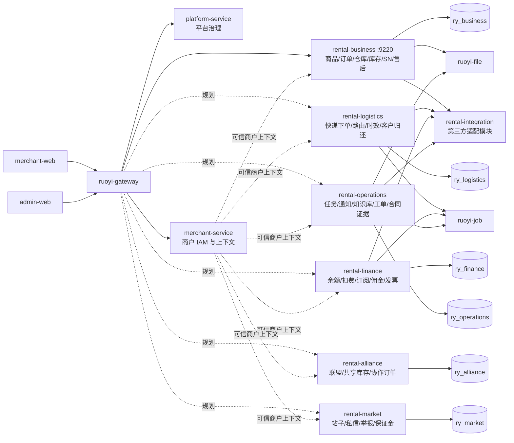

目标服务必须继续遵守以下不变量：

1. 平台、商户和后续业务服务不共用 Controller，也不根据请求参数临时切换用户体系。
2. 商户业务 Mapper 从登录态读取 `tenant_id + member_id`，涉及仓库时再校验 `warehouse_id`。
3. 前端隐藏菜单不是权限控制，Controller 权限注解、服务边界过滤和 SQL 隔离必须同时存在。
4. 跨服务只共享 API 契约和通用基础能力，不共享可变业务实体或直接跨库写对方所有表。
5. 订单、库存、SN、财务和联盟关键动作必须具备事务、幂等和不可变审计流水。
6. Seata Server 或消息队列只有在出现真实跨服务事务/异步吞吐需求时再纳入运行架构，不能只因依赖已存在就视为启用。
7. `ry_rental` 与 `ry_business` 不允许双写、兼容读取、失败回退、跨库 JOIN 或跨库物理外键。

## 15. 1.0 新增规划数据关系

以下关系是最新 1.0 文档要求、当前 49 张租赁表尚未完整覆盖的目标模型。实体名为建议命名，正式迁移前必须完成字段、索引、留存和服务所有权评审。

```mermaid
erDiagram
    RENTAL_MEMBER ||--o{ MEMBER_CERTIFICATION : submits
    MEMBER_CERTIFICATION ||--o{ CERTIFICATION_MATERIAL : contains
    RENTAL_MEMBER ||--o{ MEMBER_CREDIT_RECORD : changes
    RENTAL_MEMBER ||--o{ MEMBER_BLACKLIST_RECORD : governed_by

    AGREEMENT ||--o{ AGREEMENT_VERSION : versions
    AGREEMENT_VERSION ||--o{ AGREEMENT_ACCEPTANCE : accepted_as
    RENTAL_MERCHANT_USER ||--o{ AGREEMENT_ACCEPTANCE : accepts
    VISITOR_SESSION ||--o{ AGREEMENT_ACCEPTANCE : accepts

    RENTAL_MEMBER ||--o{ WORK_TASK : owns
    WORK_TASK ||--o{ WORK_ASSIGNMENT : assigns
    RENTAL_MERCHANT_USER ||--o{ WORK_ASSIGNMENT : receives
    RENTAL_WAREHOUSE ||--o{ WORK_ASSIGNMENT : scopes
    WORK_ASSIGNMENT ||--o| WORK_SUBMISSION : submits
    WORK_SUBMISSION ||--o| WORK_REVIEW : reviewed_as

    RENTAL_MEMBER ||--o{ INTERNAL_NOTICE : publishes
    INTERNAL_NOTICE ||--o{ NOTICE_AUDIENCE : targets
    INTERNAL_NOTICE ||--o{ NOTICE_READ_RECORD : read_by
    RENTAL_MEMBER ||--o{ KNOWLEDGE_CATEGORY : owns
    KNOWLEDGE_CATEGORY ||--o{ KNOWLEDGE_ARTICLE : contains
    KNOWLEDGE_ARTICLE ||--o{ KNOWLEDGE_VERSION : versions
    KNOWLEDGE_ARTICLE ||--o{ KNOWLEDGE_READ_RECORD : read_by

    RENTAL_MEMBER ||--o{ RECYCLE_RECORD : owns
    RENTAL_MERCHANT_USER ||--o{ RECYCLE_RECORD : deletes

    SERVICE_TICKET ||--o{ TICKET_EVENT : timeline
    SERVICE_TICKET ||--o{ TICKET_ATTACHMENT : evidence
    RENTAL_ORDER ||--o{ SERVICE_TICKET : raises
    RENTAL_ORDER ||--o| ORDER_CONTRACT : binds
    ORDER_CONTRACT ||--o{ CONTRACT_EVIDENCE : proves

    RENTAL_MEMBER ||--o{ COMPENSATION_TEMPLATE : defines
    RENTAL_ALLIANCE_ORDER ||--o{ DISPUTE_CASE : disputes
    DISPUTE_CASE ||--o{ DISPUTE_EVIDENCE : contains
    DISPUTE_CASE ||--o{ DISPUTE_CONFIRMATION : confirms

    RENTAL_MEMBER ||--o{ FINANCE_ACCOUNT : owns
    FINANCE_ACCOUNT ||--o{ ACCOUNT_LEDGER : records
    DISPUTE_CASE ||--o{ FUND_FREEZE : freezes
    FINANCE_ACCOUNT ||--o{ FUND_FREEZE : holds
    RENTAL_ORDER ||--o{ PAYMENT_SPLIT : splits
    FINANCE_ACCOUNT ||--o{ WITHDRAWAL_APPLICATION : withdraws
    RENTAL_ORDER ||--o| INVOICE_APPLICATION : invoices
    INVOICE_APPLICATION ||--o| INVOICE_RECORD : issues
    INVOICE_RECORD ||--o{ INVOICE_RED_FLUSH : reverses

    INTEGRATION_PROVIDER ||--o{ INTEGRATION_CALL_LOG : calls
    INTEGRATION_PROVIDER ||--o{ ROUTE_TIMING_SAMPLE : samples
    RENTAL_MEMBER ||--o{ STORAGE_QUOTA_LEDGER : consumes
    INTEGRATION_CALL_LOG ||--o{ ALERT_EVENT : may_trigger
    BACKUP_RECORD ||--o{ ALERT_EVENT : may_report
```

### 15.1 新增表组所有权

| 表组 | 目标所有者 | 关键不变量 |
| --- | --- | --- |
| 协议、认证、信用、黑名单 | `platform-service` 或 `rental-operations` 的平台治理模块 | 版本和审核记录不可覆盖，认证材料永久留档 |
| 工作任务、内部通知、知识库、回收站 | `rental-operations` | 强制商户隔离，知识版本保留 3 年，删除记录 30 天可恢复 |
| 工单、合同、证据 | `rental-operations` | 工单时间线和签约证据只追加，争议证据永久保留 |
| 账户、冻结、分账、提现、发票 | `rental-finance` | 资金类型分户，不可变流水，双方确认后才可纠纷扣款 |
| 第三方调用与时效样本 | `rental-integration`/`rental-logistics` | 顺丰、京东分别全站 10 次/秒，调用和降级可追溯 |
| 配额、告警、备份 | `rental-operations` 与基础设施服务 | 容量变化有流水，备份保留 7 天，告警有处理状态 |

## 16. 外部集成与异步任务关系

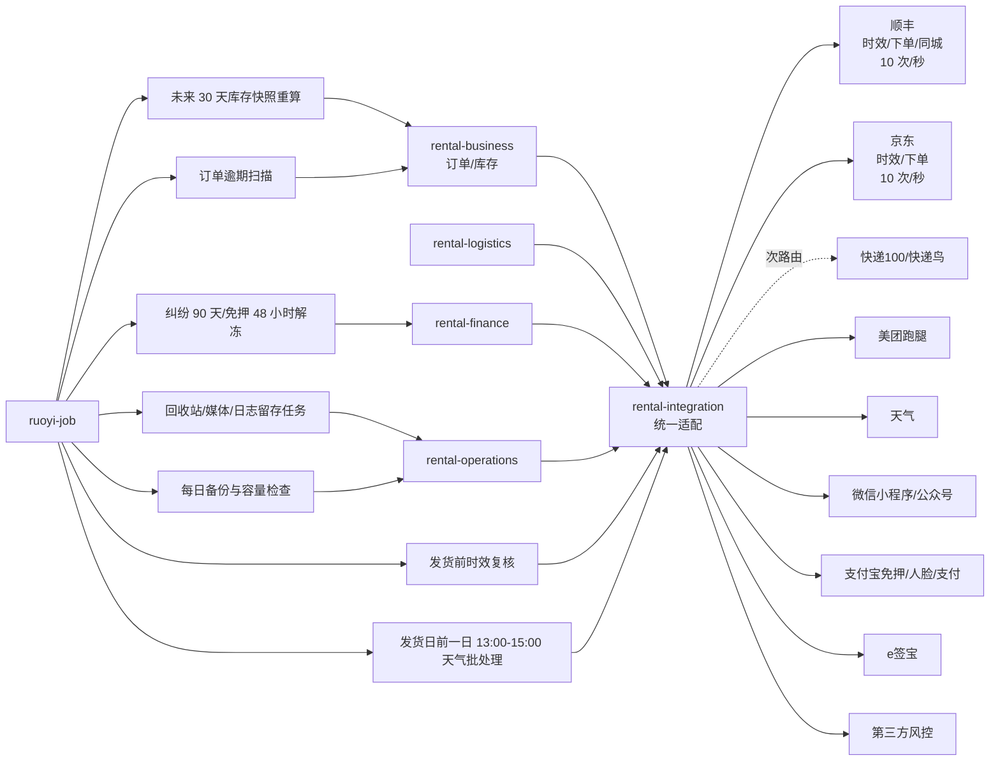

### 16.1 当前订单地址与天气实现

订单地址和天气的当前实现位于 `rental-business`，不是由平台服务直接访问业务库：

| 能力 | 实现位置 | 数据或接口边界 |
| --- | --- | --- |
| 行政区划字典 | `ry_business.ry_rental_region` | `region_code` 为 adcode，`city_code` 为高德 citycode |
| 地址解析 | `RegionAddressParser` | 按省、市、区县父子关系匹配，返回 `RegionAddressModel` |
| 收件人历史 | `ry_business.ry_rental_order_recipient_history` | 通过 `tenant_id + member_id + order_no` 追加快照 |
| 全局配置 | `platform-service` 的系统配置与 Redis | `global.amap.api-keys`、天气地址和 7 天配置缓存；高德请求每 5000 次轮换 Key |
| 配置消费 | `GlobalConfigService` | 商户服务通过 `/internal/platform/global-config/value` 读取 |
| 天气调用 | `AmapWeatherClient` | 按高德行政区划 `adcode` 查询，Redis 按 adcode 缓存 1 小时 |

订单列表优先使用最新收件人历史快照的 `district_code`（缺失时回退到市级/省级 `adcode`），旧订单没有快照时才解析当前地址；
天气失败只返回不可用状态，不阻断订单查询。完整表关系、事务流程和迁移说明见[订单收件人行政区划与全局天气设计](./order-recipient-regions-and-weather.md)。
