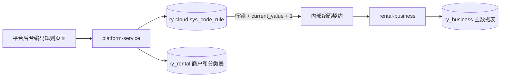

# 统一业务编码规则设计

## 1. 目标

项目中的业务编码统一由平台服务配置和分配。业务服务不再接受客户端自定义编码，也不再使用时间字符串、随机数、数据库主键或各模块自己的计数器拼接编码。

编码规则存放在平台库 `ry-cloud.sys_code_rule`，通过平台端“统一编码规则”菜单维护前缀、最终编码总长度和启用状态。编码分配由平台服务完成，租赁业务服务只通过内部服务契约取号。

## 2. 长度和格式

`code_length` 表示最终编码的总长度，包含前缀，不是数字序号的长度。

例如：

| 前缀 | 总长度 | 数字序号宽度 | 第一个编码 |
| --- | ---: | ---: | --- |
| `WH` | 12 | 10 | `WH0000000001` |
| `P` | 12 | 11 | `P00000000001` |

前缀由大写字母、数字、下划线和短横线组成；系统保存时自动转换为大写。总长度范围为 2 到 64，数字序号宽度为 1 到 18 位。当前序号不能由前端重置，规则停用后禁止继续取号。

## 3. 当前编码类型

| 类型键 | 业务对象 | 默认前缀 | 默认总长度 | 生成位置 |
| --- | --- | --- | ---: | --- |
| `merchant` | 平台商户 | `M` | 12 | `platform-service` |
| `product_class` | 平台产品分类 | `CLS` | 12 | `platform-service` |
| `warehouse` | 商户仓库 | `WH` | 12 | `rental-business` 通过内部契约取号 |
| `product` | 商户商品 SKU | `P` | 12 | `rental-business` 通过内部契约取号 |
| `accessory_item` | 逐件配件内部编码 | `ACC` | 12 | `rental-business` 通过内部契约取号 |
| `package` | 商户套餐模板 | `PKG` | 12 | `rental-business` 通过内部契约取号 |
| `order` | 租赁订单编号 | `ORD` | 20 | 订单创建服务取号 |
| `inventory_unit` | 内部逐件库存单元 | `UNIT` | 16 | 库存服务取号 |
| `inventory_batch` | 库存入库批次号 | `IB` | 16 | 库存服务取号 |
| `transfer` | 调货单号 | `TR` | 16 | 调货服务接入统一取号器 |
| `stocktaking` | 盘点单号 | `ST` | 16 | 盘点服务接入统一取号器 |
| `after_sales_case` | 售后单号 | `AS` | 16 | 售后服务接入统一取号器 |
| `finance_ledger` | 资金流水号 | `LED` | 20 | 资金流水服务接入统一取号器 |

## 4. 外部标识例外

SN 是设备厂商烧录的实物序列号，必须由商户录入、扫描或导入，不能由平台替换。因此 `sn_code` 不进入统一自增规则；系统只做商户内有效唯一、商品库存模式、归属范围和生命周期校验。

条码、物流单号、外部订单编号和第三方支付单号同样属于外部系统标识，不由本规则生成。订单内部 `order_no` 仍必须使用 `order` 类型的统一取号器；订单渠道编码使用已登记的 `order_channel` 规则。

平台框架中的用户、角色、菜单、字典、岗位和权限编码是系统语义标识，不是租赁业务实例编码，继续由对应功能维护；数据库主键、链路 ID、验证码 UUID 和文件 ID 也不使用本规则。这样既保证业务编码统一，又不会把固定语义值错误地改成不可读的流水号。

主键、外键和关联字段遵循《主键与关联字段术语规范》：技术字段继续使用现有 `id`、`*_id`、`Id`，不改成 `unique_no` 或 `uniqueNo`；注释和页面文案使用“唯一编号”。订单编号、商户编码、仓库编码等业务编码仍按本文件的业务术语展示。

## 5. 数据关系



规则表中的一行同时保存配置和当前序号，避免规则表与序列表更新不一致。`code_type` 全局唯一，因此同一编码类型在全部商户间使用统一序列；业务表仍保留商户、租户范围和有效编码唯一约束作为最后一道数据校验。

## 6. 并发和事务

1. `platform-service` 按 `code_type` 执行 `SELECT ... FOR UPDATE`。
2. 读取 `current_value`，计算下一个序号并校验是否超出数字宽度。
3. 更新 `current_value` 后格式化最终编码。
4. `rental-business` 取得编码后写入仓库、商品、配件、套餐、库存批次或库存单元记录。
5. 远程取号失败、规则停用或长度溢出时，业务写入直接失败；平台本地分类和商户写入与取号共用平台事务。
6. 跨服务取号无法与业务库共享事务，业务校验或写入失败后允许留下序号空洞，序号不复用，保证历史追踪和并发安全。

序号分配是平台服务的集中边界，业务服务的 Feign 降级只返回失败，不允许本地生成替代编码。

## 7. 接口

平台端：

- `GET /admin/code/rule/list`：查询规则。
- `GET /admin/code/rule/{codeType}`：查询单条规则。
- `PUT /admin/code/rule/{codeType}`：修改前缀、总长度和状态；不能修改当前序号。

内部服务：

- `GET /internal/platform/code-rules/{codeType}/next`：平台服务为可信业务服务分配下一个编码。

业务写接口的编码字段不具有客户端写入语义：新增由服务端取号，修改由服务端读取并保持原编码不变，客户端提交值一律忽略。前端新增表单不再要求用户填写仓库、商品、配件和套餐编码。

## 8. 迁移与检查

迁移脚本已合并至 `database/migrations/V20261019_002__consolidated_project_baseline.sql`，对应段落标记为 `V20260805_001__unified_code_rule.sql`。

部署脚本已注册该迁移。上线后应检查：

```sql
SELECT code_type, prefix_text, code_length, current_value, status
FROM `ry-cloud`.`sys_code_rule`
WHERE is_delete = 0
ORDER BY rule_id;
```

修改规则时只允许改变后续生成格式，不允许重置当前序号。生产环境应先验证新前缀和长度不会与历史人工编码冲突，再启用新规则。

## 9. 实施状态

- [x] 平台规则表和幂等迁移。
- [x] 平台端规则查询和修改页面。
- [x] 平台商户和产品分类改为系统取号。
- [x] 租赁仓库、商品、逐件配件和套餐改为系统取号；商户自定义配件使用 `accessory` 配件编码规则。
- [x] 商户库存入库批次使用 `inventory_batch` 规则，前缀默认为 `IB`；库存单元使用 `inventory_unit` 规则，实物序列号单独保存。
- [x] 调货、盘点、售后和资金流水编码规则已登记，待对应业务入口接入时直接取号。
- [x] 已停用并软删除 `stock_pool` 资源池编码规则，历史资源池表和业务入口由既有迁移清理。
- [x] 远程取号失败禁止本地兼容生成。
- [x] SN 和第三方外部标识例外规则写入文档。
- [x] 订单、库存预占、订单渠道、库存批次和库存单元均有独立规则；新建业务不得回退到时间、随机数或客户端拼接编码。
