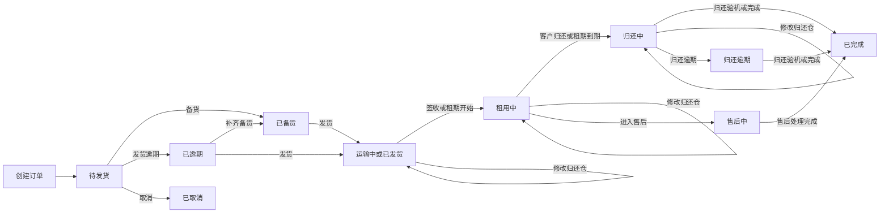
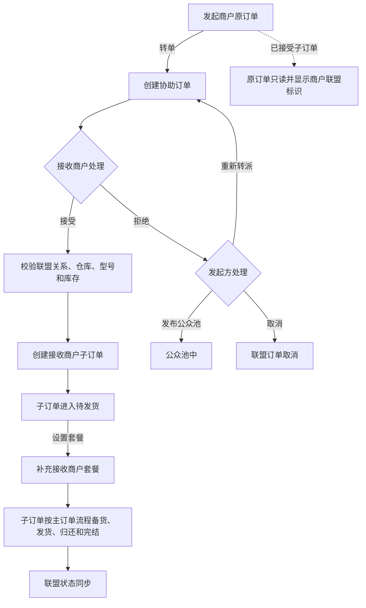

# 商户订单流程与操作状态说明

版本：V1.0

更新日期：2026-09-04

本文根据当前 `rental-business` 订单状态枚举、商户订单工作台页面和现有订单接口整理，作为订单列表底部操作、状态流转和后续接口拆分的统一依据。页面上的按钮禁用只负责交互提示，数据权限、订单归属和状态条件仍必须由后端再次校验。

## 1. 订单状态

订单状态存储为 `ry_business.ry_rental_order.order_status` 的数值编码，页面按业务阶段展示：

| 编码 | 页面名称 | 所属阶段 | 当前含义 |
| ---: | --- | --- | --- |
| 10 | 待发货 | 发货前 | 订单已创建，尚未完成备货 |
| 15 | 已备货 | 发货前 | 商品和配件已完成备货，可执行发货 |
| 20 | 运输中 | 配送履约 | 订单已进入配送过程 |
| 25 | 运输中 | 配送履约 | 历史发货在途状态，页面统一归入运输中 |
| 30 | 已发货 | 配送履约 | 发货动作已完成 |
| 40 | 租用中 | 租赁履约 | 客户正在使用设备或套餐 |
| 45 | 归还中 | 归还履约 | 客户已进入归还流程，等待验机 |
| 50 | 已完成 | 终态 | 归还验机或完结处理已完成 |
| 60 | 归还逾期 | 归还异常 | 已超过应归还时间，仍等待归还或验机 |
| 65 | 已逾期 | 发货前异常 | 当前实现的通用逾期状态，仍允许补齐备货和发货流程 |
| 70 | 售后中 | 售后履约 | 存在损坏、缺失或赔付等售后处理 |
| 80 | 已取消 | 终态 | 订单已取消，不再进入履约流程 |

其中 20、25、30 是同一配送阶段的历史状态差异；60 是归还逾期，65 是当前系统的通用逾期状态，不能因为页面文案相近而混用。

## 2. 主订单流程



### 2.1 流程约束

1. 新订单默认进入待发货；商品、套餐、仓库、客户和租期由新增订单流程校验。
2. 备货只能把待发货订单推进为已备货，不能通过备货动作修改其他订单字段。
3. 发货前应完成备货；发货动作负责快递公司、快递单号和后续物流记录。
4. 运输中、租用中和归还中允许的操作不同，不能用一个通用编辑按钮代替状态动作。
5. 已完成和已取消是终态，不能重新进入备货、发货、归还或续租流程。
6. 页面禁用按钮不能替代后端校验；直接调用接口时仍必须验证商户、仓库、订单当前状态和乐观并发条件。

## 3. 租商联盟订单流程



### 3.1 联盟订单编辑边界

- 发起商户原订单存在已接受子订单后，不允许继续编辑、转单、备货或发货；可以查看、复制、添加批注和查看编辑记录。
- 接收商户子订单的编辑表单只允许设置产品套餐，客户、仓库、租期、金额、订单渠道等复制字段不可改。
- 子订单的履约操作仍按主订单状态机禁用，不能因为是联盟子订单而跳过备货或直接发货。
- 商户端展示商户名称和订单编码，不展示联盟订单技术主键或其他 `id` 类字段。

## 4. 订单列表底部按钮规则

### 4.1 普通订单和联盟子订单

| 按钮 | 可用状态 | 禁用状态或说明 |
| --- | --- | --- |
| 编辑 | 待发货、已逾期 | 已备货及之后、已完成、已取消 |
| 设置套餐 | 联盟子订单的待发货、已逾期 | 普通订单不显示；子订单进入履约后禁用 |
| 复制 | 全部状态 | 复制只生成新订单，不修改原订单 |
| 转单 | 普通订单的待发货、已逾期 | 已备货及之后、联盟子订单、已接受联盟子订单原订单 |
| 批注 | 全部状态 | 只新增批注，不更新订单主表业务字段 |
| 备货 | 待发货、已逾期 | 已备货及之后、已完成、已取消 |
| 上传视频 | 已备货 | 当前视频文件入库接口尚未接通，点击后提示配置服务 |
| 发货 | 已备货 | 未备货、运输中及之后、已完成、已取消 |
| 转寄 | 运输中、已发货 | 其他状态 |
| 跨仓归还 | 运输中、已发货、租用中、归还中、归还逾期 | 发货前、售后中、终态 |
| 归还验机 | 归还中、归还逾期 | 其他状态 |
| 续租 | 租用中、归还中、归还逾期 | 发货前、配送完成前、售后中、终态 |
| 完成 | 归还中、归还逾期、售后中 | 其他状态 |
| 编辑记录 | 全部状态 | 只读历史记录 |

按钮保留在操作区但在不适用状态下置灰，用户可以通过鼠标悬停看到禁用原因。这样不同状态下的操作位置稳定，也避免把状态不允许的动作误认为菜单缺失。

### 4.2 原订单锁定规则

当订单已有已接受的联盟子订单时，原订单设置 `isAllianceSourceLocked`。此时底部只有以下动作可操作；其他履约按钮可以保留在操作区以保持位置稳定，但必须全部置灰并提示原因：

1. 复制。
2. 批注。
3. 编辑记录。

备货、发货、转寄、跨仓归还、归还验机、续租和完成全部禁用。原订单的履约由接收商户子订单负责，不能两边同时占用或推进同一份履约事实。

## 5. 备货动作字段边界

备货不是整单编辑，接口为：

```text
POST /merchant/orders/{orderId}/prepare
```

服务端处理顺序：

1. 从登录上下文取得租户、商户和用户唯一编号，不信任请求体中的归属字段。
2. 查询当前订单并校验商户归属、订单可见仓库和商户认证状态。
3. 当前状态为已备货时直接幂等返回。
4. 当前状态不是待发货时返回“当前订单状态不允许备货”。
5. 使用当前状态条件执行原子更新，只有一条记录成功时才算备货成功。
6. 更新字段仅包括 `order_status`、`version`、`update_by` 和 `update_time`。
7. 不更新客户、渠道、仓库、租期、金额、套餐、备注、物流和订单明细。
8. 前端成功后重新加载列表和顶部汇总，确保按钮和状态即时变化。

对应 SQL 的核心条件为：

```sql
where order_id = #{orderId}
  and tenant_id = #{tenantId}
  and member_id = #{merchantId}
  and order_status = #{fromStatus}
  and is_delete = 0
```

这样可以避免列表中的展示缺省值通过整单 `PUT` 请求覆盖真实订单字段，也能处理重复点击或并发操作。

## 6. 接口与维护约定

- 订单查询继续使用 `GET /merchant/orders`，分页总数由数据库查询总数返回，不能用当前页行数代替。
- 订单详情继续使用 `GET /merchant/orders/{orderId}`，详情回填只用于编辑表单，不应作为备货请求体。
- 普通订单编辑使用 `PUT /merchant/orders`；新增状态动作应优先设计为只提交动作所需字段的专用接口。
- 新增状态动作必须在枚举中定义状态含义，并同时补充服务层状态校验、Mapper 条件更新、前端禁用规则和测试。
- 状态动作成功后刷新列表与汇总；失败时保留当前弹窗并展示后端业务提示，不静默吞掉异常。
