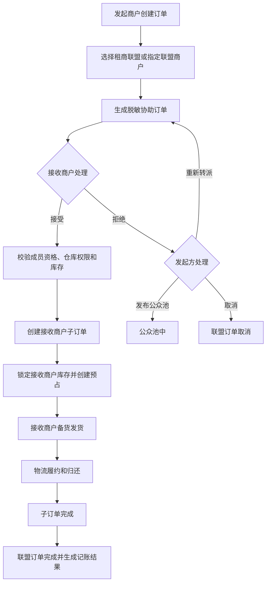
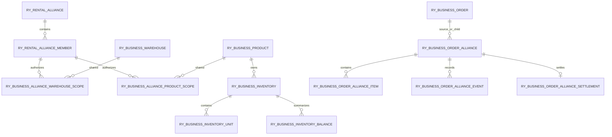

# 多仓联盟完整设计方案

## 1. 文档说明

本文档基于以下公开设计文档和当前代码架构整理：

- `docs/design/rental-platform-functional-specification.md`
- `docs/design/requirements-baseline-and-gaps.md`
- `docs/design/product-package-inventory-data-model.md`
- `docs/design/inventory-availability-rules.md`
- `docs/design/rental-database-boundaries.md`

本文档描述多仓联盟的目标设计，并保留按日期记录的实现说明；这些记录不是实时状态，当前整体进度以[开发进度快照](../development-progress.md)为准。未标记为已完成的内容不代表已经上线。

## 2. 需求核对结论

文档中的“多仓联盟”包含两类业务：

1. **联盟库存共享**：联盟成员可查看其他成员授权的仓库和库存，不影响查看自己的库存。
2. **联盟协助订单**：发起商户将订单交给联盟成员履约，接收商户接受后创建自己的子订单并负责发货。

相关规则如下：

- 共享库存只显示可履约库存，不共享库存所有权。
- 只共享商品、型号和序列号库存视图，不建立独立的套餐库存事实。
- 联盟成员退出后立即失去联盟库存和协助订单权限。
- 发起方看到完整订单；接收方在接受前只看到脱敏信息。
- 客户姓名隐藏 1 位，手机号隐藏 6 位，地址隐藏详细内容。
- 接收方可以接受、拒绝或转派订单；拒绝后发起方可以发布公众池。
- 成员可以设置可承接订单上限，该上限对联盟成员展示。
- 结算价只记账，第一阶段不做联盟在线支付。
- 支持系统快递下单、发起方自行下单、使用接收方月结账号和线下协商。
- 同一商户内部的多仓调拨和跨商户联盟共享必须分开处理。

现有文档中仍有资源池描述，但资源池业务已经弃用。本文档统一使用：

```text
仓库 + 商户商品 + 序列号库存单元 + 数量库存余额 + 库存预占
```

不得恢复资源池查询、资源池库存表或资源池套餐计算路径。

## 3. 总体业务模型

### 3.1 多仓、共享库存和协助订单的边界

| 场景 | 数据范围 | 是否跨商户 | 主要目的 |
| --- | --- | --- | --- |
| 商户自己的多仓 | 当前商户的多个仓库 | 否 | 本商户调拨和履约 |
| 联盟共享库存 | 联盟成员授权的仓库和商品 | 是 | 查看可协助履约能力 |
| 联盟协助订单 | 发起商户订单和接收商户子订单 | 是 | 由其他商户实际发货 |
| 仓库调货 | 同一商户的源仓和目标仓 | 否 | 将实物调到目标仓 |

### 3.2 核心原则

- 原订单归发起商户所有，不删除、不转移。
- 接受联盟订单后，在接收商户下创建子订单。
- 子订单用于接收商户备货、发货、归还和售后履约。
- 接受前不扣减接收商户库存，接受时才创建库存预占。
- 原订单和子订单不能重复预占同一库存单元。
- 套餐库存由套餐 BOM 和商品库存计算，不能把套餐数量当成独立库存事实。
- 公共配件按真实库存单元或数量余额计算，不能因为被多个套餐引用而重复统计。
- 所有状态变更必须有操作人、时间、前后状态和业务事件记录。

## 4. 业务流程



### 4.1 联盟订单状态

```text
待承接
  ├── 已接受
  │    ├── 已发货
  │    ├── 履约中
  │    ├── 已完成
  │    └── 已取消
  ├── 已转派
  ├── 已拒绝
  └── 公众池中
```

状态不能通过普通编辑接口任意跳转，只能由接受、拒绝、转派、发布公众池、发货、完成和取消等业务动作触发。

## 5. 平台端设计

### 5.1 菜单建议

平台端在“订单中心”下增加联盟治理能力：

```text
订单中心
├── 全部订单
├── 联盟订单
├── 协助订单
├── 公众池订单
└── 联盟纠纷
```

如第一阶段只做查询，可以先上线“联盟订单”，其余菜单在对应业务完成后开放。

### 5.2 平台端功能

#### 联盟管理

- 查看联盟列表、状态和成员数量。
- 查看成员加入、退出、停用记录。
- 查看成员接单上限和当前承接数量。
- 查看成员共享库存开关。
- 查看成员共享仓库和商品范围。
- 启用、停用联盟或成员。
- 处理异常成员和权限撤销。

#### 联盟订单中心

- 查看所有商户的联盟协助订单。
- 按联盟、发起商户、接收商户、订单状态和时间筛选。
- 查看原订单、子订单和转派链路。
- 查看订单事件、物流信息和结算记录。
- 默认遵循客户信息脱敏规则。
- 只有具备客户信息权限的角色才能查看必要的完整信息。
- 平台普通角色不能直接修改商户原始订单和库存。

#### 纠纷和赔付

后续支持：

- 履约保证金。
- 赔付规则模板。
- 纠纷发起和材料提交。
- 平台调解和双方确认。
- 冻结、扣款和解冻。
- 赔付结果与联盟结算关联。

### 5.3 平台端接口

```text
GET    /admin/alliances
GET    /admin/alliances/{allianceId}
GET    /admin/alliance-members
PUT    /admin/alliance-members/{id}/status

GET    /admin/alliance-orders
GET    /admin/alliance-orders/{allianceOrderId}
GET    /admin/alliance-orders/{allianceOrderId}/events
GET    /admin/alliance-orders/{allianceOrderId}/relation
```

平台端接口由 `platform-service` 提供。平台服务不直接访问 `ry_business`，订单和库存信息通过内部服务接口获取。

## 6. 商户端设计

### 6.1 菜单

```text
交易
├── 订单管理
├── 租商联盟
└── 库存管理
```

### 6.2 联盟概览

展示：

- 当前联盟名称和状态。
- 联盟成员数量。
- 当前商户接单上限。
- 当前已承接数量。
- 库存共享开关。
- 可见成员仓库数量。
- 待处理协助订单数量。

### 6.3 联盟成员和共享库存

联盟成员列表展示：

- 商户名称。
- 可共享仓库。
- 可共享商品或型号。
- 当前可用库存。
- 接单上限和当前承接数量。
- 是否允许协助订单。

共享库存筛选条件：

- 商户。
- 仓库。
- 一级分类、二级分类。
- 品牌。
- 型号。
- 商品类型。

共享库存展示商品、型号和可用数量，不展示其他商户的序列号明细。接受订单后，接收商户只能看到完成履约所必需的库存信息。

### 6.4 订单“转单”操作

订单底部增加“转单”操作，弹窗包含：

- 转单方式：租商联盟、指定联盟商户。
- 接收商户。
- 结算价。
- 发货方式。
- 发货仓库或取货仓库。
- 快递费用承担方。
- 备注。

选择“租商联盟”时，系统根据联盟关系、共享范围、库存和接单上限生成候选接收方。

### 6.5 接收商户操作

```text
查看、接受、拒绝、转派、发布公众池、取消
```

接受操作必须重新校验：

1. 联盟关系仍然有效。
2. 接收商户仍有承接资格。
3. 未超过接单上限。
4. 目标仓库仍然有效且有权限。
5. 商品、套餐和配件满足履约条件。
6. 库存没有被其他订单预占。
7. 当前任务仍为待承接。
8. 幂等键未被重复使用。

## 7. 数据库边界和表设计

### 7.1 数据库边界

| 数据 | 数据库 | 访问服务 |
| --- | --- | --- |
| 联盟主体、成员关系、资格和平台治理 | `ry_rental` | `merchant-service` |
| 仓库、商品、型号执行关系、库存、订单、物流 | `ry_business` | `rental-business` |
| 平台用户、菜单和权限 | `ry-cloud` | `platform-service` |

不创建跨数据库物理外键，使用服务接口和应用层逻辑关联。

### 7.2 现有表的统一处理

当前已有：

```text
ry_rental.ry_rental_alliance
ry_rental.ry_rental_alliance_member
ry_business.ry_rental_order_alliance
```

代码和历史结构中还出现过 `ry_rental_alliance_order`。最终只保留 `ry_business.ry_rental_order_alliance` 作为联盟协助订单主表，不能让两套订单表同时写入。实施时需要先盘点已有环境，再通过版本化迁移合并或废弃重复结构。

### 7.3 `ry_rental.ry_rental_alliance`

联盟主体表，建议保留并完善以下字段：

| 字段 | 说明 |
| --- | --- |
| `alliance_id` | 联盟唯一编号 |
| `tenant_id` | 租户唯一编号 |
| `alliance_name` | 联盟名称 |
| `owner_member_id` | 创建商户唯一编号 |
| `alliance_status` | 正常、停用 |
| `max_member_count` | 最大成员数 |
| `join_mode` | 邀请加入、审核加入 |
| `create_by/create_time` | 创建审计 |
| `update_by/update_time` | 更新审计 |
| `is_delete` | 软删除标识 |

唯一性建议：`tenant_id + alliance_name + is_delete`。

### 7.4 `ry_rental.ry_rental_alliance_member`

联盟成员关系表：

| 字段 | 说明 |
| --- | --- |
| `id` | 关系唯一编号 |
| `tenant_id` | 租户唯一编号 |
| `alliance_id` | 联盟唯一编号 |
| `member_id` | 商户唯一编号 |
| `member_status` | 申请中、正常、停用、退出 |
| `share_stock_enabled` | 是否共享库存 |
| `accept_order_limit` | 可承接订单上限 |
| `current_accept_order_count` | 当前承接数量 |
| `join_time/exit_time` | 加入和退出时间 |
| `is_delete` | 软删除标识 |

唯一索引：`alliance_id + member_id + is_delete`。

### 7.5 `ry_business.ry_rental_alliance_warehouse_scope`

联盟仓库共享范围表，明确哪个商户的哪个仓库对联盟可见：

| 字段 | 说明 |
| --- | --- |
| `scope_id` | 共享范围唯一编号 |
| `alliance_id` | 联盟唯一编号 |
| `owner_member_id` | 库存所属商户唯一编号 |
| `warehouse_id` | 共享仓库唯一编号 |
| `share_status` | 正常、停用 |
| `visible_stock_mode` | 精确数量、区间数量 |
| `accept_order_enabled` | 是否支持协助履约 |
| `effective_time/expire_time` | 生效区间 |
| `is_delete` | 软删除标识 |

唯一索引：`alliance_id + owner_member_id + warehouse_id + is_delete`。

### 7.6 `ry_business.ry_rental_alliance_product_scope`

联盟商品共享范围表：

| 字段 | 说明 |
| --- | --- |
| `scope_id` | 共享范围唯一编号 |
| `alliance_id` | 联盟唯一编号 |
| `owner_member_id` | 商品所属商户唯一编号 |
| `product_id` | 商户商品唯一编号 |
| `model_id` | 平台产品型号唯一编号 |
| `share_quantity_ratio` | 共享库存比例 |
| `share_quantity_limit` | 共享数量上限 |
| `accept_order_enabled` | 是否允许协助订单 |
| `share_status` | 正常、停用 |
| `is_delete` | 软删除标识 |

该表放在 `ry_business`，因为 `product_id`、`model_id` 和库存事实都属于执行库。`ry_rental` 只保存联盟成员治理关系。

### 7.7 `ry_business.ry_rental_order_alliance`

联盟协助订单主表，建议统一为以下模型：

| 字段 | 说明 |
| --- | --- |
| `alliance_order_id` | 联盟协助订单唯一编号 |
| `tenant_id` | 租户唯一编号 |
| `alliance_id` | 联盟唯一编号 |
| `source_order_id` | 原订单唯一编号 |
| `child_order_id` | 子订单唯一编号 |
| `source_member_id` | 发起商户唯一编号 |
| `target_member_id` | 当前接收商户唯一编号 |
| `target_warehouse_id` | 接收商户履约仓库唯一编号 |
| `transfer_mode` | 联盟、指定商户、公众池 |
| `alliance_order_status` | 联盟订单状态 |
| `settlement_price` | 商户结算价 |
| `shipping_mode` | 快递、自提、配送、线下 |
| `shipping_payer` | 发起方、接收方、协商 |
| `masked_snapshot_json` | 脱敏订单快照 |
| `full_snapshot_json` | 接受后的履约快照 |
| `transfer_chain_no` | 转派链路编号 |
| `idempotency_key` | 幂等请求标识 |
| `version` | 乐观锁版本 |
| `create_by/create_time` | 创建审计 |
| `update_by/update_time` | 更新审计 |
| `is_delete` | 软删除标识 |

建议索引：

```text
(tenant_id, source_member_id, alliance_order_status, create_time)
(tenant_id, target_member_id, alliance_order_status, create_time)
(tenant_id, source_order_id, is_delete)
(tenant_id, child_order_id, is_delete)
```

### 7.8 `ry_business.ry_rental_order_alliance_item`

联盟订单明细快照表：

| 字段 | 说明 |
| --- | --- |
| `alliance_item_id` | 明细唯一编号 |
| `alliance_order_id` | 联盟订单唯一编号 |
| `source_order_item_id` | 原订单明细唯一编号 |
| `product_id` | 商品唯一编号 |
| `model_id` | 型号唯一编号 |
| `package_id` | 套餐唯一编号 |
| `quantity` | 数量 |
| `bom_snapshot_json` | 套餐 BOM 快照 |
| `accessory_snapshot_json` | 配件快照 |
| `is_delete` | 软删除标识 |

快照必须保存商品、套餐和配件名称，不能依赖跨库查询才能还原历史订单。

### 7.9 `ry_business.ry_rental_order_alliance_event`

联盟订单不可变事件表，记录：

- 创建转单。
- 接受、拒绝、转派。
- 发布或撤回公众池。
- 创建子订单。
- 修改履约仓库。
- 发货、归还、完成、取消。
- 异常和纠纷。

核心字段：

```text
event_id
alliance_order_id
event_type
from_status
to_status
operator_member_id
operator_user_id
event_data_json
create_time
```

### 7.10 `ry_business.ry_rental_order_alliance_settlement`

第一阶段只记录联盟结算，不做在线支付：

| 字段 | 说明 |
| --- | --- |
| `settlement_id` | 结算记录唯一编号 |
| `alliance_order_id` | 联盟订单唯一编号 |
| `source_member_id` | 发起商户唯一编号 |
| `receiver_member_id` | 接收商户唯一编号 |
| `settlement_amount` | 结算金额 |
| `express_amount` | 快递费用 |
| `compensation_amount` | 赔付金额 |
| `settlement_status` | 待确认、已确认、争议中、已关闭 |
| `remark` | 备注 |
| `is_delete` | 软删除标识 |

后续接入保证金或财务账户时，通过不可变财务流水关联，不直接覆盖结算记录。

### 7.11 `ry_rental.ry_rental_alliance_deposit_account` 和 `ry_rental_alliance_deposit_ledger`

保证金账户保存联盟成员当前可用金额和冻结金额，流水表只追加不覆盖，纠纷冻结、扣除、解冻和退回均通过流水记录。账户更新必须使用 `version` 乐观锁，流水使用幂等键防止重复扣款。

### 7.12 `ry_business.ry_rental_order_alliance_dispute`

纠纷与联盟订单一对多关联，保存发起方、被申请方、纠纷类型、申请金额、冻结金额、最终赔付金额和处理结论。纠纷状态按 `待处理 → 举证中 → 调解中 → 待确认 → 已解决/已驳回/已关闭` 流转，禁止通过普通编辑接口任意跳转。

### 7.13 `ry_business.ry_rental_order_alliance_dispute_evidence` 和 `ry_rental_order_alliance_mediation`

证据记录支持图片、视频、文件和文字，保存提交商户及文件/文本快照；调解记录按轮次追加，保存平台方案、赔付金额和双方确认结果。证据和调解记录不物理删除。

### 7.14 `ry_rental.ry_rental_compensation_rule`

平台赔付规则模板属于平台治理主数据，按纠纷类型配置单笔赔付金额上限、优先级、启停状态和备注。`dispute_type=0` 为通用规则，类型专属规则优先于通用规则；同类型按优先级升序、编号倒序取一条启用规则。规则表由 `platform-service` 访问，调解提交前由平台服务校验方案金额，`rental-business` 继续只负责纠纷和调解执行数据，不跨库访问平台治理表。

## 8. 数据关系图



对应实际表名：

```text
ry_rental.ry_rental_alliance
ry_rental.ry_rental_alliance_member
ry_business.ry_rental_alliance_warehouse_scope
ry_business.ry_rental_alliance_product_scope
ry_business.ry_rental_order
ry_business.ry_rental_order_item
ry_business.ry_rental_order_alliance
ry_business.ry_rental_order_alliance_item
ry_business.ry_rental_order_alliance_event
ry_business.ry_rental_order_alliance_settlement
ry_business.ry_rental_warehouse
ry_business.ry_rental_product
ry_business.ry_rental_merchant_inventory
ry_business.ry_rental_merchant_inventory_unit
ry_business.ry_rental_merchant_inventory_balance
```

## 9. 库存计算规则

### 9.1 序列号商品

```text
可用库存 = 可用状态库存单元
         - 有效预占数量
         - 已锁定但未完成的调拨数量
         - 保护库存数量
```

联盟可见库存还必须受共享比例和共享数量上限限制：

```text
联盟可见库存 = min(可用库存 × 共享比例, 共享数量上限)
```

实际计算应使用整数向下取整，并在服务端再次校验接受订单所需数量。

### 9.2 数量型配件

```text
可用数量 = 账面数量
         - 已预占数量
         - 维修数量
         - 损坏数量
         - 保护数量
```

### 9.3 套餐

套餐不直接共享库存，按照套餐 BOM 计算：

```text
可售套餐数量 = MIN(
    主商品可用数量 / 主商品需求量,
    配件可用数量 / 配件需求量
)
```

通用电池、手柄等配件只计算一次。多个套餐共同使用同一配件时，不能将其库存分别加到每个套餐中。

## 10. 接受订单的事务设计

接受联盟订单必须在 `rental-business` 的一个本地事务中完成：

1. 锁定联盟订单记录。
2. 校验状态仍为待承接。
3. 校验联盟成员关系和承接资格。
4. 校验接单上限。
5. 校验目标仓库权限。
6. 校验商品、套餐 BOM 和配件库存。
7. 按固定顺序锁定库存汇总行或库存单元。
8. 创建接收商户子订单。
9. 复制订单明细和 BOM、配件快照。
10. 创建库存预占和库存流水。
11. 更新联盟订单状态为已接受。
12. 写入联盟事件和结算记录。
13. 提交事务。

重复点击接受必须通过幂等键或状态条件返回第一次结果，不能生成多个子订单或重复预占。

## 11. 服务接口职责

### `merchant-service`

负责联盟主体、成员关系、资格、接单上限、菜单权限和成员名称解析：

```text
/merchant/alliances/**
/internal/merchant/alliance-members/**
```

### `rental-business`

负责共享库存、转单、接受、拒绝、转派、公众池、子订单、库存预占、物流和联盟事件：

```text
/merchant/alliance-inventory/**
/merchant/alliance-orders/**
/merchant/orders/{orderId}/transfer
/internal/alliance/**
```

禁止 `rental-business` 直接查询 `ry_rental`。联盟成员和授权关系通过内部服务接口获得，执行库中的商品、仓库和库存由 `rental-business` 自己查询。

## 12. 安全和并发要求

- 所有查询必须校验租户、当前商户、联盟关系和仓库范围。
- 接收方只能访问当前联盟授权的脱敏协助订单。
- 原订单客户信息不得通过普通联盟列表接口返回。
- 转派必须验证目标商户仍在同一有效联盟中。
- 接受、转派和拒绝使用乐观锁或状态条件更新。
- 库存预占使用数据库行锁或现有库存工作流锁，禁止先查询后异步写入。
- 所有写操作使用幂等键，重复请求不得重复创建订单、物流或库存流水。
- 结算、纠纷、库存和订单事件不得物理删除。
- 快递单号和客户信息继续遵循当前敏感数据和审计规则。

## 13. 实施阶段

### 阶段一：结构统一

- 盘点已执行迁移和实际数据库表。
- 统一 `ry_rental_order_alliance` 与历史重复联盟订单表。
- 清理资源池查询、资源池路由和资源池文档残留。
- 统一联盟状态、转单方式和发货方式枚举。

### 阶段二：联盟成员和共享范围

- 完善联盟成员管理。
- 增加仓库共享范围。
- 增加商品共享范围、共享比例和数量上限。
- 增加接单上限和成员状态校验。

### 阶段三：共享库存

- 实现联盟库存查询。
- 支持商户、仓库、品牌、型号和商品类型筛选。
- 支持 SN 库存和数量库存。
- 支持共享比例、保护库存和权限撤销。

### 阶段四：协助订单

- 完善订单底部“转单”弹窗。
- 实现脱敏快照和订单明细快照。
- 实现接受、拒绝、转派和公众池。
- 实现子订单创建和库存预占。

### 阶段五：物流和履约

- 接入快递公司配置。
- 支持不同发货责任人和费用承担方。
- 关联发货单号、归还单号和物流状态。
- 同步子订单和联盟协助订单状态。

### 阶段六：平台治理和财务

- 平台端联盟订单中心。
- 履约保证金和赔付规则。
- 纠纷、证据、调解和冻结。
- 联盟结算和经营分析。

## 14. 实施前需要确认的业务决策

本方案采用以下默认决策，执行前需要确认：

1. 联盟采用一个联盟包含多个商户的联盟组模式。
2. 共享库存默认展示精确可用数量，不展示序列号。
3. 共享范围按商品/型号和仓库控制，不共享套餐库存。
4. 接受订单后创建接收商户子订单，原订单不删除、不转移。
5. 子订单使用接收商户自己的仓库和库存。
6. 接受前不扣库存，接受时创建库存预占。
7. 第一阶段联盟结算只记账，不在线支付。
8. 公众池保留，并通过功能开关控制开放范围。
9. 服务之间不直接跨库查询。
10. 现有未提交联盟代码保留，实施时按本文档逐项校正，不直接推倒重做。

## 15. 当前实施进度

截至 2026-09-01，已完成以下基础落地：

- 新增联盟共享仓库范围、共享商品范围、联盟订单明细快照、联盟订单事件流水和联盟结算记账表迁移 `V20260901_007__merchant_alliance_scope_and_events.sql`，并登记到统一部署脚本。
- 联盟转单创建、接收、拒绝已写入事件流水；接收成功会保存原订单明细及套餐 BOM 快照，并创建待确认结算记录。
- 联盟共享库存查询已从已弃用资源池路径切换到商户库存事实表，并接入共享仓库/商品范围及共享比例、数量上限计算。
- 新增共享范围查询、保存和删除接口；商户服务只负责解析有效联盟，执行服务负责写入 `ry_business` 范围表。
- 后端 XML 校验、脚本语法检查、租赁业务模块测试和 Maven 全量打包已通过；迁移 `V20260901_007` 已在本地数据库执行，统一部署脚本已完成本地 Docker 发布，平台端和商户端入口均返回 HTTP 200。
- 接受协助订单时必须选择接收商户自己的履约仓库；子订单的主商品型号和套餐会映射到接收商户数据，库存预占与联盟状态更新在同一事务中完成。

本阶段已补充平台端“订单中心 > 联盟订单”只读治理入口：平台服务通过 rental-business 内部接口分页读取联盟订单，支持状态筛选、商户名称补全和原订单/子订单链路展示，不直接访问 `ry_business`。迁移 `V20260901_008__platform_alliance_order_menu.sql` 已登记并在本地部署执行，平台端和商户端重新构建发布后入口均返回 HTTP 200。
- 联盟订单列表已增加详情弹窗；平台服务通过同一内部边界读取联盟订单主记录、事件流水和结算记录，前端分别展示三类信息，避免平台端直接访问执行库。
- 本阶段验证通过：XML 校验、`git diff --check`、平台端/租赁业务相关测试 65 项、两个正式前端生产构建，以及 `./scripts/deploy.sh local`；本次镜像版本为 `af57a8f3df29`，全部本地容器运行中。

本阶段补充公众池闭环：发起方可将已拒绝任务重新发布，联盟成员可查看脱敏任务并原子领取，领取后进入履约仓库选择和子订单复制流程；转单方式为 3、任务状态为 5，迁移为 `V20260901_009__merchant_alliance_public_pool.sql`。

下一步继续实现履约状态同步，并增加联盟流程的集成测试和浏览器联调。

本阶段开始实现履约状态同步：子订单状态 20/25/30/40/45 映射联盟状态 6“履约中”，50 映射 7“已完成”，60/65/70 映射 8“异常”，80 映射 3“已取消”；状态变化写入联盟事件流水。迁移为 `V20260901_010__merchant_alliance_fulfillment_status.sql`，商户联盟列表和平台联盟治理查询前会执行同步。
本阶段验证：租赁业务模块全量清理后测试通过，新增状态映射单元测试 3 项通过；平台端、商户端 HTTP 200，Docker Compose 全部应用容器运行中。真实数据库集成测试、浏览器联调以及阶段六的保证金、纠纷和经营分析仍未完成。

阶段六已开始落地保证金和纠纷基础表：迁移 `V20260901_011__merchant_alliance_dispute_deposit.sql` 新增联盟保证金账户、保证金不可变流水、纠纷、证据和调解表，已在本地数据库执行并核验 5 张表存在；业务接口和平台/商户页面将在下一阶段接入。

本阶段继续完成第一批纠纷后端能力：商户端新增联盟纠纷分页、详情、发起纠纷和提交证据接口，接口按联盟订单参与方校验可见范围，并以幂等键防止重复发起；平台端新增联盟纠纷分页和详情治理查询，仍通过 `rental-business` 内部接口访问业务库。纠纷类型、证据类型、状态校验和结束后禁止追加证据已在服务层实现，租赁业务与平台服务 Maven 编译通过。

（历史记录，2026-09-02 之前）尚未完成保证金流水、调解接口和两端纠纷页面；后续记录已覆盖本阶段实现结果。

本阶段继续完成调解状态机：平台可通过平台订单中心提交调解方案，商户可对当前方案接受或拒绝，调解记录保存发起方和接收方的独立确认状态；双方确认后纠纷进入“已解决”，任一方拒绝后进入“已驳回”。新增迁移 `V20260902_001__merchant_alliance_mediation_confirmation.sql` 已在本地数据库执行并登记，平台端、商户端和租赁业务模块编译通过，Docker 应用容器重建后两端首页返回 HTTP 200。

（历史记录，2026-09-02 之前）保证金流水、平台纠纷处理页面、商户纠纷页面及集成验收尚未完成；本轮已分别补齐，最终验收结果见本文末尾。

截至 2026-09-02，已补充保证金账户内部能力：`merchant-service` 在 `ry_rental` 本地事务内维护保证金账户余额和不可变流水，提供缴纳、冻结、解冻、扣除、退回五类内部接口；每次操作以幂等键防止重复记账，以账户版本号防止并发覆盖，并通过 `ruoyi-api-merchant` 暴露给纠纷编排使用。后续记录已补充纠纷状态与保证金的最终一致性编排。

截至 2026-09-02，本轮继续补齐纠纷查询和页面基础链路：商户纠纷详情同时返回证据与最新调解方案，平台纠纷详情通过 `rental-business` 内部查询返回证据与最新调解方案；商户端纠纷详情新增文字/文件地址证据提交入口，提交后刷新详情。平台端和商户端生产构建通过，Docker 镜像按 `af57a8f3df29` 标签重建并启动，两个前端入口返回 HTTP 200。统一部署脚本的基础镜像预拉取仍受本机 Docker 凭据插件影响，本轮已复用本地基础镜像完成构建和发布。

截至 2026-09-02，纠纷与保证金已完成第一版业务编排：发起纠纷时先在 `rental-business` 写入纠纷记录，再通过商户服务冻结被申请方保证金；冻结失败会执行幂等补偿解冻并将纠纷置为驳回。平台提交调解方案后，双方分别确认；任一方拒绝会释放当前冻结金额并结束纠纷，双方确认后按方案金额执行“补充冻结、扣除赔付、释放余额”，再将调解和纠纷置为已解决。跨服务操作使用按纠纷阶段生成的幂等键，重复请求返回既有流水结果，避免重试重复记账；本地数据库更新和远程保证金调用不放在同一个事务中，异常由上层补偿和重试收敛。

当前阶段验证：租赁业务模块测试 35 项通过，平台服务测试 33 项通过，商户服务测试 22 项通过；Mapper XML 校验、`git diff --check`、全量 Maven `clean package -DskipTests`、两个正式前端生产构建和 `./scripts/deploy.sh local` 均通过。数据库迁移检查通过，Docker Compose 全部服务运行中，平台端 `8088` 和商户端 `8089` 均返回 HTTP 200。剩余工作为真实业务数据下的接口集成测试和浏览器端到端验收，不影响已完成的构建发布结果。

本阶段补齐平台端“联盟管理”：平台服务通过商户服务内部接口分页读取联盟及成员信息，支持联盟名称/盟主关键词、联盟状态筛选和成员详情查看；新增菜单迁移 `V20260902_002__platform_alliance_management_menu.sql`，不跨库访问商户治理数据。平台端和商户端生产构建通过，迁移记录已写入 `ry-config.qianruo_schema_migration`，Docker 镜像使用内容指纹标签 `8228d97cc9ff075a3ea8` 发布，全部应用容器运行中，两个前端入口返回 HTTP 200。

当前尚未完成的验收项仅包括：使用真实登录账号对平台联盟管理、商户联盟协作、共享库存、转单接单、纠纷调解进行浏览器端到端联调，并基于真实业务数据验收结算汇总与经营分析口径。未登录情况下无法替代真实权限和数据链路验收。

截至 2026-09-02，本轮补齐数量库存的联盟预占链路：新增迁移 `V20260902_004__merchant_inventory_quantity_reservation.sql`，数量库存按库存汇总行执行行锁和可用量扣减，并以独立预占明细记录释放、消耗和状态变化；序列号库存继续按设备单元锁定。联盟接单的履约校验同步支持数量库存可用量和序列号库存数量，避免仅支持 SN 库存导致数量库存无法接单。该迁移已由 `./scripts/deploy.sh local` 执行，租赁业务模块定向测试、全量 Maven `clean package -DskipTests` 和 XML 校验均通过。

本轮同时修正联盟接单的多商品订单处理：履约校验不再只读取首条订单明细，而是逐条检查接收商户对应型号、套餐和库存；子订单复制全部明细后，按明细序号使用独立幂等键分别创建商品或套餐库存预占，确保多商品订单的校验、复制和预占范围一致。统一发布脚本的认证、平台、商户和租赁业务健康检查均支持宿主机端口与 Compose 内网地址，已通过完整本地 Docker 发布验证。

本轮 Docker 发布使用内容指纹标签 `aaf93f21efff20c5`，平台端 `8088`、商户端 `8089` 返回 HTTP 200，平台服务 `9201`、商户服务 `9210` 健康检查返回 HTTP 200，Compose 应用容器均保持运行。统一脚本对租赁业务健康检查出现误判并被中止，原因是该服务端口未映射到宿主机；容器日志已确认服务启动并注册 Nacos。真实登录账号的浏览器端到端联调和真实数据验收仍待执行。

截至 2026-09-02，本轮补齐联盟协助订单的取消动作：发起方可取消处于“待接受”或“公众池中”的任务，接口使用来源商户、当前状态和未删除条件原子更新，并追加取消事件；已接受、履约中、已完成或异常任务不能通过该入口取消。商户端协助订单操作区新增取消入口，转派目标仍通过商户名称下拉框选择。Mapper XML、租赁业务 37 项测试及商户端生产构建已通过。

截至 2026-09-02，本轮补齐平台联盟订单治理筛选：平台端支持按联盟、发起商户、接收商户、联盟订单状态和创建时间范围筛选，商户下拉选项按选定联盟动态加载并只显示商户名称；状态覆盖待接受、已接受、已拒绝、已取消、已过期、公众池中、履约中、已完成和异常。`ry_rental_order_alliance` 新增 `alliance_id` 及查询索引，转单时从当前有效联盟关系写入该字段，旧数据允许为空且不影响未指定联盟条件的查询。平台服务、租赁业务服务的接口契约和 Mapper XML 已同步，平台服务测试 33 项、租赁业务测试 37 项及平台端生产构建通过。

本阶段补齐平台联盟管理的状态治理：平台端联盟管理页支持启用/停用联盟及成员，平台服务通过商户服务内部接口更新 `ry_rental` 中的治理数据；成员详情保留正常/停用成员并显示状态，新增权限迁移 `V20260902_003__platform_alliance_management_edit_permission.sql`。接口、Mapper XML、平台端生产构建均通过，迁移已执行，受影响的三个容器已使用内容指纹标签 `69be77e054d57c41b51257d8` 重建，平台端入口返回 HTTP 200。

当前仍需真实登录账号完成浏览器端到端联调，并用真实联盟订单验证结算汇总与经营分析口径；上述内容属于验收阶段，不在未登录环境中伪造通过结论。

截至 2026-09-02，本轮完成联盟页面的信息展示约束：平台端和商户端联盟列表、共享库存、协助订单、纠纷及详情均不再向用户展示技术主键；商户端展示商户名称、订单编码、仓库名称等业务信息。商户端新增联盟成员和发起纠纷的关联字段改用可搜索名称选择控件，提交时继续沿用原有 ID 字段。平台端联盟订单和纠纷查询同步补充原订单编码、子订单编码及商户名称字段。相关前端生产构建、联盟相关后端测试和 Docker 发布已通过；本轮镜像内容指纹为 `93f6953d7ce01ec2`，平台端 `8088`、商户端 `8089` 及租赁业务健康检查均返回 HTTP 200。

截至 2026-09-02，本轮补充平台端联盟结算汇总能力：`rental-business` 新增结算汇总内部只读接口，按有效结算记录聚合联盟订单数、待确认/已确认/争议/已关闭金额、快递费用和赔付金额；`platform-service` 通过内部服务边界获取数据，平台联盟订单中心增加汇总卡片。相关 Mapper XML 校验、联盟相关测试、全量 Maven `clean package -DskipTests`、两个正式前端生产构建及 Docker 发布均通过；本轮镜像内容指纹为 `79bfbd7c1306d63d`，平台端 `8088`、商户端 `8089` 和租赁业务健康检查均返回 HTTP 200。当前仍需真实登录账号完成浏览器端到端联调，并使用真实业务数据验收结算汇总与经营分析口径。

截至 2026-09-02，本轮再次核验多商品联盟接单链路：源订单每条明细均执行目标商品型号、可用库存及非空 `platform_package_id` 套餐校验，子订单复制全部明细，并按明细生成独立库存预占幂等键；数量库存和序列号库存分别使用汇总行锁定与库存单元锁定。当前验证通过：联盟相关 Mapper XML 校验、租赁业务模块 35 项测试、`git diff --check`，以及平台端、商户端、认证服务、平台服务、商户服务和租赁业务容器健康检查；`V20260902_004__merchant_inventory_quantity_reservation` 已登记且数量预占明细表已存在。剩余仅为真实登录账号和真实业务数据的端到端验收，不能用未登录环境替代。

截至 2026-09-02，本轮修正商户端联盟关系页共享范围下拉框字段映射：仓库选项使用 `warehouseId/warehouseName/warehouseCode`，商品选项使用 `productId/productName/productCode`，与 `rental-business` 实际接口返回契约一致，避免共享范围保存时提交空编号或显示空名称。商户端生产构建通过，并重新执行 `./scripts/deploy.sh local`；首次应用重启期间平台服务因 MySQL 短暂连接超时退出，数据库恢复健康后已单独重启平台服务，最终平台服务健康检查、平台端 `8088` 和商户端 `8089` 均返回 HTTP 200，Compose 应用容器保持运行。

截至 2026-09-02，本轮修复平台端联盟管理和联盟订单页面缺少 Vue/Element Plus 显式依赖导致的运行时白屏风险，补齐 `ref`、`reactive` 和 `ElMessage` 导入。平台端、商户端生产构建均通过，统一 `./scripts/deploy.sh local` 完成前后端镜像重建与迁移核验；本轮镜像内容指纹为 `aaf93f21efff20c5`，Compose 应用容器均保持运行，平台端 `8088` 和商户端 `8089` 返回 HTTP 200。应用服务已启动并成功加载 Nacos 配置；部分服务的 actuator 路径不作为公开宿主机健康入口，最终状态以统一部署脚本和容器运行状态为准。真实登录账号的浏览器端到端联调仍需后续验收。

截至 2026-09-02，本轮补齐联盟订单物流只读聚合：商户端协助订单和平台端联盟订单列表/详情复用 `ry_business.ry_rental_logistics_order`，按接收商户子订单优先、发起商户原订单回退，展示发货/归还快递公司、快递单号及最新物流状态，不新增重复物流表，也不改变现有物流写入流程。新增平台联盟订单视图字段及两端 Mapper 映射后，全量 Maven clean package、平台端 33 项测试、租赁业务 37 项测试、两端生产构建和统一 Docker 发布均通过；本轮镜像内容指纹为 `aaf93f21efff20c5`，所有 Compose 应用容器运行中，平台端 `8088`、商户端 `8089` 返回 HTTP 200。真实登录账号的浏览器端到端联调和真实数据验收仍待执行。

截至 2026-09-02，本轮清理资源池业务残留入口：移除网关对 `/merchant/pool` 的路由注册，并修正当前路由清单中资源池导入及预占明细的过时描述；历史迁移脚本和设计文档历史章节保留，仅用于迁移审计，不作为当前业务入口。网关定向测试、全量 Maven `clean package -DskipTests` 和统一 `./scripts/deploy.sh local` 发布均通过；本轮镜像内容指纹为 `aaf93f21efff20c5`，Compose 应用容器运行中，平台端 `8088`、商户端 `8089` 返回 HTTP 200。真实登录账号的浏览器端到端联调仍待执行。

截至 2026-09-02，本轮完成联盟订单结构收敛：新环境基础 DDL 不再创建历史 `ry_rental.ry_rental_alliance_order`，新增迁移 `V20260902_006__remove_legacy_alliance_order.sql` 删除旧重复表；该表在当前本地数据库中核验为空，现行联盟订单唯一使用 `ry_business.ry_rental_order_alliance`。迁移已登记并由统一 Docker 发布脚本成功执行，旧联盟订单表和资源池表均核验不存在，平台端 `8088`、商户端 `8089` 返回 HTTP 200。真实登录账号端到端联调和真实业务数据验收仍待执行。

本轮运行态冒烟验证覆盖 `/merchant/alliances`、`/merchant/alliance-scopes`、`/merchant/alliance-disputes`、`/merchant/express-companies`、`/admin/orders/alliance` 和 `/admin/alliances`；未登录请求均由网关转发至对应服务并返回统一 JSON `令牌不能为空`，未出现静态资源回退或路由未匹配。平台、商户和租赁业务容器最近 10 分钟日志未发现联盟相关异常。真实登录账号的浏览器端到端联调仍需执行。

本次继续验收确认：商户菜单 `租商联盟`（`menu_id=2124`）处于启用状态，角色菜单和用户菜单各有 3 条有效授权；当前联盟相关后端模块级测试全部通过（平台端 33 项、商户服务 22 项、租赁业务 37 项），Mapper XML 和脚本语法检查通过。由于当前浏览器没有已登录的真实账号，平台联盟管理、商户联盟协作、共享库存、转单接单、纠纷调解及真实结算数据仍需登录态端到端验收。

本次最终发布复核：`./scripts/deploy.sh local` 完成全量 Maven clean package、平台端和商户端生产构建、迁移检查及 Compose 重建，镜像内容标签为 `aaf93f21efff20c5`。全部应用容器保持运行，平台端 `8088`、商户端 `8089` 返回 HTTP 200；联盟路由冒烟请求均由网关转发并返回统一未登录响应，平台服务、商户服务和租赁业务最近 10 分钟日志未发现联盟相关异常。真实登录态浏览器联调仍需使用有效账号执行。

截至 2026-09-03，本轮将联盟子订单履约状态同步从查询触发补充为主动定时任务：`ruoyi-job` 每 5 分钟通过内部 Feign 接口调用 `rental-business`，按子订单状态更新联盟订单状态并释放已结束订单的接单名额；迁移 `V20260903_004__merchant_alliance_order_status_job.sql` 已登记并执行。修复任务服务缺少 Feign fallback 注册导致启动失败的问题后，全量 Maven `clean package -DskipTests=false` 通过，Docker 发布使用内容指纹标签 `aaf93f21efff20c5`，全部 Compose 服务运行中；任务已在本地运行态实际执行并返回 `changed=0`。当前剩余仍为真实登录态浏览器端到端联调，以及真实业务数据下的结算汇总和经营分析口径验收。

截至 2026-09-02，本轮补正平台联盟结算汇总在无记录或某一状态无记录时可能返回 `NULL` 的问题，待确认、已确认、争议和已关闭订单数统一使用 `COALESCE` 返回 0，避免映射到基础数值类型时出现空值。租赁业务模块定向测试 37 项、全量 Maven `clean package`、两个正式前端生产构建、数据库迁移检查和 `./scripts/deploy.sh local` 均通过；本轮镜像内容标签仍为 `aaf93f21efff20c5`，全部 Compose 应用容器运行中，平台端 `8088`、商户端 `8089` 返回 HTTP 200。真实登录态浏览器联调和真实业务数据验收仍待使用有效账号完成。

截至 2026-09-02，本轮修复公众池协助订单的跨联盟领取边界：接受前先解析当前商户所属有效联盟，并校验任务返回的 `alliance_id` 与当前联盟一致；联盟订单查询同步显式返回联盟编号，避免仅凭租户和订单编号领取其他联盟的公众池任务。新增 Mapper 回归校验后，租赁业务模块 39 项测试全部通过；随后再次执行 `./scripts/deploy.sh local`，全量 Maven clean package、两个正式前端生产构建、迁移检查和 Docker 重建均通过，镜像内容标签为 `aaf93f21efff20c5`，平台端 `8088`、商户端 `8089` 返回 HTTP 200，相关未登录路由返回统一鉴权 JSON。真实登录态浏览器端到端联调和真实业务数据验收仍待有效账号完成。

截至 2026-09-02，本阶段补齐转单弹窗与联盟订单主表之间的字段落库：结算价、发货方式、快递费用承担方和备注现在由商户端提交，并由 `MerchantOrderAllianceMapper.insertTransfer` 写入 `ry_business.ry_rental_order_alliance`；接收方履约仓库仍由接受协助订单时选择并校验。新增 Mapper 回归校验，租赁业务模块 `clean test` 的 40 项测试全部通过，商户端生产构建通过。待完成验收仍为真实登录态浏览器联调及真实业务数据下的结算、纠纷和履约闭环确认。

截至 2026-09-02，本轮修复接受协助订单时履约仓库未写入联盟主表的问题：接收商户选择的仓库同时保存到 `ry_business.ry_rental_order_alliance.target_warehouse_id`，并继续用于创建子订单和库存预占，确保联盟订单、子订单、库存预占三者使用同一履约仓库。新增 Mapper 回归校验；全量 Maven clean package、两个正式前端生产构建、数据库迁移检查和 `./scripts/deploy.sh local` 均通过，全部 Compose 应用容器运行中，平台端 `8088`、商户端 `8089` 返回 HTTP 200。真实登录态浏览器联调和真实业务数据验收仍待有效账号完成。

截至 2026-09-02，本轮补齐协助订单履约仓库的可追溯展示：接受协助订单时将接收方选择的仓库写入 `target_warehouse_id`，协助订单列表通过同商户和租户范围关联仓库并显示仓库名称；子订单创建和库存预占继续使用同一仓库。新增 Mapper 回归校验，平台端和商户端生产构建、全量 Maven `clean package`、数据库迁移检查和 `./scripts/deploy.sh local` 均通过，所有 Compose 应用容器运行中，平台端 `8088`、商户端 `8089` 返回 HTTP 200。真实登录态浏览器联调和真实业务数据验收仍待有效账号完成。
截至 2026-09-02，本轮补齐已接受协助订单的履约仓库变更：仅在子订单处于“待发货/已备货”时允许接收商户更换履约仓库；系统在同一事务中锁定并释放原仓库有效预占，按原订单全部明细重新校验新仓库的商品、套餐和库存，再更新子订单 `warehouse_id` 与联盟主表 `target_warehouse_id`，并写入不可变仓库变更事件。商户端协助订单列表增加“更换仓库”操作，仓库通过名称下拉框选择，不向用户展示技术编号。新增 Mapper 回归校验；租赁业务模块 42 项测试、全量 Maven `clean package`、商户端生产构建、数据库迁移检查和 `./scripts/deploy.sh local` 均通过，全部 Compose 应用容器运行中，平台端 `8088`、商户端 `8089` 返回 HTTP 200。真实登录态浏览器联调和真实业务数据验收仍待有效账号完成。

截至 2026-09-03，本轮补齐联盟共享范围配置入口：商户端共享仓库支持设置是否允许协助订单；共享商品支持设置共享比例、共享数量上限和是否允许协助订单，保存时沿用现有共享范围接口及 `ry_business.ry_rental_alliance_product_scope` 字段，后端继续执行比例和上限校验。商户端生产构建、数据库迁移检查和 `./scripts/deploy.sh local` 均通过，全部 Compose 应用容器运行中，平台端 `8088`、商户端 `8089` 返回 HTTP 200。真实登录态浏览器联调和真实业务数据验收仍待有效账号完成。

截至 2026-09-03，本轮补齐联盟成员接单上限闭环：新增 `ry_rental.ry_rental_alliance_order_slot` 幂等预占记录，接受协助订单时通过商户服务原子增加 `current_accept_order_count`，达到配置上限时拒绝接单；联盟订单同步进入完成、取消或异常状态后释放对应名额，重复释放不会重复扣减，并在迁移中回填历史未结束订单数量。新增接口契约和 Mapper 回归校验；全量 Maven `clean package`、两端生产构建、迁移执行和统一 Docker 发布均通过，全部 Compose 应用容器运行中，平台端 `8088`、商户端 `8089` 返回 HTTP 200。真实登录态浏览器联调和真实业务数据验收仍待有效账号完成。

截至 2026-09-03，本轮补齐平台联盟管理的共享范围查看：平台成员详情可按成员打开共享范围弹窗，通过 `platform-service -> rental-business` 内部接口读取共享仓库和共享商品范围；页面显示仓库/商品名称、业务编码、品牌、型号、共享比例、共享上限及是否允许协助订单，不展示技术唯一编号，也不跨库访问业务数据。新增平台 API 视图、内部 Feign 契约、Mapper 查询及前端入口，并增加 Mapper 回归校验。

截至 2026-09-03，本轮补齐平台联盟成员加入/退出记录：联盟成员表新增 `exit_time`，商户主动退出时记录退出时间，平台成员详情返回并展示加入时间、退出时间；成员查询同时保留正常、停用和已退出记录，已退出成员不可被平台重新恢复为正常。新增版本化迁移 `V20260903_002__merchant_alliance_member_exit_time.sql`，并同步更新基础 DDL、内部 DTO、Mapper 映射、平台页面和 XML 回归测试。商户服务清理测试 23 项、平台端生产构建、统一 Docker 发布和平台端/商户端 HTTP 200 验证均通过。真实登录态验收仍待有效账号执行。

截至 2026-09-03，本轮修复历史协助订单的联盟归属和接单名额占用：对已接受但缺少 `alliance_id` 或占用明细的订单，仅在依据联盟成员关系和订单创建时间能够唯一推断联盟时回填联盟编号，并幂等补建 `ry_rental_alliance_order_slot`；无法唯一推断的记录不作猜测。随后按有效占用明细重新计算联盟成员 `current_accept_order_count`，保证成员计数与占用明细一致。新增迁移 `V20260903_003__repair_alliance_order_reservations.sql` 已执行，订单 `2` 已回填到联盟 `1`，历史占用不一致数量为 `0`，已接受订单缺失占用明细数量为 `0`。全量 Maven clean package、平台端和商户端生产构建、数据库迁移检查及统一 Docker 发布均通过，镜像内容标签为 `aaf93f21efff20c5`，全部 Compose 服务运行中，平台端 `8088`、商户端 `8089` 返回 HTTP 200。真实登录态浏览器端到端联调和真实业务数据验收仍待有效账号完成。

截至 2026-09-03，本轮补齐商户端租商联盟概览：联盟关系页现在展示联盟名称和状态、成员数量及上限、当前商户接单上限、当前承接数量、共享库存开关、可见共享仓库数量和待处理协助订单数量。概览复用现有联盟关系、共享范围和协助订单查询，不新增跨库访问或技术编号展示；联盟治理查询补充最大成员数和加入方式字段。商户端生产构建、全量 Maven clean package、数据库迁移检查和 `./scripts/deploy.sh local` 均通过，镜像内容标签为 `aaf93f21efff20c5`，全部 Compose 服务运行中，平台端 `8088`、商户端 `8089` 返回 HTTP 200。真实登录态浏览器端到端联调仍待有效账号完成。

截至 2026-09-03，本轮补齐平台赔付规则模板：新增 `ry_rental.ry_rental_compensation_rule` 及平台端“赔付规则”菜单，支持按纠纷类型维护赔付上限、优先级、启停状态和备注；平台提交调解方案时按类型专属规则优先、通用规则兜底进行金额上限校验。新环境 DDL 与存量迁移 `V20260903_005__platform_compensation_rule_template.sql` 已同步，规则配置不向商户端暴露。全量 Maven `clean package -DskipTests=false` 通过，平台端、商户端生产构建通过；迁移记录、规则表和平台菜单已在本地 MySQL 核验，`./scripts/deploy.sh local` 已完成并使用内容标签 `aaf93f21efff20c5` 重建，全部 Compose 应用容器保持运行，平台端 `8088`、商户端 `8089` 返回 HTTP 200，赔付规则接口未登录请求返回统一鉴权 JSON。平台服务启动并成功加载新 Mapper；真实登录态浏览器端到端联调和真实规则数据验收仍待有效账号执行。

截至 2026-09-03，本轮补齐平台端独立“联盟纠纷”页面：新增纠纷菜单及权限迁移 `V20260903_006__platform_alliance_dispute_menu.sql`，页面支持按状态分页查询、查看纠纷详情、查看证据和提交调解方案；页面展示订单编码、商户名称和业务文字，不展示技术唯一编号，数据仍通过 `platform-service -> rental-business` 的内部接口获取。迁移已在本地 MySQL 执行并登记，平台前端生产构建、商户前端生产构建和全量 Maven `clean package -DskipTests=false` 均通过；统一 `./scripts/deploy.sh local` 已完成，镜像内容标签为 `aaf93f21efff20c5`，全部 Compose 应用容器运行中，平台端 `8088`、商户端 `8089` 返回 HTTP 200，联盟纠纷路由未登录请求返回统一鉴权 JSON。真实登录态浏览器端到端联调仍待有效账号执行。

截至 2026-09-03，本轮补齐平台端“协助订单”和“公众池订单”独立菜单视图：新增迁移 `V20260903_007__platform_alliance_order_views.sql`，两个菜单共用联盟订单查询页面，但分别通过 `viewMode=1/2` 限定为非公众池协助订单和公众池订单；`platform-service`、内部 Feign 契约、`rental-business` 查询接口及前端路由视图已同步，公众池页面隐藏普通状态筛选，仍支持分页、联盟、商户和创建时间筛选。迁移已在本地 `ry-cloud` 执行并核验菜单记录；全量 Maven `clean package -DskipTests=false`、平台端和商户端生产构建、`bash -n`、Mapper XML 校验及统一 `./scripts/deploy.sh local` 均通过，镜像内容标签为 `aaf93f21efff20c5`，全部 Compose 应用容器运行中，平台端 `8088`、商户端 `8089` 返回 HTTP 200。真实登录态浏览器端到端联调和真实业务数据验收仍需有效账号执行。

截至 2026-09-03，本轮修复商户端联盟纠纷列表联表查询的字段歧义：`MerchantAllianceDisputeMapper.xml` 中纠纷主表的成员、状态、软删除和排序字段统一使用 `d.` 别名，详情查询的创建/更新时间也明确限定为纠纷主表字段，避免分页 count 在连接联盟订单和原订单时因 `is_delete` 或 `create_time` 多表同名而失败。新增 Mapper XML 回归契约测试；全量 Maven `clean package -DskipTests=false`、XML 校验和统一 Docker 发布均通过，实际数据库执行相同 count SQL 返回正常，租赁业务容器未再出现该 SQL 异常，平台端 `8088`、商户端 `8089` 返回 HTTP 200。

截至 2026-09-28，本轮继续收紧联盟订单大厅的接收边界：转单提交按接收商户接单上限、共享产品型号、可接单仓库、套餐和当前可用库存筛选候选方；公众池列表、汇总和详情复用同一接收方能力判断，接受及更换履约仓库时再次校验共享范围与库存。历史仅配置商品/仓库联盟开关的数据保留兼容兜底；租赁业务 Mapper XML 与全量后端构建测试通过，真实登录态和真实订单数据仍需继续验收。
