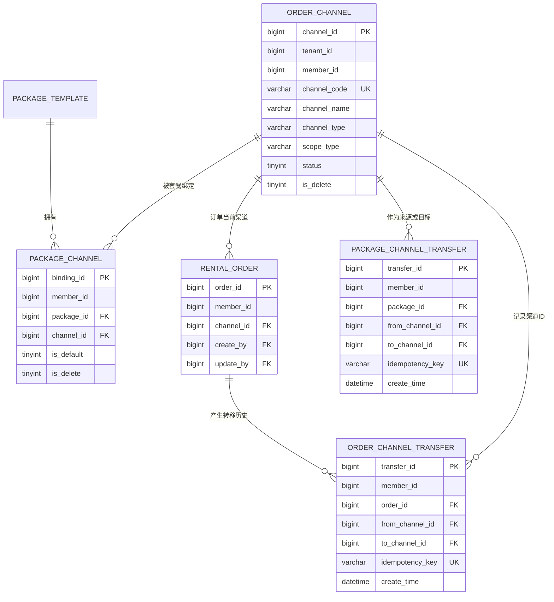
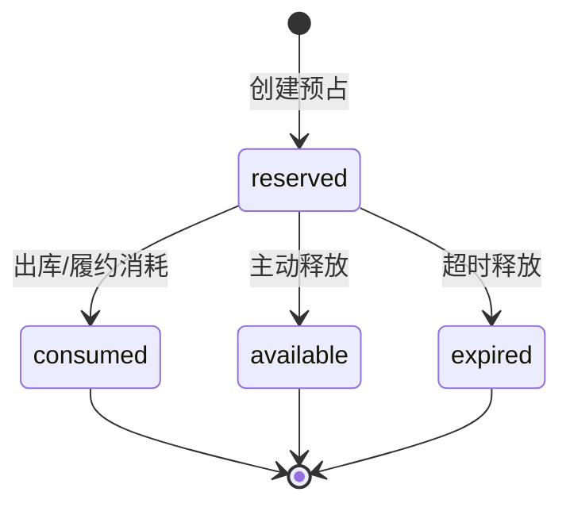

# 订单渠道、库存工作流、批处理、文件配额与协议版本设计

版本：V1.1
更新日期：2026-08-13
适用服务：`rental-business`、`platform-service`、`merchant-service`、`ruoyi-file`

## 1. 设计目标

本模块解决五类容易互相影响的问题：

1. 平台维护租仓联盟的联盟订单渠道，商户维护自定义订单渠道；套餐和订单都可以在商户范围内转移渠道。
2. 商品、SN、配件、资源池、套餐和仓库支持批量导入导出，导入仍复用领域服务的全部校验。
3. 库存有明确状态机，预占只冻结可用容量，释放/过期恢复容量，消耗才扣减真实库存。
4. 并发库存操作使用资源池锁行和数据库行锁，写请求使用幂等键和请求摘要，防止重复扣减和错误复用。
5. 文件使用商户级配额台账，协议使用平台版本和商户用户确认记录，所有关键动作均可审计。

## 2. 订单渠道模型



### 2.1 归属规则

- 平台联盟渠道：`tenant_id=0`、`member_id=0`、`scope_type=platform`、`channel_type=alliance`，只有平台端可以新增、修改和软删除。
- 商户自定义渠道：使用当前登录上下文的 `tenant_id + member_id`，`scope_type=merchant`、`channel_type=custom`，只能由当前商户维护。
- 商户查询可以同时看到有效的平台联盟渠道和自己的自定义渠道，但不能看到其他商户渠道。
- 套餐默认渠道只有一个；转移时先清除旧默认关系，再写入新关系和转移历史。
- 订单转移按照订单版本号更新，版本不一致时拒绝，避免并发操作覆盖最新结果。
- 渠道编码由平台统一编码规则生成，前端不能指定编码或修改编码。
- `channel_code` 只作为可展示、可搜索的业务编码，订单、套餐绑定和转移记录均不得使用它建立关系；所有关系字段统一为 `channel_id BIGINT`。
- 新增或编辑订单时，服务端必须校验 `channel_id` 是启用的平台联盟渠道或当前商户自定义渠道，不能依赖前端下拉框防止越权。
- 订单域的 `create_by`、`update_by` 和转移记录的 `operator_id` 均为 `BIGINT`，逻辑关联 `ry_rental_merchant_user.merchant_user_id`；跨数据库不建立物理外键。
- 平台维护全局渠道时，渠道表的商户用户审计字段保持 `NULL`，平台操作人由平台操作日志记录，禁止混入平台 `sys_user.user_id`。

### 2.2 幂等规则

- 套餐转移的唯一业务键是 `member_id + idempotency_key`。
- 批量订单转移的唯一业务键是 `member_id + order_id + idempotency_key`，同一批次内每个订单独立记录。
- 重复请求返回第一次业务结果，不重复写绑定关系和转移流水。
- 同一幂等键提交不同参数时，服务端比较请求摘要并拒绝，避免“键复用但语义不同”。

## 3. 库存状态机和共享资源池

### 3.1 统计口径

套餐库存不按套餐行累加，而是把每个 BOM 组件映射到资源池：

```text
资源池可接单量 = 资源池在库可用量 - 资源池未释放预占量
套餐可售量     = min(每个 BOM 资源池可接单量 / 每套需求数量)
```

例如 Pocket 3 和 Pocket 4 各 10 台，共用 15 个续航手柄：

- Pocket 3 全能套装和 Pocket 4 全能套装的主设备属于不同资源池。
- 续航手柄属于同一个共享资源池，两个套餐 BOM 都引用该资源池。
- 两个套餐合计可做套装数不能超过 15；`5+10` 和 `10+5` 都可行，`10+10` 必须被拒绝。
- 套餐切换只改变订单或套餐的组合分配，不复制库存，不重复统计共享手柄。

### 3.2 库存状态

数量型余额和逐件/SN 资产使用同一组业务状态：

| 状态 | 允许转移到 |
| --- | --- |
| `available` | `reserved`、`rented`、`repairing`、`lost` |
| `reserved` | `available`、`rented` |
| `rented` | `available`、`repairing`、`lost` |
| `repairing` | `available`、`retired` |
| `lost` | `available`、`retired` |
| `retired` | 无 |

每次迁移都必须写入 `ry_rental_inventory_transition` 和库存流水；禁止直接修改历史流水。

### 3.3 预占生命周期



- 创建预占：锁定每个 `pool_id + warehouse_id`，校验 `available - reserved`，再写预占主表、明细和流水。
- 释放或过期：只更新预占状态和明细状态，不扣减实物库存，因而恢复可接单容量。
- 消耗：重新锁定资源池，按数量余额或逐件 SN 扣减，状态从 `available` 转为 `rented`，然后预占转为 `consumed`。
- 每个生命周期动作必须携带幂等键；状态已是目标状态时返回现状，非法状态转移直接拒绝。

## 4. 并发锁和幂等

### 4.1 锁顺序

1. 先按 `pool_id`、`warehouse_id` 排序并锁定 `ry_rental_inventory_pool_lock`。
2. 再锁定预占、库存余额或 SN 行。
3. 按固定顺序更新余额、资产状态、预占状态和流水。
4. 事务提交后才返回成功。

固定锁顺序可以降低多个套餐共享同一资源池时的死锁概率。资源池锁行只负责串行化同一库存池的容量计算，真实库存仍由数据库行锁保护。

### 4.2 幂等表

`ry_rental_idempotent_request` 保存 `tenant_id`、`member_id`、业务范围、幂等键、请求 SHA-256、处理状态和响应业务主键。唯一约束防止并发创建第二条占位记录；请求摘要不一致时拒绝执行。

## 5. 批量导入导出

支持资源：`warehouse`、`pool`、`product`、`sn`、`accessory`、`package`。

- 导入使用 `ExcelUtil<BatchImportRow>` 解析，按行调用现有 `RentalBusinessService`，因此仍执行分类经营范围、仓库权限、型号、资源池、BOM、状态和软删除校验。
- 导入结果返回总行数、成功数、失败数和失败行原因；单行失败不会掩盖其他行结果。
- 导出只查询当前商户范围，并以统一字段结构生成 Excel；前端不能通过导出参数绕过租户、商户或仓库范围。
- 文件导入前记录文件大小并执行商户配额校验；导出记录审计但文件大小为 0，不重复占用永久配额。

## 6. 文件配额审计

`ry_rental_file_quota_account` 保存商户总配额、已使用字节和版本；`ry_rental_file_quota_ledger` 保存文件名、地址、大小、操作类型、关联资源和操作人。

- 上传/导入使用条件更新 `used_bytes + file_size <= quota_bytes`，不足时整个事务失败。
- 导入记录 `change_type=import`，公共文件和商户资料上传可复用同一服务写入 `upload`。
- 导出记录 `change_type=export`，用于追踪谁在什么时间导出了什么资源。
- 审计流水只允许追加，普通删除接口不允许清理；文件物理删除和配额回收需要单独的受控任务。

## 7. 协议版本

`ry_rental_protocol` 由平台维护，按 `protocol_key + version_no` 唯一。正文保存 SHA-256：

- 草稿可修改，已发布版本禁止覆盖。
- 发布新版本时同协议键旧版本自动变为 `retired`。
- 商户端只展示有效发布版本，商户用户确认时写入 `protocol_id`、版本号和正文哈希。
- 同一商户用户重复确认同一版本执行幂等更新，不产生重复确认记录。

## 8. 当前接口

| 端口 | 路径 | 作用 |
| --- | --- | --- |
| 商户 | `/merchant/order-channel/**` | 渠道查询、商户渠道 CRUD、套餐/订单渠道转移 |
| 商户 | `/merchant/inventory/workflow/**` | 预占、查询、释放、消耗、过期、状态迁移 |
| 商户 | `/merchant/batch/{resource}/import` | 主数据批量导入 |
| 商户 | `/merchant/batch/{resource}/export` | 主数据批量导出 |
| 商户 | `/merchant/file-quota`、`/merchant/file-quota/ledger` | 配额和文件审计 |
| 商户 | `/merchant/protocol/list`、`/merchant/protocol/accept` | 有效协议和确认 |
| 平台 | `/admin/rental/order-channel/**` | 联盟订单渠道管理 |
| 平台 | `/admin/rental/protocol/**` | 协议草稿、修改、发布和版本查询 |

所有路径按客户端类型严格隔离：平台端使用 `X-Client-Type: platform`，商户端使用 `X-Client-Type: merchant`；不提供跨端兼容路径。

菜单迁移写入商户模板和平台角色菜单。已有商户自定义角色不被强制追加新权限，需要由商户管理员在角色权限树中显式授权；新建商户管理员角色按当前模板复制，避免历史角色被静默扩大权限。

## 9. 验收清单

- 渠道：平台联盟渠道可被商户使用，商户自定义渠道互相不可见，删除被引用渠道会拒绝。
- 转移：套餐和订单转移均有历史；版本冲突、停用目标、重复键和跨商户 ID 均被拒绝。
- 库存：共享资源池只统计一次；预占、释放、过期和消耗结果可从流水还原；并发预占不产生负可用量。
- 批处理：导入逐行返回错误；导出不跨商户；导入文件超配额时事务失败并留下审计原因。
- 文件：配额条件更新在并发上传下不超额；流水包含操作类型、资源和操作人。
- 协议：已发布版本不可覆盖；商户确认包含版本和正文哈希；重复确认幂等。
