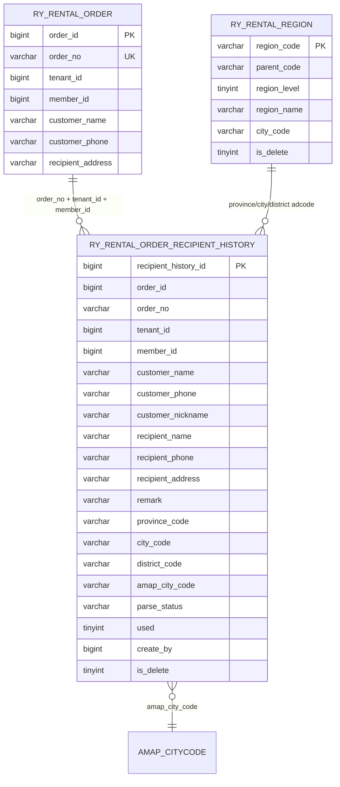
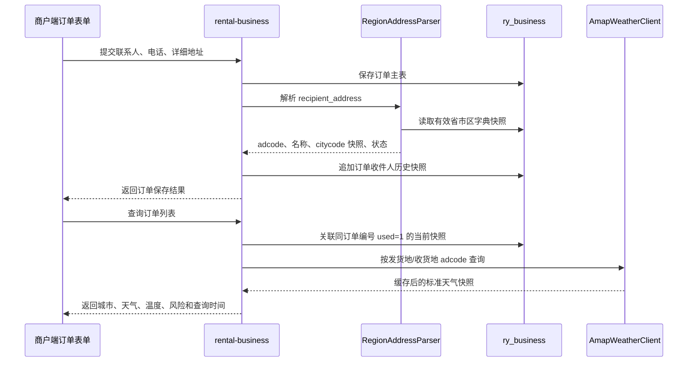
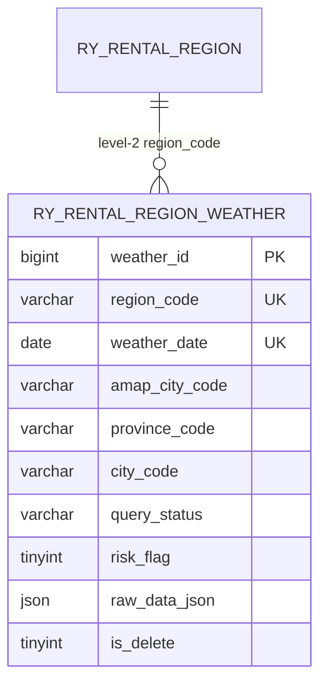
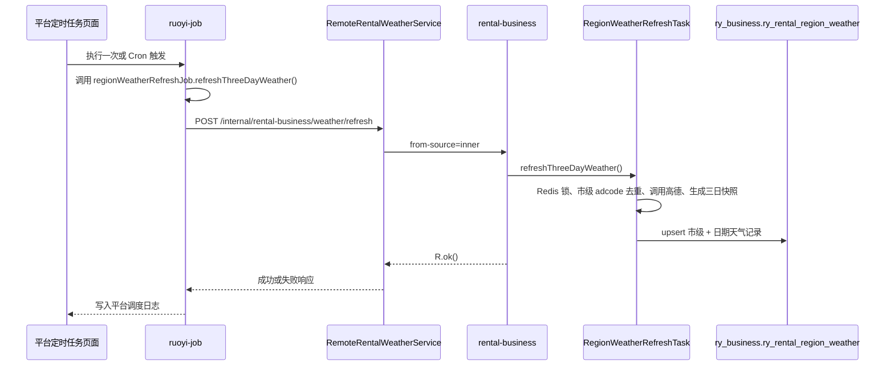

# 订单收件人行政区划与全局天气设计

## 1. 目标和边界

本模块解决四个问题：

1. 订单收件人信息支持历史留存，地址修改后仍能追溯历史版本。
2. 订单详细地址能够复用统一解析规则，得到省、市、区县 `adcode` 和高德 `citycode` 快照。
3. 平台统一维护高德 API Key 等全局配置，商户业务服务只通过公共配置服务读取。
4. 订单列表按发货地和收货地城市查询天气，第三方异常时不阻断订单列表。

订单主表仍然是租赁执行面的事实源，收件人历史是订单的追加式扩展表；平台服务只维护
全局配置，不直接访问 `ry_business` 订单数据。

## 2. 数据关系

### 2.1 表字段职责

表 `ry_business.ry_rental_order_recipient_history` 的核心字段如下：

| 字段 | 说明 |
| --- | --- |
| `recipient_history_id` | 历史快照主键，按写入顺序确定同一订单的最新版本 |
| `order_id`、`order_no` | 同时保存数据库主键和业务订单编号，查询与审计均使用订单编号 |
| `tenant_id`、`member_id` | 商户数据隔离键，任何读写都必须从登录上下文取得 |
| `customer_name`、`customer_phone`、`customer_nickname` | 本次订单客户信息快照 |
| `recipient_name`、`recipient_phone`、`recipient_address` | 本次订单收件人信息快照 |
| `remark` | 本次订单备注快照 |
| `province_code`、`city_code`、`district_code` | 行政区划 `adcode`，来源于 `ry_rental_region.region_code` |
| `province_name`、`city_name`、`district_name` | 解析时的名称快照，避免字典改名影响历史展示 |
| `amap_city_code` | 行政区划导入的高德 `citycode` 快照，来源于 `ry_rental_region.city_code`；天气接口不直接使用该字段 |
| `parse_status`、`parse_message` | `success`、`partial`、`failed` 及失败原因 |
| `used` | 当前订单正在使用的地址标识，`1` 为当前地址，`0` 为历史地址；同一订单只保留一条 `1` |
| `create_by`、`update_by` | 商户用户 `merchant_user_id`，类型为 `BIGINT` |
| `is_delete` | 软删除标记，历史记录默认不删除 |

高德天气接口的 `city` 参数必须使用行政区划 `adcode`，不能把 `amap_city_code` 这种
`citycode` 快照或城市名称直接传入。订单天气统一使用市级 `city_code` 解析出的二级行政区
`adcode`；区县只保留原始 `district_code`，查询天气时回退到所属市级天气快照。

## 3. 订单新增和编辑流程

保存订单时先读取同一订单的 `used = 1` 快照并比较联系人、电话、详细地址及行政区划解析结果。
上述信息完全一致时不新增记录；发生变化时将旧记录更新为 `used = 0`，再新增一条
`used = 1` 快照。解析失败只记录 `failed` 或 `partial`，不因为第三方或字典问题阻断订单保存。
这样可以先完成业务录单，待字典补充或地址修正后再次编辑订单生成新快照。查询当前快照的
条件必须包含 `tenant_id`、`member_id`、`order_no`、`used = 1` 和 `is_delete = 0`，不能只按订单编号查。

## 4. 公共地址解析类

公共服务类：

`com.ruoyi.rentalbusiness.service.RegionAddressParser`

职责：

- 从 `ry_rental_region` 懒加载省、市、区县三级有效节点，并建立内存快照。
- 以父子编码约束候选范围，按最长行政区划名称匹配，减少简称和“市辖区”误判。
- 识别区县后回溯城市和省份，支持直辖市虚拟市级节点。
- 返回 `RegionAddressModel`，不让解析异常穿透到订单保存事务。
- 字典更新后可调用 `refresh()` 重新加载快照。

解析器返回的状态含义：

| 状态 | 业务处理 |
| --- | --- |
| `success` | 省、市、区县 `adcode` 和 citycode 快照可用 |
| `partial` | 识别到部分行政区划，但缺少天气查询所需的 `adcode`，天气显示待查询 |
| `failed` | 未识别行政区划，保留地址文本和失败原因 |

## 5. 全局配置

平台端系统配置菜单使用现有系统配置业务，菜单名称统一为“系统配置”。默认配置键：

| 配置键 | 默认值 | 用途 |
| --- | --- | --- |
| `global.config.cache-ttl-days` | `7` | 全局配置缓存有效期 |
| `global.amap.api-keys` | 空 | 高德 Web 服务 API Key 列表，多个 Key 使用逗号、分号或换行分隔 |
| `global.amap.weather-url` | `https://restapi.amap.com/v3/weather/weatherInfo` | 高德天气接口地址，可用于私有网关或测试替身 |

平台配置服务写入 Redis 的共享键仍为 `sys_config:{configKey}`，缓存有效期统一为 7 天；新增、
修改和删除配置都会刷新或清理对应缓存。商户服务通过 `GlobalConfigService` 按以下顺序读取：

1. 读取共享 Redis 缓存；
2. 缓存未命中时调用平台内部契约 `GET /internal/platform/global-config/value`；
3. 成功返回后在商户服务本地共享 Redis 写入 7 天缓存；
4. 平台不可用时只返回调用方提供的安全默认值，不把 API Key 返回前端。

内部接口仅允许 `from-source: inner` 的服务间调用，并由 `@InnerAuth` 保护。配置查询不允许
商户端直接访问平台配置表，商户端只消费被业务服务封装后的能力。

## 6. 高德天气通用类

公共服务类：

`com.ruoyi.rentalbusiness.integration.amap.AmapWeatherClient`

调用约定：

- 输入只能是市级行政区划 `adcode`，不接受前端传入的城市名称、`citycode`、区县 `adcode` 或 API Key。
- 使用配置中心的 Key 和接口地址调用高德天气 `extensions=all` 接口。
- 结果转换成 `AmapWeatherSnapshot`，统一输出城市、天气、温度、报告时间、图标和风险标记。
- 按市级 `weather:amap:{adcode}` 缓存 1 小时，区县和市级请求共享同一份天气缓存。
- 平台配置支持多个 API Key；每次真正发起高德 HTTP 请求都通过 Redis 原子计数，前 5000 次使用第一个
  Key，第 5001 次切换到第二个 Key，达到最后一个后循环使用，不同服务实例共享同一计数。
- 公共客户端统一按 500ms 间隔发起请求；收到 HTTP 429 或高德 `infocode=10021`
  (`CUQPS_HAS_EXCEEDED_THE_LIMIT`) 时按 1s、2s、4s 退避重试，避免批量任务超过高德 Key 的 QPS 配额。
- HTTP 超时、非成功响应、密钥未配置或返回结构异常时返回不可用快照，订单查询继续完成。
- API Key 只存在平台配置和服务端请求中，不进入前端响应、日志和源码。

订单列表天气使用发货仓库城市解析出的市级 `adcode` 作为发货地，使用最新收件人历史快照解析出的
市级 `adcode` 作为收货地；区县地址统一复用所属市级天气。旧订单没有快照时，临时使用当前地址调用公共解析器。前端显示真实城市名称、天气
描述和风险状态，查询失败统一显示“待查询”，不伪造天气结果；订单列表不显示温度。

## 7. 数据迁移与验证

新增迁移：

以下历史迁移已按原执行顺序汇总在 `database/migrations/V20261019_002__consolidated_project_baseline.sql`：
`V20260814_008__order_recipient_history_global_config.sql` 创建历史表，
`V20260815_001__order_recipient_history_used.sql` 增加 `used` 字段并回填当前地址，
`V20260912_003__order_recipient_history_customer_snapshot.sql` 补齐客户和收件人字段，
`V20260912_004__remove_order_recipient_history_contact_fields.sql` 删除旧的 `contact_*` 字段。

执行内容：

1. 在 `ry_business` 创建订单收件人历史表及订单编号、城市编码索引；
2. 在 `ry-cloud` 初始化全局配置键；
3. 将平台菜单 106 统一命名为“系统配置”，并修复平台角色授权；
4. 由 `scripts/deploy.sh` 的本地和云端迁移列表统一执行。

验证要求：

- `RegionAddressParserTest` 验证完整地址、直辖市地址和空地址失败状态。
- Mapper XML 使用 `xmllint` 校验，订单列表和详情 SQL 必须能在无历史快照时正常返回。
- 平台服务健康检查、内部配置接口和商户行政区划接口必须返回成功。
- 配置更新后 Redis 中旧值不能继续生效超过配置刷新操作；天气结果只允许按城市缓存。

## 8. 市级天气扩展与三日定时刷新

为支持订单、首页统计和后续物流能力按行政区划读取天气，新增表
`ry_business.ry_rental_region_weather`。该表按“市级编码 + 预报日期”保存天气快照，不把天气数据直接
写入订单主表，也不把高德返回的城市级结果误当成商户数据。表的关键关系如下：

### 8.1 获取范围和日期窗口

- 定时任务类：`com.ruoyi.rentalbusiness.task.RegionWeatherRefreshTask`。
- 平台调度 Bean：`com.ruoyi.job.task.RegionWeatherRefreshJob`，调用目标为
  `regionWeatherRefreshJob.refreshThreeDayWeather()`。
- 执行时间：平台 `ruoyi-job` 中默认任务每天凌晨 1 点执行，cron 为 `0 0 1 * * ?`；平台服务和
  业务任务均使用 `Asia/Shanghai` 时区。
- 获取范围：只查询 `ry_rental_region.region_level = 2`、`is_delete = 0` 的全部市级行政区；每个市级行政区以自身 `region_code`（adcode）请求高德。
- 二级以下行政区不单独请求高德，也不单独生成天气快照；查询区县天气时根据 `parent_code` 找到市级记录并复用。
- 日期窗口：以任务执行日为基准，写入当天、次日和后日，共 3 个自然日。
- 每个市级 `region_code`（adcode）保存一份三日预报，查询方传入市级或区县编码均解析到市级记录；`city_code` 仅作为导入数据中的高德 citycode 快照保留。

### 8.2 请求去重、缓存和幂等

1. 任务只查询所有有效市级行政区，每个市级行政区每天最多请求一次；区县不会触发独立高德请求。
2. `AmapWeatherClient.queryForecasts` 使用 `extensions=all` 获取完整预报列表，并按 adcode 缓存 1 小时。
3. 任务使用 Redis 锁 `rental-business:task:region-weather:refresh`，锁有效期 30 分钟，防止多个
   `rental-business` 实例同时刷新全部市级行政区。
4. `ry_rental_region_weather` 使用唯一键 `uk_region_weather_region_date(region_code, weather_date)`，其中 `region_code` 固定为市级编码，写入采用原子
   `insert ... on duplicate key update`：没有该市级行政区和日期的记录时创建，已有记录时直接更新天气快照、更新时间，并将软删除记录恢复为有效。重复执行只更新最新天气，不会重复统计或产生重复记录。
5. 客户端限速和退避只控制高德请求，不阻塞数据库批量写入；因此一次全量刷新可能需要数分钟，不能通过
   并发请求缩短时间，否则会触发高德 QPS 限制。
6. 高德没有返回某一天、密钥未配置或请求失败时，仍为对应市级行政区和日期写入 `query_status = failed`
   及 `query_message`，业务查询可以明确显示“待查询”，不会把失败误判为晴天。
7. `raw_data_json` 只保存高德单日 `cast` 原文，空文本转换为 `NULL`，避免 MySQL JSON 字段因空字符串报错。

### 8.3.1 高德接口获取不到数据的排查顺序

高德天气接口的 `city` 参数必须传二级行政区 `adcode`。导入表中的 `city_code` 是高德
`citycode`，不能直接作为天气接口参数；混用时可能返回 HTTP 成功但 `casts` 为空，最终被记录为
“高德未返回该预报日期天气”。二级行政区编码若返回空 `casts`，应保留失败状态并检查该编码是否属于高德天气服务覆盖范围；
二级以下行政区不直接调用高德，而是沿 `parent_code` 复用所属二级行政区天气。港澳地区编码若返回
`infocode=20003` 或没有预报，属于高德天气服务覆盖范围限制，应保留失败状态并由业务页面显示“待查询”。
如果日志出现 `infocode=10021`，表示请求频率超过当前 Key 的 QPS 配额，应先确认客户端限速已生效，
再检查同一 Key 是否被其他服务或环境共用。

### 8.3 与订单天气的关系

订单天气仍然通过收件人历史表中的 `city_code` 和发货仓库行政区划关联；`district_code` 只用于保留收件人原始行政区划，`amap_city_code` 仅保留为原始 citycode 快照，不作为高德天气请求参数。
订单列表可以优先查询 `ry_rental_region_weather(region_code, weather_date)` 的已落库结果；如果任务尚未完成，
再按既有高德客户端读取城市缓存并显示“待查询”状态。市级天气表只负责公共天气快照，不保存订单、
商户或用户字段，因此不会破坏租户隔离。

### 8.4 迁移和验证

历史迁移 `V20260815_002__region_weather.sql`、`V20260815_004__platform_region_weather_job.sql`、
`V20260817_001__city_weather_scope_and_amap_api_keys.sql` 和
`V20260817_002__drop_deprecated_region_tables.sql` 已汇总到
`database/migrations/V20261019_002__consolidated_project_baseline.sql`。上线后建议按以下顺序验证：

1. 确认 `ry_business.ry_rental_region_weather` 存在唯一键和日期索引。
2. 确认 `ry_business` 中不存在已废弃的 `ry_region` 和 `ry_region_weather` 表。
3. 确认 `ry-cloud.sys_job` 存在调用目标
   `regionWeatherRefreshJob.refreshThreeDayWeather()`，状态为正常；平台“定时任务”的“执行一次”
   和 Cron 触发都通过该目标执行。
4. 在平台系统配置中配置 `global.amap.api-keys`，多个 Key 使用逗号、分号或换行分隔；从平台定时任务页面执行一次，确认市级日志和三日记录均产生。
5. 使用 `POST /internal/rental-business/weather/refresh` 配合 `from-source=inner` 验证内部契约，未携带内部头时必须拒绝。
6. 使用同一基准日期重复执行任务，确认记录数不增加，只更新 `update_time`；Redis 锁应防止并发重复刷新。
7. 清空或临时替换 API Key 后执行任务，确认失败状态入库且服务不退出。
8. 检查平台调度日志、业务日志中的有效市级行政区数和写入记录数，确认写入记录数为市级行政区数乘以 3，区县不会新增天气记录。
9. 检查高德调用日志不再出现连续 `infocode=10021`；批量刷新期间应按配置的间隔请求，并在必要时出现退避重试日志。

### 8.5 平台调度调用链

平台调度服务不直接加载 rental-business 的 Bean，也不直接访问 `ry_business`；两者通过
专用的 `RemoteRentalWeatherService` 和受 `@InnerAuth` 保护的内部接口隔离。天气客户端使用
独立的长读取超时，不改变普通租赁业务 Feign 接口的超时策略。业务服务不再启用本地
`@Scheduled`，避免平台 Cron 与业务 JVM 本地 Cron 在凌晨重复执行。
