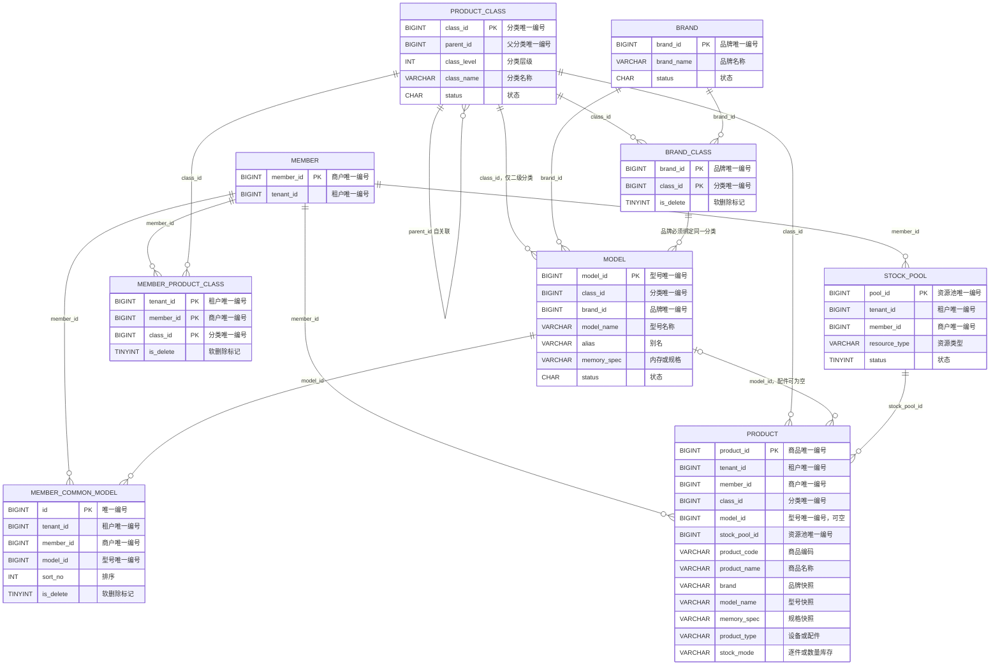
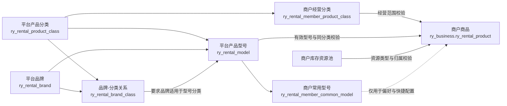
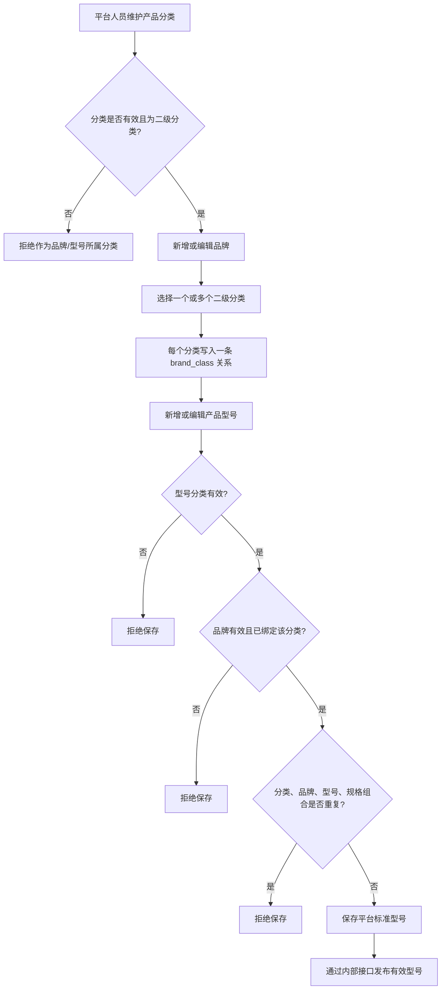
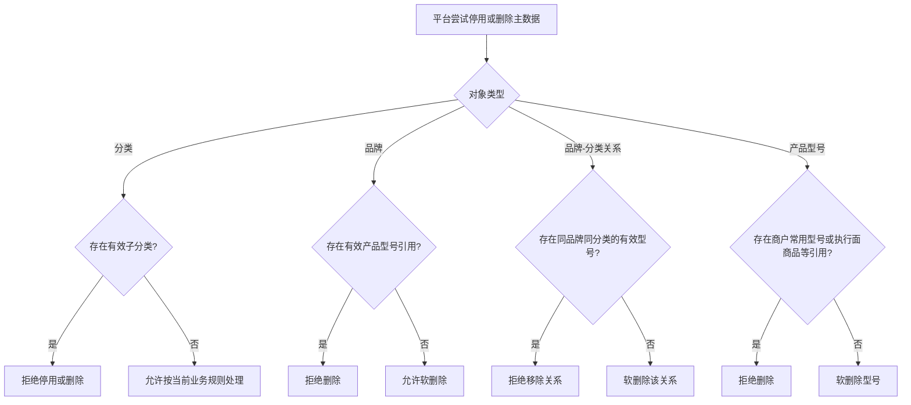
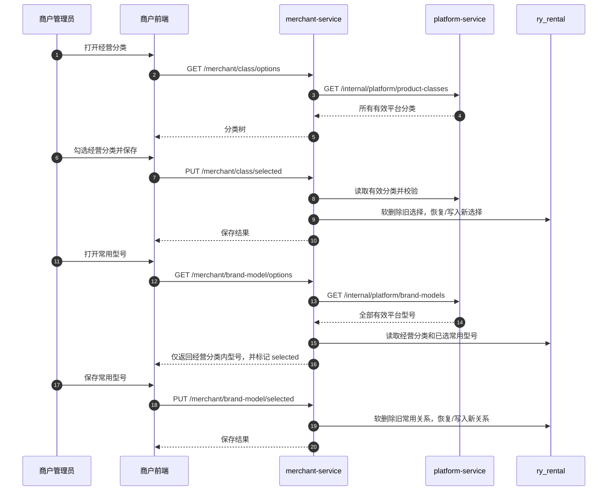
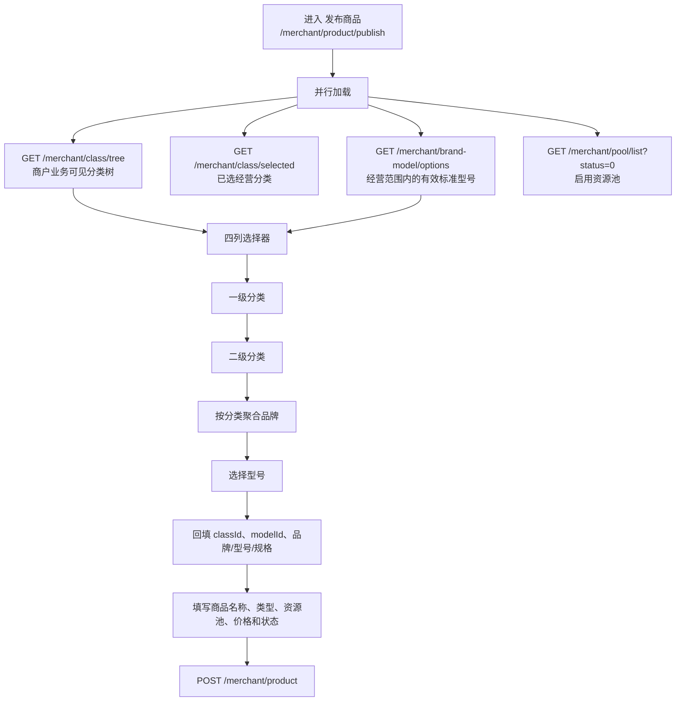
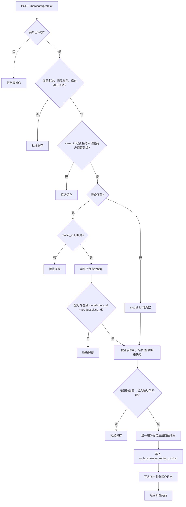
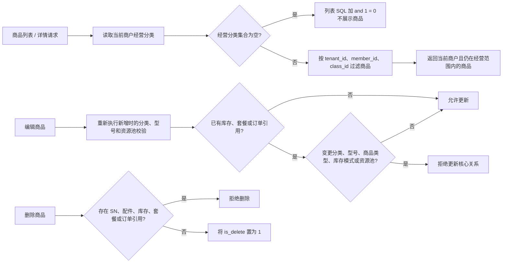
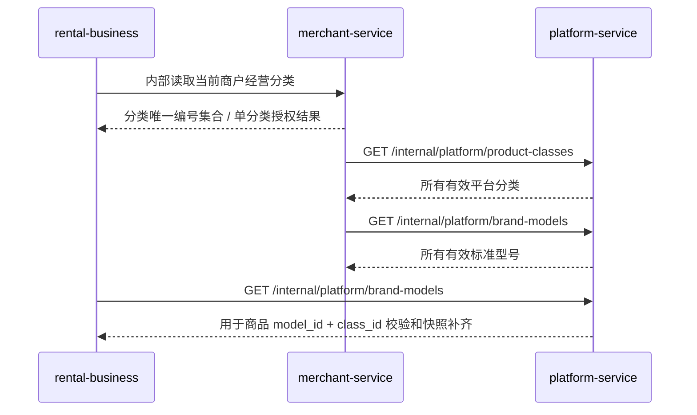
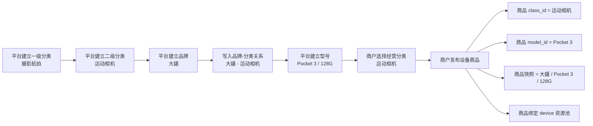

# 平台标准型号与商户商品关系说明

> 本文以当前实现为准，说明平台端“产品分类 / 品牌 / 产品型号”主数据如何约束商户端“经营分类 / 常用型号 / 商品”。
>
> 适用范围：平台端 `platform-service`、商户控制面 `merchant-service`、商户执行面 `rental-business`，以及正式商户前端的“发布商品”页面。

## 1. 结论

平台端维护全局、可复用的产品主数据；商户端不复制或维护标准型号主数据，而是在平台允许的范围内选择经营分类、维护常用型号，并创建自己的实际出租商品。

1. **产品分类**是平台主数据的根。平台可维护多级分类；品牌与产品型号仅可绑定到有效的二级分类。
2. **品牌**可以适用于多个二级分类。每个“品牌 - 分类”对应关系保存为 `ry_rental_brand_class` 中的一行，而不是将多个分类写入一个字段。
3. **产品型号**唯一绑定一个品牌和一个二级分类。型号是否可供商户使用，取决于型号、品牌、分类及品牌分类关系是否均为有效状态。
4. **经营分类**是商户的可经营范围。商户商品只能使用当前商户已选择的分类；这是商品查询和写入的共同边界。
5. **常用型号**仅是商户的偏好/快捷配置，不是商品发布授权。商品发布页可选择当前经营分类内的全部有效标准型号，而不只限常用型号。
6. **商户商品**保存 `class_id`、`model_id` 作为逻辑关联，同时保存品牌、型号、规格快照，用于商品和历史业务稳定展示；平台后续改名不会自动回写历史商品。
7. 所有跨表关系均由应用层校验和维护，数据库中**不建立物理外键**。

## 2. 数据归属与职责

| 业务层 | 数据库 | 表 | 职责 |
| --- | --- | --- | --- |
| 平台主数据 | `ry_rental` | `ry_rental_product_class` | 平台产品分类树；可维护多级分类。 |
| 平台主数据 | `ry_rental` | `ry_rental_brand` | 平台品牌主体。 |
| 平台主数据 | `ry_rental` | `ry_rental_brand_class` | 品牌和二级分类的多对多关系；一条关系一行。 |
| 平台主数据 | `ry_rental` | `ry_rental_model` | 平台标准产品型号；绑定一个分类和一个品牌。 |
| 商户控制面 | `ry_rental` | `ry_rental_member_product_class` | 当前商户选择的经营分类范围。 |
| 商户控制面 | `ry_rental` | `ry_rental_member_common_model` | 当前商户选择的常用标准型号。 |
| 商户执行面 | `ry_business` | `ry_rental_product` | 当前商户实际经营的商品 SKU。 |
| 商户执行面 | `ry_business` | `ry_rental_stock_pool` | 商品归属的库存资源池。 |

`ry_rental` 是商户控制面和平台治理主数据；`ry_business` 是商品、库存、套餐、订单等执行数据。`platform-service` 不直接读取 `ry_business`，`merchant-service` 不直接读取 `ry_business`，跨边界由内部 Feign 契约完成。

## 3. 关系图

### 3.1 逻辑 ER 图

> 图中的连线是应用层逻辑关联，不代表数据库物理外键。所有表使用 `is_delete` 软删除标记。

### 3.2 关系含义

虚线表示“常用型号”不是商品的强制前置条件。即使某个型号未标记为常用，只要它仍是平台有效型号，且其分类已被当前商户选择，仍可在商品发布页中被选择。

## 4. 关键字段映射

### 4.1 平台分类、品牌与产品型号

| 表 | 关键字段 | 与下一层的关系 | 当前约束 |
| --- | --- | --- | --- |
| `ry_rental_product_class` | `class_id`、`parent_id`、`class_level`、`status` | 分类树；被品牌关系、型号、商户经营范围和商品引用 | 平台分类可多级；品牌和型号仅可使用状态正常的二级分类。 |
| `ry_rental_brand` | `brand_id`、`brand_name`、`status` | 通过关系表与多个分类绑定；被型号引用 | 删除品牌前必须不存在有效产品型号引用。 |
| `ry_rental_brand_class` | `brand_id`、`class_id`、`is_delete` | 一条记录代表品牌适用于一个分类 | 仅允许有效的二级分类；取消某关系前必须不存在使用该“品牌 + 分类”的有效型号。 |
| `ry_rental_model` | `model_id`、`class_id`、`brand_id`、`model_name`、`alias`、`memory_spec`、`status` | 一个型号对应一个品牌和一个分类 | 新增/编辑时必须校验：分类二级且有效，品牌有效且已绑定该分类；同分类、品牌、型号、规格的组合不能重复。 |

标准型号在当前实现中有 `brand` 展示字段，但其权威关联是 `brand_id`；保存时会依据品牌唯一编号回填品牌名称，商品发布也以型号唯一编号作为校验入口。

### 4.2 商户经营范围与常用型号

| 表 | 关键字段 | 作用 | 与商品的关系 |
| --- | --- | --- | --- |
| `ry_rental_member_product_class` | `(tenant_id, member_id, class_id)` | 保存商户已经选择的经营分类 | 商品列表按该集合过滤；新增、编辑商品时必须直接命中该集合。 |
| `ry_rental_member_common_model` | `member_id`、`model_id`、`sort_no` | 保存商户常用标准型号及排序 | 只用于常用型号页面的勾选和回显，不替代商品型号校验。 |

当前商户经营分类保存时，后端只要求分类来自平台的有效集合，因此父子分类可以独立勾选。对“设备商品”而言，标准型号只挂在二级分类下，实际发布时应选择对应的二级经营分类；否则型号与商品分类不一致，后端会拒绝保存。

### 4.3 商户商品与型号快照

| 商品字段 | 来源/写入方式 | 业务含义 |
| --- | --- | --- |
| `class_id` | 商户发布页所选经营分类 | 平台分类的逻辑关联；决定经营范围和商品列表可见性。 |
| `model_id` | 所选平台标准型号；配件商品允许为空 | 标准型号的逻辑关联；设备商品必填。 |
| `stock_pool_id` | 当前商户所选资源池 | 同时校验商户归属、启用状态和资源类型。 |
| `brand` | 标准型号回填或商户明确填写 | 品牌**快照**，用于商品/历史业务展示。 |
| `model_name` | 标准型号回填或商户明确填写 | 型号名称**快照**。 |
| `memory_spec` | 标准型号回填或商户明确填写 | 规格**快照**；可表示同型号的不同存储规格或销售包装。 |
| `product_type` | `device` 或 `accessory` | 决定型号必填性及可选资源池类型。 |
| `stock_mode` | `serial` 或 `quantity` | 决定后续按 SN 逐件管理或按数量库存管理。 |

当商品绑定 `model_id` 且品牌、型号、规格快照为空时，服务端自动从平台有效标准型号补齐。若商户已填写这些快照字段，服务端保留其值，以支持同一标准型号下的商品变体；因此快照不会被平台后续改名自动覆盖。

## 5. 平台主数据维护流程

### 5.1 停用、删除和关系变更保护

平台内部“有效型号”集合同时要求：型号正常、型号未删除、所属分类正常、品牌正常、品牌分类关系仍有效。任一条件不满足，商户端不会再将该型号作为可选标准型号返回。

## 6. 商户经营范围与常用型号流程

商户经营分类控制的是“能经营什么”；常用型号控制的是“常用哪些型号”。二者是不同层次的配置，不能互相替代。

## 7. 商品发布流程

### 7.1 前端选择与加载

四列选择器的“品牌”不是单独调用品牌接口得到的列表，而是由当前经营范围内的有效标准型号按品牌名称在前端分组得到。型号选中后，前端把型号所属分类、型号唯一编号及其展示快照带入发布表单。

### 7.2 后端校验与入库

### 7.3 商品类型和资源池匹配

| 商品类型 | `model_id` | 可选资源池类型 | 默认库存模式 |
| --- | --- | --- | --- |
| `device`（设备商品） | 必填 | `device` | `serial`（逐件 / SN） |
| `accessory`（配件商品） | 可空 | `accessory` 或 `consumable` | `quantity`（数量库存） |

商品新增时，服务端从登录上下文确定 `tenant_id`、`member_id` 与操作用户；客户端不能指定其他商户的数据归属。

## 8. 商品查询、编辑与删除流程

商品查询不是仅按 `member_id` 过滤：还会按当前商户已选择的 `class_id` 集合过滤。因此，取消某个经营分类后，该分类下的既有商品不会在商户商品列表中继续展示；它们不会被自动物理删除。

## 9. 跨服务调用与浏览器接口

### 9.1 内部服务链路

### 9.2 主要浏览器接口

| 终端 | 接口 | 用途 |
| --- | --- | --- |
| 平台端 | `GET /admin/rental/class/tree` | 维护分类树。 |
| 平台端 | `GET /admin/rental/brand/list`、`POST/PUT /admin/rental/brand` | 维护品牌及其分类关系。 |
| 平台端 | `GET /admin/rental/brand-model/list`、`POST/PUT /admin/rental/brand-model` | 维护标准产品型号。 |
| 商户端 | `GET /merchant/class/options` | 平台有效分类树，用于配置经营分类。 |
| 商户端 | `GET /merchant/class/tree` | 仅当前商户已选择分类及其展示祖先。 |
| 商户端 | `PUT /merchant/class/selected` | 保存经营分类。 |
| 商户端 | `GET /merchant/brand-model/options` | 当前经营分类内的有效标准型号，附带常用选中状态。 |
| 商户端 | `PUT /merchant/brand-model/selected` | 保存常用型号。 |
| 商户端 | `GET /merchant/product/list`、`GET /merchant/product/{id}` | 查询当前商户商品。 |
| 商户端 | `POST /merchant/product`、`PUT /merchant/product`、`DELETE /merchant/product/{id}` | 商品新增、编辑、软删除。 |

网关浏览器命名空间保持严格隔离：平台端使用 `/admin/**`，商户端使用 `/merchant/**`，内部服务使用 `/internal/**`。商户端不会通过平台端浏览器控制器读取或修改平台主数据。

## 10. 完整示例

以下示例展示“摄影航拍 / 运动相机 / 大疆 / Pocket 3”被商户发布为实际商品的全过程。

最终形成的核心数据关系如下：

| 对象 | 示例值 | 说明 |
| --- | --- | --- |
| 平台分类 | `摄影航拍 / 运动相机` | 型号和品牌关系使用的二级分类。 |
| 品牌关系 | `大疆 -> 运动相机` | 允许“大疆”在该分类下维护型号。 |
| 平台型号 | `Pocket 3 / 128G` | 绑定“大疆”和“运动相机”。 |
| 商户经营分类 | `运动相机` | 允许该商户创建此分类下的商品。 |
| 商户商品 | `Pocket 3 标准套装` | 绑定分类和型号，并写入商品自身快照、资源池、价格、库存模式等经营信息。 |

## 11. 当前实现边界

1. **分类层级约束不同**：平台分类树可维护多级；品牌与产品型号的所属分类严格限制为二级。商户经营分类当前允许勾选任意有效层级，因此业务人员应为设备商品选择对应二级分类。
2. **型号的可见性**：商户“发布商品”页面显示的是“经营分类内全部有效标准型号”，而不是仅显示商户常用型号。
3. **品牌不是商品的独立关联字段**：商品表没有 `brand_id`。商品对标准品牌的约束是通过 `model_id -> brand_id` 间接完成，`brand` 列是显示快照。
4. **配件可不绑定型号**：配件商品不强制标准型号；此时品牌、型号、规格快照不经过平台型号校验。设备商品则必须绑定一个同分类的有效标准型号。
5. **型号申请入口未接后端**：发布商品页已有“品牌型号申请”弹窗和表单校验，但提交动作当前仅提示“接口尚未接入”，不会创建平台型号申请记录。
6. **历史稳定性优先**：平台品牌或型号名称发生变化时，已创建商品的快照字段不会自动同步修改；如需改变历史商品展示，应通过商品编辑业务处理，并受库存、套餐和订单引用保护。

## 12. 维护与排查清单

| 现象 | 优先检查项 |
| --- | --- |
| 商户发布页没有型号 | 商户是否已选择型号所在二级经营分类；平台型号、品牌、品牌分类关系、分类是否均为正常且未删除。 |
| 设备商品保存失败，提示型号不匹配 | `product.class_id` 是否等于 `model.class_id`；不要只选择一级经营分类。 |
| 商品列表为空 | 当前商户是否存在经营分类；列表按经营分类直接过滤，空集合会返回空数据。 |
| 无法修改商品的分类/型号/资源池 | 商品是否已有 SN、配件、库存、套餐或订单引用。 |
| 无法删除品牌、型号或品牌分类关系 | 是否仍有有效型号、常用型号或执行面引用。 |
| 平台改名后商品仍显示旧品牌/型号 | 属于快照设计的预期行为；商品展示字段不会自动回写。 |

## 13. 实现定位

| 范围 | 关键实现 |
| --- | --- |
| 平台分类 | `RentalProductClassService`、`RentalProductClassMapper.xml` |
| 平台品牌 | `RentalBrandService`、`RentalBrandMapper.xml` |
| 平台产品型号 | `RentalBrandModelService`、`RentalBrandModelMapper.xml` |
| 商户经营分类 | `MerchantProductClassService`、`MerchantProductClassMapper.xml` |
| 商户常用型号 | `MerchantBrandModelService`、`MerchantBrandModelMapper.xml` |
| 商品执行服务 | `RentalBusinessService`、`RentalBusinessMapper.xml` |
| 商品发布页面 | `frontend/merchant-web/src/views/merchant/product/ProductPublishPage.vue` |

相关代码和迁移均使用领域主键 `class_id`、`brand_id`、`model_id`、`member_id`、`product_id` 等；这些字段名和接口 JSON 属性保持不变，页面文案按项目统一术语显示“唯一编号”。
