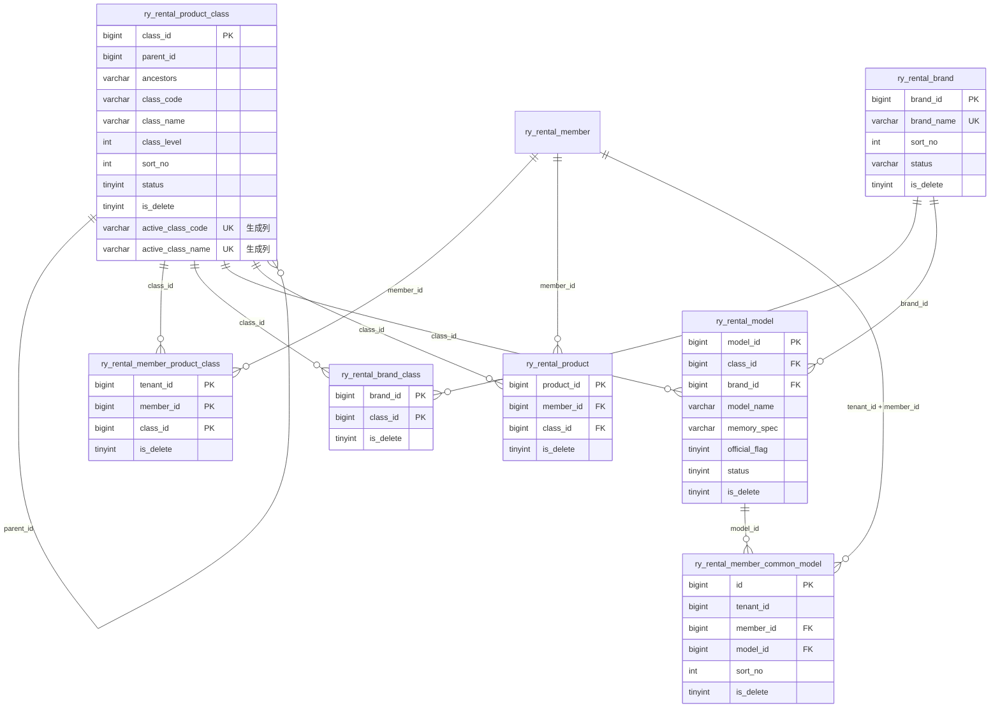

# 产品分类、接口审计与软删除设计

版本：V1.0  
更新日期：2026-07-30

本文定义平台产品分类、商户经营分类、全接口操作审计和全库软删除的统一实现。代码、数据库迁移、前端菜单和后续业务模块必须遵循本文，不再使用 `del_flag` 或物理删除。

## 1. 设计结论

1. 平台是产品分类主数据的唯一维护方，分类支持最多 8 级树形结构。
2. 商户不能创建或修改平台分类，只能选择多个正常分类作为经营范围。
3. 商户商品、标准型号、套餐和后续相关业务只能使用当前商户已选择的有效分类。
4. 平台分类表由 `platform-service` 拥有；商户经营分类关系由 `merchant-service` 按当前登录上下文维护。
5. 所有 `RestController` 公共方法统一记录成功或失败的操作日志，包括 GET 查询和公开接口。
6. 所有应用表统一使用 `is_delete TINYINT(1) NOT NULL DEFAULT 0`；`0` 正常，`1` 删除。
7. 运行时 MyBatis 拒绝执行 `DELETE` 和 `TRUNCATE`，代码生成器也只生成软删除 SQL。

## 2. 服务与接口边界

| 能力 | 服务所有者 | 对外入口 | 权限 |
| --- | --- | --- | --- |
| 平台分类树 | `platform-service` | `GET /admin/rental/class/tree` | `platform:class:list` |
| 平台分类详情 | `platform-service` | `GET /admin/rental/class/{classId}` | `platform:class:query` |
| 平台分类新增 | `platform-service` | `POST /admin/rental/class` | `platform:class:add` |
| 平台分类修改 | `platform-service` | `PUT /admin/rental/class` | `platform:class:edit` |
| 平台分类软删除 | `platform-service` | `DELETE /admin/rental/class/{classId}` | `platform:class:remove` |
| 平台品牌列表 | `platform-service` | `GET /admin/rental/brand/list` | `platform:brand:list` |
| 平台品牌详情 | `platform-service` | `GET /admin/rental/brand/{brandId}` | `platform:brand:query` |
| 平台品牌新增 | `platform-service` | `POST /admin/rental/brand` | `platform:brand:add` |
| 平台品牌修改 | `platform-service` | `PUT /admin/rental/brand` | `platform:brand:edit` |
| 平台品牌软删除 | `platform-service` | `DELETE /admin/rental/brand/{brandId}` | `platform:brand:remove` |
| 平台品牌型号列表 | `platform-service` | `GET /admin/rental/brand-model/list` | `platform:brandModel:list` |
| 平台品牌型号详情 | `platform-service` | `GET /admin/rental/brand-model/{modelId}` | `platform:brandModel:query` |
| 平台品牌型号新增 | `platform-service` | `POST /admin/rental/brand-model` | `platform:brandModel:add` |
| 平台品牌型号修改 | `platform-service` | `PUT /admin/rental/brand-model` | `platform:brandModel:edit` |
| 平台品牌型号软删除 | `platform-service` | `DELETE /admin/rental/brand-model/{modelId}` | `platform:brandModel:remove` |
| 平台有效品牌型号内部契约 | `platform-service` | `GET /internal/platform/brand-models` | 内部服务身份 |
| 平台有效分类内部契约 | `platform-service` | `GET /internal/platform/product-classes` | 内部服务身份 |
| 商户可选分类 | `merchant-service` | `GET /merchant/class/options` | `merchant:class:list` |
| 商户已选分类 | `merchant-service` | `GET /merchant/class/selected` | `merchant:class:list` |
| 商户业务分类树 | `merchant-service` | `GET /merchant/class/tree` | `merchant:class:list` |
| 保存商户经营分类 | `merchant-service` | `PUT /merchant/class/selected` | `merchant:class:edit` |
| 商户常用型号选项 | `merchant-service` | `GET /merchant/brand-model/options` | `merchant:brandModel:list` |
| 商户已选常用型号 | `merchant-service` | `GET /merchant/brand-model/selected` | `merchant:brandModel:list` |
| 保存商户常用型号 | `merchant-service` | `PUT /merchant/brand-model/selected` | `merchant:brandModel:edit` |

商户接口不接收 `tenant_id` 或 `member_id`。`MerchantProductClassService` 只能从可信登录上下文读取归属；跨服务读取平台有效分类必须通过 `RemoteProductClassService`，不得跨服务调用 Mapper。

商户端通过“商品管理 -> 经营分类”进入 `/merchant/product/class`。商户管理员默认拥有查看和保存权限；自定义角色必须在商户权限树中分别授予 `merchant:class:list` 和 `merchant:class:edit`。商品页在尚未选择经营分类时提供“前往设置”入口，保存后商品、品牌型号、SN、配件和套餐等业务只使用已选择的分类范围。

前端必须独立接收 `roles` 和 `permissions`，不得因历史账号暂无角色副本而丢弃后端下发的用户级权限。菜单修复迁移只恢复原本已存在的商户管理员或已审核所有者授权记录，不向自定义角色或其他用户追加新权限。

## 3. 数据模型

`ancestors` 保存祖先路径，`class_level` 由平台服务计算，前端不得指定可信层级。有效分类编码和同级名称使用生成列唯一约束，软删除后不阻碍重建。`ry_rental_member_product_class` 的联合主键为 `tenant_id + member_id + class_id`，重复保存时恢复原软删除记录，不创建重复关系。品牌使用独立的 `ry_rental_brand` 主表，`ry_rental_brand_class` 维护品牌可经营的多个分类；型号使用独立的 `ry_rental_model` 表，只保存 `brand_id + class_id` 关系，不保存品牌名称快照。标准型号使用 `class_id + brand_id + model_name + memory_spec` 作为业务唯一组合；商户常用型号只保存 `tenant_id + member_id + model_id` 关系，不复制标准型号字段。

## 4. 分类业务规则

- 分类编码在未删除记录中全局唯一；同一父节点下分类名称唯一。
- 新增和移动节点时由服务端计算祖先路径与层级，禁止选择自身或后代作为父节点；移动父分类必须在同一事务中批量替换全部后代的祖先路径并修正层级。
- 父分类停用时不能新增子分类；存在有效子分类时不能停用或删除父分类。
- 商户保存经营范围前，必须重新向平台内部接口取得有效分类并校验全部主键。
- 平台停用或删除分类后，该分类立即从商户业务分类树消失；历史商品仍保留 `class_id` 以供审计，不自动改写历史数据。
- 新增或修改商户商品、标准型号、套餐时，必须调用经营范围校验；未选择的分类返回业务错误。
- 商户业务下拉框只调用 `/merchant/class/tree`，不得直接请求平台全量分类。

### 品牌、型号与商户常用型号

- 平台是标准品牌和标准型号的唯一维护方。新增品牌时必须绑定一个或多个正常产品分类；新增或修改型号时必须同时提交已启用的 `brand_id` 和 `class_id`，且二者必须存在于 `ry_rental_brand_class` 有效关系中。
- 平台操作人员通过“产品管理 -> 品牌管理”进入 `/rental/brand` 维护品牌和经营分类，通过“产品管理 -> 产品型号”进入 `/rental/brand-model` 维护型号。型号录入表单只接受 `class_id`、`brand_id`、型号、规格、官方标识、状态和备注，不接受品牌文本作为写入依据。
- 标准型号写接口使用独立的 `PlatformBrandModelCommand`，查询使用 `PlatformBrandModelQuery`，返回使用 `PlatformBrandModelVO`，Controller 不直接接收或返回数据库实体。服务端统一去除文本首尾空白，将空规格保存为 `NULL`，并对字段长度、官方标识、状态、分类有效性和业务唯一性进行二次校验。
- 数据库通过有效记录生成列对 `class_id + brand_id + model_name + memory_spec` 建立唯一约束；应用层预校验用于返回中文业务提示，数据库约束负责阻止并发重复录入。软删除后生成列为空，因此允许后续重新建立同一标准型号。
- 平台型号通过 `GET /internal/platform/brand-models` 发布给商户服务；商户服务不得跨服务直接访问平台 Mapper，也不得接受客户端传入的租户或商户归属。
- 商户常用型号页面只展示当前商户经营分类内的有效标准型号；保存时服务端重新拉取平台有效型号，并校验每个 `model_id` 的分类属于当前商户经营范围。
- 未审核商户可以读取型号页面和选项，但保存常用型号属于写操作，必须由 `MerchantContextUtils.requireMerchantApproved()` 拒绝。
- 标准型号被商品或商户常用型号引用后禁止物理删除；删除请求返回业务错误，平台人员应先停用型号。停用型号不再进入商户选项，但历史商品和关系保留。
- 商品、套餐及后续统计必须复用标准 `model_id`，禁止商户自由输入品牌或型号文本，避免统计维度分裂。

分类、品牌、型号和商品关系字段继续使用 `class_id`、`brand_id`、`model_id`、`product_id` 等既有技术字段；注释和页面文案统一称为“分类唯一编号”“品牌唯一编号”“型号唯一编号”“商品唯一编号”，具体规则见《主键与关联字段术语规范》。

## 5. 全接口操作审计

`LogAspect` 环绕认证、平台、商户、文件、代码生成和任务服务中的所有 `RestController` 公共方法，负责平台和商户请求级日志；显式 `@Log` 优先使用业务标题和类型，未标注的方法按 HTTP 方法推断：POST 为新增、PUT/PATCH 为修改、DELETE 为删除、GET 为查询。网关只负责转发和链路标识，不重复写业务操作日志。商户业务服务对新增、修改、删除、登录、密码、权限、库存和批量等真实业务动作显式调用 `MerchantBusinessAuditRecorder`，只有成功完成业务写入后才记录变更前后快照，避免把查询请求误当成业务变更。

商户业务变更的审计写入采用严格模式：记录器通过内部审计契约最多重试三次，仍失败时抛出业务异常；资料、密码、头像、用户、角色、主数据、订单、库存、渠道、文件和协议等写入口必须位于 `rollbackFor = Exception.class` 事务内，确保“业务已修改但业务日志缺失”不会成功返回。登录属于已经建立会话的不可回滚流程，使用非阻断审计入口记录成功登录，审计服务暂时不可用时只记录错误并不阻断登录。

请求级审计字段至少包括：操作用户、终端类型、租户、商户、请求链路 ID、HTTP 状态码、请求方法、URL、来源 IP、操作结果、错误摘要和耗时，统一写入平台 `sys_oper_log`。商户业务审计字段包括：操作时间、用户名、操作人、业务模块、操作类型、对象、描述、IP、状态及变更前/后脱敏快照，统一写入 `ry_rental.ry_rental_audit_log`；用户名和操作人均由 `actor_id` 关联 `ry_rental_merchant_user.merchant_user_id`，其中用户名读取 `user_name`、操作人读取用户昵称 `nick_name`，关联条件必须包含 `tenant_id + member_id`，用户软删除或昵称为空时使用日志中的操作人名称快照兜底；商户端不展示请求方式和请求地址。历史重复表 `ry_rental_merchant_business_audit_log` 仅保留结构和历史数据，不作为运行时数据源。密码、令牌、联系方式、证件和支付信息必须脱敏或排除，超长 JSON 必须使用合法摘要。

商户业务审计的写入归属由业务服务决定：`merchant-service` 直接写入本表，`rental-business` 和认证中心通过内部 Feign 审计契约写入本表。仓库、资源池、商品、SN、配件、套餐、库存、订单、订单渠道、库存工作流、批量、文件、协议、商户用户、角色权限、经营分类、品牌型号、个人资料、密码和登录均必须覆盖对应的 `CREATE`、`UPDATE`、`DELETE` 或业务动作；列表查询、导出本身不产生商户业务变更日志。平台维护操作只写平台请求级日志，不把平台用户写入商户审计表。商户日志页面只能读取 `ry_rental.ry_rental_audit_log`，不得读取历史 `ry_rental_merchant_oper_log`、已停用的 `ry_rental_merchant_business_audit_log` 或平台 `ry-cloud.sys_oper_log`。商户管理员权限必须按平台当前有效商户菜单实时计算，不能只依赖历史角色菜单快照；迁移 `V20260814_004__sync_merchant_admin_menu_permissions.sql` 用于补齐已有角色菜单关系。资源池和 SN 仍属于商户端完整业务模块，迁移 `V20260814_005__restore_merchant_master_data_menus.sql` 恢复对应菜单；商品发布菜单继续保持停用。

平台日志接收接口本身不再二次记录，避免日志写入递归。历史 `ry_rental_merchant_oper_log` 仅作为请求级兼容留存表，迁移 `V20260814_003__retire_legacy_merchant_request_log.sql` 会将其活动行软删除，防止旧数据继续被误当成商户业务日志。审计表不开放业务删除和清空入口；其 `is_delete` 字段只用于合规归档流程。

## 6. 全库软删除规则

- 数据库字段固定命名为 `is_delete`，Java/JSON 属性固定命名为 `isDelete`，禁止新增 `isdeleted`、`deleted`、`is_deleted`、`delete_flag` 或 `del_flag`。
- 业务查询默认追加 `is_delete = 0`；详情、联表、统计、导出和权限关系查询同样适用。
- 删除操作固定使用 `UPDATE ... SET is_delete = 1`，并保留更新时间和操作人。
- 关系表重新授权时使用幂等 upsert 将 `is_delete` 恢复为 `0`。
- 更新和软删除必须同时限制主键、数据归属和 `is_delete = 0`，商户数据还必须包含可信 `tenant_id + member_id`。
- `PhysicalDeleteGuardInterceptor` 在 JDBC 预编译前拒绝 MyBatis 物理删除 SQL。
- 代码生成模板默认生成软删除列表、详情、更新和删除 SQL。
- `V20260730_000__isdeleted_prerequisite.sql` 先为应用表补字段、迁移旧值并彻底删除 `del_flag`；后续代码只读取 `is_delete`。

## 7. 索引与性能

- 平台分类按 `parent_id + status + is_delete` 查询树；有效编码和有效同级名称使用生成列唯一索引，允许保留任意数量的软删除历史记录。
- 商户注册手机号使用 `active_contact_phone` 生成列唯一索引；历史重复数据优先保留已绑定商户用户的主体，其余记录标记为软删除。
- 商户经营范围按 `member_id + is_delete` 查询，按 `class_id + is_delete` 支持反向治理检查。
- 商户商品使用 `member_id + class_id + status + is_delete` 联合索引。
- 审计日志按终端、商户、时间和链路 ID 建索引；列表必须按时间倒序分页，禁止一次加载全量日志。
- 软删除会保留历史行，需通过归档任务和索引统计监控表膨胀，不允许用物理删除绕开留存策略。

## 8. 验收清单

1. 平台可新增、修改、停用和软删除多级分类，非法循环和带子节点删除被拒绝。
2. 商户只能选择平台正常分类，不能通过请求参数切换其他商户。
3. 商户 A 保存经营分类不影响商户 B；商品页只显示 A 的经营分类。
4. 平台停用分类后，商户业务树不再返回该分类。
5. GET、写操作、失败请求和公开注册接口均产生对应审计记录。
6. 敏感字段不进入日志明文，平台与商户日志分别入库。
7. 源码、Mapper、代码生成模板中不存在运行时物理删除 SQL。
8. 旧库迁移后不存在 `del_flag`，所有应用表均存在类型一致的 `is_delete`。
9. 两端前端生产构建、后端测试和数据库迁移重复执行均通过。
10. 商户管理员登录后可在“商品管理”下看到“经营分类”，保存后商品页面能够加载所选分类。
