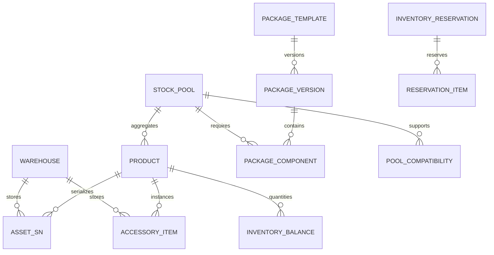

# 商品、SN、配件、套餐、仓库、库存基础功能说明

更新日期：2026-08-10

## 1. 服务和数据边界

这些业务由 `rental-business` 独立维护，业务库为 `ry_business`。平台用户、商户用户、角色、菜单和登录业务不进入该服务。

商户请求统一使用 `/merchant/**`，网关将主数据路径精确转发到 `rental-business`。服务端从登录态读取 `tenant_id`、`member_id` 和 `warehouse_scope`，请求体中的归属字段不会参与授权。

主数据基础表已经从 `ry_rental` 收口到 `ry_business`，新环境直接创建业务库权威表，旧环境由迁移脚本完成一次性复制与遗留表退役：

- `V20260803_001__rental_business_order_tables.sql`
- `V20260804_001__rental_business_master_data.sql`
- `V20260804_002__rental_business_master_data_menu.sql`
- `V20260811_002__retire_ry_rental_business_duplicates.sql`

所有删除接口只更新 `is_delete = 1`，查询统一追加 `is_delete = 0`。已被订单、库存、SN、配件、套餐或预占引用的数据拒绝删除，避免产生断链事实。

## 2. 领域关系



商品是 SKU，资源池是可替代库存的统计边界。Pocket 3 和 Pocket 4 可以分别是两个设备商品，但通用续航手柄应挂在同一个配件资源池；套餐只引用资源池，不直接复制配件商品数量。

## 3. CRUD 与校验规则

| 领域 | 查询 | 写入校验 |
| --- | --- | --- |
| 仓库 | 按编码、名称、城市、状态分页 | 商户内编码唯一；用户必须有仓库范围；有库存、SN、配件或订单引用时不可删除 |
| 资源池 | 按编码、名称、资源类型分页 | 商户内编码唯一；设备池只能挂设备商品；配件池可配置标准型号兼容关系；有引用时不可切换资源类型 |
| 商品 | 商户端专用列表、关键词、类型、库存模式、分类、状态筛选，详情、新增、修改和软删除 | 分类必须是商户已选择分类；标准型号必须来自平台启用型号且与分类一致；设备必须有标准型号；商品类型和库存模式必须合法；有事实引用时不可切换资源池、分类、型号、类型或库存模式 |
| SN | 按 SN、商品、仓库、状态分页 | 商品必须为 `serial` 且属于当前经营分类；SN 编码商户内唯一；已租用/预占 SN 不可直接改仓库、状态或删除 |
| 配件 | 按配件编码、商品、仓库、状态分页 | 只有逐件配件商品能创建实例；数量型配件通过数量库存维护，不创建实例；列表和详情只展示当前经营分类；已租用/预占实例不可直接改仓库、状态或删除 |
| 套餐 | 按编码、名称、启用状态分页 | 套餐编码商户内唯一；每个版本必须且只能有一个主设备资源池；同一版本不能重复引用资源池；组件数量必须大于零 |
| 库存 | 按仓库、商品和商品类型汇总，支持单商品/仓库详情 | 数量型商品使用余额锁定和流水调整；调整后不能为负；逐件商品必须通过 SN/配件实例变更；余额只能在零库存且无资源池预占时软删除，库存流水永不删除 |

新增、修改、删除、库存调整均要求商户已审核通过。未审核商户可以读取允许范围内的列表，但所有业务写入由统一守卫拒绝。

商品 CRUD 页面使用以下稳定入口：

- `/merchant/product` 和 `/merchant/product/my`：商品分页列表、条件筛选、详情抽屉、编辑和软删除。
- `/merchant/product/publish`：仅使用 `merchant:product:add` 权限打开新增商品表单，不预先请求商品列表。
- 商品编码不由前端提交，新增时由 `CodeGeneratorClient` 按平台统一编码规则生成；修改时始终保留原编码。
- 表单分类、标准型号和资源池均来自服务端选项接口；标准型号按商品分类过滤，资源池按设备/配件类型过滤。
- 商品写接口为 `GET /merchant/product/list`、`GET /merchant/product/{id}`、`POST /merchant/product`、`PUT /merchant/product` 和 `DELETE /merchant/product/{id}`，全部从登录上下文取得 `tenant_id + member_id`。

## 4. 套餐与库存统计

套餐保存为不可变版本 BOM：`package_template -> package_version -> package_component`。发布新套餐不会修改历史版本，订单后续应保存 BOM 快照。

库存校验先按资源池汇总，并应用资源池的型号兼容关系：

```text
资源池可用量 = 逐件可用数量 + 数量型余额
资源池可下单量 = 资源池可用量 - 进行中的资源池预占量
套餐所需量 = 当前套餐版本组件.required_qty × 套餐数量
```

例如 Pocket 3、Pocket 4 各 10 台，共用 15 个续航手柄：

- `Pocket 3 全能套装 × 5` 和 `Pocket 4 全能套装 × 10`：共享手柄需求 15，允许。
- `Pocket 3 全能套装 × 10` 和 `Pocket 4 全能套装 × 5`：共享手柄需求 15，允许。
- `Pocket 3 全能套装 × 10` 和 `Pocket 4 全能套装 × 10`：共享手柄需求 20，拒绝。

因此套餐不能把同一资源池拆成多条重复组件；套餐切换只改变版本或组件数量，不会把共享配件重复计入库存。资源池一旦配置兼容型号，只统计对应型号商品；未配置兼容关系的资源池表示池内商品全部可替代。

## 5. 库存概览规则

未来库存概览的实际计算口径、型号和套餐公式、天数限制及边界情况，统一以《库存概览与剩余库存计算规则》为准。该页面展示未来 1-30 天，默认 30 天；每日从当前库存基线独立重算，不递推前一日结果。

详细规则见：[库存概览与剩余库存计算规则](inventory-availability-rules.md)。

## 6. 权限、路由和审计

接口权限使用 `merchant:warehouse:*`、`merchant:pool:*`、`merchant:product:*`、`merchant:sn:*`、`merchant:accessory:*`、`merchant:package:*` 和 `merchant:inventory:*`。库存删除权限为 `merchant:inventory:remove`，仅允许删除零库存余额。商户管理员模板权限由迁移脚本同步，商户自定义角色可以在商户角色权限页面分配。

Controller 的写操作使用通用 `@Log` 入库，业务库存另追加库存流水。关键校验失败会返回明确业务错误，不能通过更换 `tenantId`、`memberId` 或仓库 ID 绕过。

## 7. 当前剩余工作

当前完成的是主数据与库存 CRUD，其中商品已完成商户端专用列表、详情、新增、编辑、软删除页面和后端引用保护；同时完成经营分类过滤、标准型号校验、资源池兼容统计和零库存余额软删除。订单渠道绑定与套餐渠道转移、主数据批量导入导出、库存预占/释放/过期/消耗状态流、资源池并发锁、幂等校验、文件配额审计和协议版本接口已接入。入库/出库/调货/盘点等完整履约状态仍在后续订单阶段扩展。
