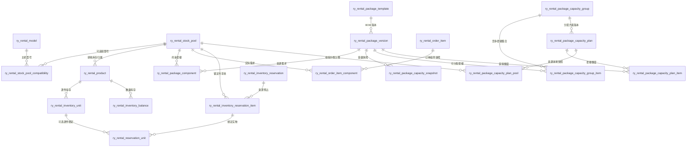
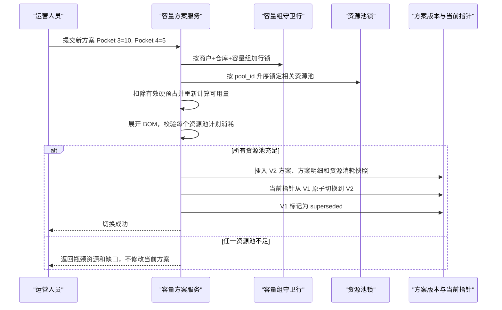
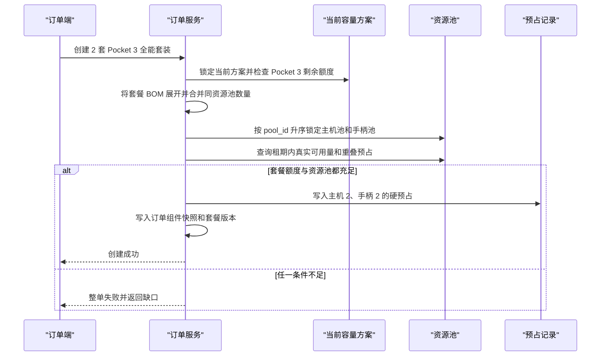

# 商品与套餐库存数据结构设计

版本：V2.0
更新日期：2026-08-26
状态：V2.0 设计已确认，按阶段实施

> V2.0 说明：本文件前部的 V1.1 资源池方案保留作为历史记录，不再作为后续实现依据。V2.0 废弃资源池作为库存事实，库存事实改由商户商品、库存汇总、逐件库存单元和库存预占组成；套餐仍然是虚拟 BOM，不单独持有库存。

本文保留商品、配件、套餐、订单预占和套餐容量的历史设计，并在第 14 节给出当前 V2.0 目标模型。后续实现、迁移和接口开发以第 14 节为准。

## 历史章节：V1.1 资源池模型

以下第 1 至第 13 节仅用于记录旧资源池方案、迁移背景和历史讨论，不再作为后续实现依据。

## 1. 设计结论

1. 套餐是版本化 BOM 和录单模板，不是实物库存，数据库不得维护可手工增减的“套餐库存”。
2. 所有可租实物先归属商品 SKU，每个商品 SKU 必须且只能归属一个排他库存资源池。
3. 通用配件只进入一个共享资源池，再通过兼容关系关联多个主机型号，不能为每个兼容型号复制一份库存。
4. 套餐 BOM 不直接引用零散库存记录，只引用资源池及所需数量。
5. 下单时必须把套餐 BOM 展开为资源池预占明细；并发校验和扣减均以资源池为最小约束单位。
6. 单个套餐的“独立可组数”可以展示，但不同套餐的独立可组数不能相加。跨套餐合计必须通过共享约束计算。
7. 套餐配置修改必须新建版本；历史订单保留套餐版本和组件快照，不能跟随当前 BOM 变化。
8. 实时结果由库存和有效预占计算，日报与未来 30 天数据只保存计算快照，快照不是库存事实来源。
9. 运营可以把共享资源容量按任意合法比例分配给多个套餐，并随时从 `5+10` 切换为 `10+5`；分配方案是可版本化的销售额度，不复制、不移动也不锁定具体实物。

## 2. 为什么现有模型会重复统计

当前骨架中存在以下风险：

- `ry_rental_accessory_item.compatible_model_ids` 将兼容型号保存在字符串中，无法建立唯一约束、外键语义和可靠查询。
- `ry_rental_package_item` 直接引用 `product_id`，缺少“多个商品 SKU 属于同一可替代库存池”的表达能力。
- `ry_rental_inventory_reservation` 只记录一个 `product_id` 和套餐数量，没有把套餐展开成主机、通用配件等真实资源需求。
- `ry_business.ry_rental_inventory_snapshot` 同时保存商品和套餐数量，容易让套餐快照被误当成独立库存并再次扣减。
- `asset_sn`、`accessory_item` 和总数型配件没有统一的库存事实及时间区间占用口径。

本次设计不保留新旧两套计算逻辑。迁移完成后，以资源池、版本化 BOM 和资源预占为唯一实现路径。

## 3. 核心概念

| 概念 | 说明 | 示例 |
| --- | --- | --- |
| 商品 SKU | 商户实际采购、定价和入库的商品定义 | 大疆 Pocket 3 主机、Pocket 4 主机、Pocket 3/4 续航手柄 |
| 库存资源池 | 一组在套餐计算中可互相替代且只能被计算一次的商品 SKU | `DJI_POCKET_3_4_BATTERY_HANDLE` |
| 兼容关系 | 某个配件资源池可以适配哪些主机标准型号 | 续航手柄池适配 Pocket 3、Pocket 4 |
| 库存单元 | 逐件追踪的实物，具有 SN、条码或内部编号 | 一台 Pocket 3、一只逐件管理的手柄 |
| 数量库存 | 不逐件追踪的同质配件在仓库中的账面数量 | 10 根数据线 |
| 套餐模板 | 套餐稳定身份和展示信息 | Pocket 3 全能套装 |
| 套餐版本 | 某一时刻生效的 BOM 版本 | V2：主机 1 + 手柄 1 + 包 1 |
| 资源预占 | 某订单在时间区间内对资源池数量的占用 | 8 套 Pocket 3 全能套装预占 8 台主机和 8 个手柄 |
| 独立可组数 | 假设只组装当前套餐时的最大数量 | Pocket 3 全能套装 10 套 |
| 组合总容量 | 多种套餐共同竞争共享资源时，可同时满足的最大套数 | Pocket 3/4 全能套装合计最多 15 套 |
| 容量分配方案 | 在组合约束内给各套餐分配可销售额度，可原子切换版本 | Pocket 3/4 按 `5+10` 或 `10+5` 分配 |

## 4. 目标数据关系



## 5. 表结构设计

所有业务表必须包含 `tenant_id`、`member_id`、创建时间和必要的审计字段。涉及仓库的库存查询还必须包含 `warehouse_id`，服务端不得信任前端传入的租户或商户隔离字段。

### 5.1 商品与库存归属

V2.0 不再使用库存资源池。库存的唯一事实主体是商户商品、仓库和库存记录；套餐只引用平台型号或商户商品，不创建独立的套餐库存。

#### `ry_rental_merchant_product`

商户商品是采购、定价、入库和库存统计的主体。每条商品记录绑定一个平台产品型号（配件可以为空），并由 `stock_mode` 区分序列号库存和数量库存。

关键约束：

- 商品必须属于当前 `tenant_id + member_id`。
- 主设备商品必须绑定 `model_id`；商户自定义配件可以只绑定二级 `class_id`。
- `stock_mode = 1` 表示序列号库存，库存单元写入 `ry_rental_merchant_inventory_unit`。
- `stock_mode = 2` 表示数量库存，库存余额写入 `ry_rental_merchant_inventory_balance`。
- 同一个商品可以在多个仓库拥有库存，但每个仓库只允许一条有效库存汇总记录。

#### `ry_rental_merchant_inventory`

按商户、仓库和商品保存库存汇总，不保存套餐数量，不保存兼容型号列表。

| 字段 | 类型 | 约束 | 说明 |
| --- | --- | --- | --- |
| `inventory_id` | BIGINT | PK | 库存汇总唯一编号 |
| `tenant_id` | BIGINT | NOT NULL | 租户唯一编号 |
| `member_id` | BIGINT | NOT NULL | 商户唯一编号 |
| `warehouse_id` | BIGINT | NOT NULL | 仓库唯一编号 |
| `product_id` | BIGINT | NOT NULL | 商户商品唯一编号 |
| `model_id` | BIGINT | NULL | 平台产品型号唯一编号 |
| `stock_mode` | TINYINT | NOT NULL | 1序列号库存，2数量库存 |
| `total_quantity` | INT | NOT NULL | 总库存数量 |
| `available_quantity` | INT | NOT NULL | 可用库存数量 |
| `reserved_quantity` | INT | NOT NULL | 已预占数量 |
| `rented_quantity` | INT | NOT NULL | 已出租数量 |
| `status` | TINYINT | NOT NULL | 0启用，1停用 |

唯一索引：`uk_merchant_inventory_scope(member_id, warehouse_id, product_id, is_delete)`。

库存共享通过多个套餐明细引用同一个商户商品实现；不再建立商品到资源池的归属字段，也不再通过资源池合并库存。

### 5.2 配件兼容关系

#### `ry_rental_accessory_model`

| 字段 | 类型 | 约束 | 说明 |
| --- | --- | --- | --- |
| `accessory_model_id` | BIGINT | PK | 配件型号关系唯一编号 |
| `accessory_id` | BIGINT | NOT NULL | 平台配件唯一编号 |
| `model_id` | BIGINT | NOT NULL | 可适配的产品型号唯一编号 |
| `compatibility_type` | TINYINT | NOT NULL | 兼容类型 |
| `condition_json` | JSON | NULL | 仅保存结构化附加条件，不保存型号列表 |

唯一索引：`uk_accessory_compatible_model(accessory_id, model_id, is_delete)`。

该表只负责套餐配置校验和可选项展示，不保存库存数量。库存统一按商户商品和仓库统计。

### 5.3 逐件库存与数量库存

#### `ry_rental_merchant_inventory_unit`

统一承载需要逐件追踪的主机和配件，替代分散的 SN 实例和配件实例计算路径。

| 字段 | 类型 | 约束 | 说明 |
| --- | --- | --- | --- |
| `unit_id` | BIGINT | PK | 库存单元 ID |
| `product_id` | BIGINT | NOT NULL | 商品 SKU |
| `warehouse_id` | BIGINT | NOT NULL | 当前仓库 |
| `unit_code` | VARCHAR(128) | NOT NULL | SN、配件编号或内部唯一编号 |
| `unit_status` | VARCHAR(32) | NOT NULL | `available`、`reserved`、`rented`、`repairing`、`lost`、`retired` |
| `condition_level` | VARCHAR(32) | NULL | 成色 |
| `version` | INT | NOT NULL | 乐观锁版本 |

唯一索引：`uk_inventory_unit(member_id, unit_code)`。  
查询索引：`idx_inventory_unit_stock(member_id, warehouse_id, product_id, unit_status)`。

#### `ry_rental_merchant_inventory_balance`

只承载 `stock_mode=quantity` 的商品 SKU。

| 字段 | 类型 | 约束 | 说明 |
| --- | --- | --- | --- |
| `balance_id` | BIGINT | PK | 主键 |
| `product_id` | BIGINT | NOT NULL | 数量型商品 SKU |
| `warehouse_id` | BIGINT | NOT NULL | 仓库 |
| `stock_status` | VARCHAR(32) | NOT NULL | `available`、`repairing`、`lost` 等 |
| `on_hand_qty` | INT | NOT NULL | 当前实物数量，不包含动态可用量 |
| `version` | INT | NOT NULL | 并发更新版本 |

唯一索引：`uk_inventory_balance(member_id, warehouse_id, product_id, stock_status)`。  
`on_hand_qty` 不能小于零，所有变化必须追加库存流水并使用幂等业务号。

### 5.4 套餐模板、版本和 BOM

#### `ry_rental_package`

仅保存平台套餐稳定身份、展示名称和启停状态，不保存库存数量。

#### `ry_rental_package_version`

| 字段 | 类型 | 约束 | 说明 |
| --- | --- | --- | --- |
| `package_version_id` | BIGINT | PK | 套餐版本 ID |
| `package_id` | BIGINT | NOT NULL | 套餐模板 |
| `version_no` | INT | NOT NULL | 递增版本号 |
| `version_status` | VARCHAR(20) | NOT NULL | `draft`、`active`、`retired` |
| `effective_time` | DATETIME | NULL | 生效时间 |
| `bom_hash` | CHAR(64) | NOT NULL | 规范化 BOM 哈希，用于审计和幂等 |

唯一索引：`uk_package_version(package_id, version_no)`。  
一个套餐同一时刻只能有一个生效版本，发布后 BOM 不允许原地修改。

#### `ry_rental_package_item`

| 字段 | 类型 | 约束 | 说明 |
| --- | --- | --- | --- |
| `component_id` | BIGINT | PK | 组件 ID |
| `package_version_id` | BIGINT | NOT NULL | 套餐版本 |
| `model_id` | BIGINT | NULL | 主产品型号唯一编号 |
| `accessory_id` | BIGINT | NULL | 平台配件唯一编号 |
| `component_role` | VARCHAR(20) | NOT NULL | `main`、`accessory`、`consumable` |
| `required_qty` | INT | NOT NULL | 每套所需数量，必须大于零 |
| `allocation_policy` | VARCHAR(20) | NOT NULL | `any`、`fifo`、`fefo`、`manual` |
| `sort_no` | INT | NOT NULL | 展示顺序 |

唯一索引：`uk_package_component(package_version_id, pool_id)`。

同一套餐版本中的同一型号或配件只能出现一行。`model_id` 和 `accessory_id` 必须二选一，发布前必须合并重复明细。

可选加购不进入基础 BOM。用户确认加购后，直接写入订单组件快照和资源预占，避免可选项影响基础套餐容量。

### 5.5 订单组件快照

#### `ry_rental_merchant_order_package_item`

创建订单时，将选中的套餐版本展开为不可变组件快照；单品订单也转换为一条组件快照。后续套餐改版不会影响历史订单。

| 字段 | 类型 | 约束 | 说明 |
| --- | --- | --- | --- |
| `order_item_component_id` | BIGINT | PK | 主键 |
| `order_item_id` | BIGINT | NOT NULL | 订单明细 |
| `package_version_id` | BIGINT | NULL | 来源套餐版本；单品订单为空 |
| `product_id` | BIGINT | NULL | 商户商品唯一编号 |
| `model_id` | BIGINT | NULL | 平台产品型号唯一编号 |
| `accessory_id` | BIGINT | NULL | 平台配件唯一编号 |
| `component_role` | VARCHAR(20) | NOT NULL | 组件角色 |
| `unit_qty` | INT | NOT NULL | 每个订单明细单位所需数量 |
| `order_quantity` | INT | NOT NULL | 下单套数或单品数量 |
| `required_qty` | INT | NOT NULL | `unit_qty * order_quantity` |
| `snapshot_json` | JSON | NOT NULL | 当时名称、SKU 偏好、赔付和展示信息 |

唯一索引：`uk_order_item_pool(order_item_id, pool_id)`。

### 5.6 时间区间预占

#### `ry_rental_merchant_inventory_reservation`

| 字段 | 类型 | 约束 | 说明 |
| --- | --- | --- | --- |
| `reservation_id` | BIGINT | PK | 预占单 ID |
| `order_id` | BIGINT | NOT NULL | 订单 |
| `order_item_id` | BIGINT | NOT NULL | 订单明细 |
| `warehouse_id` | BIGINT | NOT NULL | 履约仓库 |
| `occupy_start_time` | DATETIME | NOT NULL | 占用开始，含开始时刻 |
| `occupy_end_time` | DATETIME | NOT NULL | 占用结束，不含结束时刻 |
| `reservation_status` | VARCHAR(20) | NOT NULL | `reserved`、`locked`、`consumed`、`released`、`expired` |
| `idempotency_key` | VARCHAR(128) | NOT NULL | 创建预占幂等键 |
| `version` | INT | NOT NULL | 乐观锁版本 |

唯一索引：`uk_reservation_idempotency(member_id, idempotency_key)`。  
时间区间统一采用左闭右开 `[start, end)`，重叠条件统一为 `existing.start < new.end AND existing.end > new.start`。

#### `ry_rental_merchant_inventory_reservation_item`

| 字段 | 类型 | 约束 | 说明 |
| --- | --- | --- | --- |
| `reservation_item_id` | BIGINT | PK | 主键 |
| `reservation_id` | BIGINT | NOT NULL | 预占单 |
| `order_item_component_id` | BIGINT | NOT NULL | 订单组件快照 |
| `inventory_id` | BIGINT | NOT NULL | 商户库存汇总唯一编号 |
| `reserved_qty` | INT | NOT NULL | 预占数量 |

唯一索引：`uk_reservation_pool(reservation_id, pool_id)`。

#### `ry_rental_merchant_reservation_unit`

按 SN 提前分配或发货绑定实物时使用。数量预占可以先完成，具体 SN 可在拣货阶段绑定。

| 字段 | 类型 | 说明 |
| --- | --- | --- |
| `reservation_unit_id` | BIGINT | 主键 |
| `reservation_item_id` | BIGINT | 资源池预占明细 |
| `unit_id` | BIGINT | 具体库存单元 |
| `bind_status` | VARCHAR(20) | `active`、`released`、`consumed` |
| `active_unit_key` | BIGINT 生成列 | 活跃时等于 `unit_id`，非活跃时为 NULL |

对 `active_unit_key` 建唯一索引，使一个逐件库存单元同一时刻只能有一个活跃绑定；历史释放记录仍可保留。

### 5.7 库存保护和容量快照

#### `ry_rental_stock_policy`

按 `member_id + warehouse_id + pool_id` 保存固定保护数量和最低比例。保护数量为：

```text
protected_qty = max(fixed_protected_qty, ceil(serviceable_total_qty * protected_ratio))
```

#### `ry_rental_package_capacity_snapshot`

仅保存计算结果，用于未来 30 天报表和趋势查询。

| 字段 | 类型 | 说明 |
| --- | --- | --- |
| `business_date` | DATE | 独立计算日期 |
| `warehouse_id` | BIGINT | 仓库 |
| `package_version_id` | BIGINT | 套餐版本 |
| `independent_capacity` | INT | 当前套餐独立可组数 |
| `bottleneck_pool_id` | BIGINT | 最先耗尽的资源池 |
| `calculation_version` | BIGINT | 本次库存计算版本 |
| `calculated_time` | DATETIME | 计算时间 |

唯一索引：`uk_package_capacity_date(member_id, warehouse_id, business_date, package_version_id)`。

快照中的 `independent_capacity` 不允许跨套餐求和。组合容量单独按指定套餐集合和分配策略计算，不写回库存表。

### 5.8 可切换容量分配方案

独立可组数只能用于判断单个套餐上限。若运营希望明确展示“Pocket 3 全能套装 5 套、Pocket 4 全能套装 10 套”，必须建立独立的容量分配方案，不能把分配数量写入套餐模板或库存余额。

#### `ry_rental_package_capacity_group`

定义一组会竞争共享资源的套餐，例如“Pocket 全能套装容量组”。同一套餐版本在同一业务范围内只进入一个容量组。

#### `ry_rental_package_capacity_group_item`

保存 `capacity_group_id + package_version_id`，唯一索引为 `uk_capacity_group_package(capacity_group_id, package_version_id)`。

#### `ry_rental_package_capacity_plan`

| 字段 | 类型 | 约束 | 说明 |
| --- | --- | --- | --- |
| `capacity_plan_id` | BIGINT | PK | 分配方案版本 ID |
| `capacity_group_id` | BIGINT | NOT NULL | 容量组 |
| `warehouse_id` | BIGINT | NOT NULL | 生效仓库 |
| `occupy_start_time` | DATETIME | NOT NULL | 方案适用区间开始 |
| `occupy_end_time` | DATETIME | NOT NULL | 方案适用区间结束 |
| `plan_version` | INT | NOT NULL | 递增方案版本 |
| `plan_strategy` | VARCHAR(20) | NOT NULL | `manual`、`demand`、`priority`、`balanced` |
| `plan_status` | VARCHAR(20) | NOT NULL | `draft`、`active`、`superseded`、`expired` |
| `source_calculation_version` | BIGINT | NOT NULL | 生成方案时的库存计算版本 |
| `version` | INT | NOT NULL | 乐观锁版本 |

#### `ry_rental_package_capacity_plan_item`

| 字段 | 类型 | 约束 | 说明 |
| --- | --- | --- | --- |
| `capacity_plan_item_id` | BIGINT | PK | 主键 |
| `capacity_plan_id` | BIGINT | NOT NULL | 分配方案 |
| `package_version_id` | BIGINT | NOT NULL | 套餐版本 |
| `allocated_qty` | INT | NOT NULL | 本方案为该套餐分配的可销售额度 |
| `priority_no` | INT | NOT NULL | 自动再平衡优先级 |

唯一索引：`uk_capacity_plan_package(capacity_plan_id, package_version_id)`。

#### `ry_rental_package_capacity_plan_pool`

保存方案展开后的资源消耗快照：`capacity_plan_id + pool_id + planned_qty`。其中：

```text
planned_qty[i] = sum(bom[p,i] * allocated_qty[p])
```

唯一索引：`uk_capacity_plan_pool(capacity_plan_id, pool_id)`。任一 `planned_qty` 超过方案区间内的 `pool_available` 时，方案禁止激活。

#### `ry_rental_package_capacity_plan_current`

使用唯一键 `member_id + warehouse_id + capacity_group_id + occupy_start_time + occupy_end_time` 保存当前生效的 `capacity_plan_id`。切换方案时只在事务内更新该指针，旧方案改为 `superseded` 并永久保留，实现 `5+10` 与 `10+5` 的原子切换和完整审计。

同一商户、仓库和容量组在重叠时间区间内最多只能有一个当前方案。激活时必须锁定该容量组的守卫行，并使用与订单一致的区间重叠条件检查当前方案；不能只依赖起止时间完全相同的唯一索引。

容量分配方案属于软额度：它不预先绑定具体 SN，也不改变资源池实物数量。订单成功后产生的资源池预占才是硬占用。每条预占记录保存来源 `capacity_plan_id`，用于扣减套餐额度和审计当时采用的分配方案。

## 6. 套餐容量计算

### 6.1 资源池可用量

对仓库和时间区间内的每个资源池计算：

```text
pool_available
= 可服务的逐件库存数量
+ 可服务的数量型在手库存
+ 占用开始前可确认到库的调拨或采购数量
- 与目标区间重叠的有效订单预占
- 维修、报废、盘亏和调出占用
- 库存保护数量
```

跨仓库存默认不能直接相加。只有调拨能够在占用开始前到达并被确认时，才能计入目标仓库预计可用量。

### 6.2 单套餐独立可组数

套餐 `p` 对资源池 `i` 的单位需求为 `bom[p,i]`，资源池可用量为 `available[i]`：

```text
independent_capacity[p]
= min(floor(available[i] / bom[p,i]))
```

该指标回答“如果后续只接这一种套餐，最多还能接多少套”，不能回答多个套餐同时接单的合计数量。

### 6.3 多套餐组合总容量

多个套餐共享资源时，需要求整数约束：

```text
最大化：sum(x[p])
约束：对每个资源池 i，sum(bom[p,i] * x[p]) <= available[i]
      x[p] 为大于等于 0 的整数
```

若运营需要得到每个套餐的明确分配数量，还必须提供优先级、预计订单需求或手工配额。没有分配策略时只能给出最大总量和约束范围，不能伪造唯一拆分结果。

### 6.4 容量方案任意切换

设旧方案为 `x3=5, x4=10`，新方案为 `x3=10, x4=5`。切换时不移动 15 个手柄，只重新计算两个方案对资源池的需求：

```text
旧方案：P3 主机 5、P4 主机 10、共享手柄 15
新方案：P3 主机 10、P4 主机 5、共享手柄 15
```

两个方案都满足资源矩阵，因此都可以激活。切换必须创建新版本并原子更新当前方案指针，不能直接覆盖旧方案明细。

如果已经存在硬预占，生成新方案时先从资源池扣除全部有效预占，再对剩余可用量分配。例如已经预占 8 套 Pocket 3 后，只剩 2 台 Pocket 3、10 台 Pocket 4 和 7 个手柄，此时不能再激活 `10+5` 的剩余额度方案，只能在 `x3<=2、x4<=10、x3+x4<=7` 内重新分配。

## 7. Pocket 3 / Pocket 4 示例

### 7.1 基础数据

| 资源池 | 可用数量 | 包含商品 |
| --- | ---: | --- |
| `POOL_POCKET_3_HOST` | 10 | Pocket 3 主机 SKU |
| `POOL_POCKET_4_HOST` | 10 | Pocket 4 主机 SKU |
| `POOL_POCKET_3_4_HANDLE` | 15 | Pocket 3/4 通用续航手柄 SKU |

兼容关系：`POOL_POCKET_3_4_HANDLE` 分别关联 Pocket 3 和 Pocket 4 标准型号，但库存仍然只有一个 15 件的资源池。

### 7.2 套餐 BOM

| 套餐 | 主机资源池 | 共享手柄资源池 |
| --- | ---: | ---: |
| Pocket 3 全能套装 | `POOL_POCKET_3_HOST × 1` | `POOL_POCKET_3_4_HANDLE × 1` |
| Pocket 4 全能套装 | `POOL_POCKET_4_HOST × 1` | `POOL_POCKET_3_4_HANDLE × 1` |

设 Pocket 3 全能套装数量为 `x3`，Pocket 4 全能套装数量为 `x4`：

```text
x3 <= 10
x4 <= 10
x3 + x4 <= 15
```

因此：

- Pocket 3 全能套装独立可组数为 10。
- Pocket 4 全能套装独立可组数为 10。
- 两者不能显示为合计 20；受共享手柄约束，组合总容量最多为 15。
- 15 套可以是 `10 + 5`、`8 + 7` 或其他满足约束的分配，没有业务优先级时不存在唯一拆分。

### 7.3 手工切换分配方案

| 方案版本 | Pocket 3 全能套装额度 | Pocket 4 全能套装额度 | 共享手柄计划占用 | 是否有效 |
| --- | ---: | ---: | ---: | --- |
| V1 | 5 | 10 | 15 | 是 |
| V2 | 10 | 5 | 15 | 是 |
| V3 | 10 | 10 | 20 | 否，超过共享手柄 15 |

从 V1 切换到 V2 时，系统新增 V2、校验全部资源池、更新当前方案指针并将 V1 标记为已替代。V1 仍用于解释历史订单和运营调整，不删除、不覆盖。

### 7.4 下单后的变化

若先接受 8 套 Pocket 3 全能套装，预占明细必须同时写入：

```text
POOL_POCKET_3_HOST      预占 8
POOL_POCKET_3_4_HANDLE  预占 8
```

剩余可用量为 Pocket 3 主机 2、Pocket 4 主机 10、手柄 7：

- Pocket 3 全能套装独立可接 2 套。
- Pocket 4 全能套装独立可接 7 套。
- 新订单组合总容量最多为 7 套，不能把 2 和 7 相加成 9。

## 8. 下单与并发控制

创建或修改订单时按以下事务执行：

1. 读取生效的套餐版本并展开为订单组件快照，相同资源池先合并数量。
2. 若启用了容量分配方案，先锁定当前方案指针并校验该套餐的剩余额度。
3. 按 `pool_id` 升序锁定 `member_id + warehouse_id + pool_id` 对应的资源池锁行，避免不同套餐并发时死锁。
4. 查询目标时间区间内的可服务库存、有效预占、异常占用和保护数量。
5. 任一套餐额度或资源池不足则整单失败，不写入部分预占，并返回具体瓶颈套餐或资源池缺口。
6. 全部充足后写入带 `capacity_plan_id` 的预占单和资源池预占明细，再提交事务。
7. 重复请求使用同一 `idempotency_key` 返回原结果，不重复预占。
8. 取消、驳回或超时只变更预占状态并追加流水，不物理删除历史记录；释放后可按策略自动再平衡方案。
9. 拣货时绑定具体 SN；绑定失败必须保留资源池预占并进入异常处理，不能静默换仓或超卖。

不能使用“先查询可用量，再在事务外写订单”的方式。该方式在两个并发订单同时读取 15 个手柄时会分别通过校验，最终形成 20 个占用。

## 9. 统计口径

### 9.1 套餐租赁次数

- 按已履约订单明细的 `package_version_id` 和 `order_quantity` 统计。
- 套餐改名或改 BOM 后仍按原版本归档，可在报表层汇总到稳定的 `package_id`。
- 不允许根据主机和配件组合反推历史套餐，否则同一组实物可能符合多个套餐定义。

### 9.2 配件使用与占用

- 按 `order_item_component` 和 `inventory_reservation_item` 的资源池数量统计。
- 逐件配件可继续穿透到 `reservation_unit` 和库存单元履历。
- 数量型配件通过库存流水和资源池预占统计，不创建虚假套餐库存。

### 9.3 套餐库存看板

建议展示以下列：

| 列 | 含义 |
| --- | --- |
| 套餐名称/版本 | 当前生效套餐 |
| 独立可组数 | 只接该套餐时的最大数量 |
| 瓶颈资源 | 决定独立可组数的资源池 |
| 已预占套数 | 按套餐订单统计，不代表全部资源池占用 |
| 当前分配额度 | 当前方案为套餐分配的剩余可销售数量 |
| 共享资源提示 | 列出与其他套餐共享的资源池 |

页面禁止对“独立可组数”列做普通求和。若展示合计，应标记为“共享约束下组合总容量”，并显示采用的套餐范围与分配策略。

## 10. 当前表调整建议

| 当前表/字段 | 目标处理 | 原因 |
| --- | --- | --- |
| `ry_rental_product` | 保留，新增非空 `stock_pool_id`，统一 `stock_mode` 枚举 | 商品仍是采购、定价和入库主体 |
| `ry_rental_asset_sn` | 数据迁入 `ry_rental_inventory_unit` 后删除旧表 | 主机与逐件配件统一实物模型 |
| `ry_rental_accessory_item` | 逐件数据迁入库存单元；总数数据聚合到库存余额；随后删除 | 不保留双计算路径 |
| `compatible_model_ids` | 删除，改用兼容关系表 | 避免字符串列表和重复关系 |
| `ry_rental_package_template.main_product_id` | 删除，主机也作为 BOM 资源池组件 | 所有套餐约束统一计算 |
| `ry_rental_package_item` | 由套餐版本和组件表取代 | 支持版本、共享池和历史追溯 |
| `ry_rental_order_item.accessory_item_ids` | 删除，改用订单组件与逐件绑定表 | JSON 无法保证唯一占用和关系完整性 |
| `ry_rental_inventory_reservation` | 拆分预占头和资源池明细 | 一个套餐会占用多个共享资源 |
| `ry_business.ry_rental_inventory_snapshot.package_id` | 拆出独立套餐容量快照 | 防止套餐快照被误当库存事实 |

迁移采用一次性切换：停写旧表、迁移和校验数据、切换服务、验证库存守恒后删除旧路径，不增加兼容读取或双写逻辑。

## 11. 验收条件

1. 同一商品 SKU 无法归属两个资源池。
2. 同一套餐版本无法重复添加同一资源池组件。
3. 通用手柄兼容 Pocket 3 和 Pocket 4，但其可用库存只统计一次。
4. 示例数据中两个套餐独立可组数均为 10，组合总容量必须为 15。
5. 可以在不移动实物库存的情况下，把当前方案从 `5+10` 原子切换为 `10+5`，旧方案和切换操作可追溯。
6. `10+10` 方案因共享手柄需求为 20 必须被拒绝，不能只校验各套餐独立可组数。
7. 两个并发订单分别申请 10 套 Pocket 3 和 10 套 Pocket 4 时，最多一个完整成功；另一个只能部分重试或因手柄不足失败。
8. 套餐改版后，历史订单的名称、BOM、租赁次数和配件占用不变化。
9. 取消订单释放预占后，资源池可用量恢复且库存流水可追溯。
10. 未来 30 天每天独立计算，任一天均能穿透到订单预占、预计到库、异常占用和保护库存。
11. 跨仓库存不因简单求和产生虚假可用量，调拨未按时到达时自动移出预计可用量。
12. 所有库存扣减、释放、调拨、盘点和报废均有幂等业务号与不可覆盖流水。

## 12. 实施顺序

1. 评审资源池边界、SKU 可替代规则、时间占用区间和跨仓策略。
2. 创建新表和索引，准备旧商品、SN、配件和套餐数据迁移脚本。
3. 实现资源池可用量、BOM 发布、套餐独立容量和组合容量领域服务。
4. 实现容量组、手工/自动分配方案、方案版本切换和资源矩阵校验。
5. 实现订单组件快照、事务预占、取消释放、超时释放和 SN 绑定。
6. 实现未来 30 天容量快照、库存穿透和共享资源提示。
7. 完成并发、幂等、库存守恒、方案切换、跨仓和套餐改版测试后，一次性删除旧计算路径。

## 13. 业务逻辑详细解释

本章从业务人员、产品经理和开发人员三个视角解释整套逻辑。文中“任意切换”是指运营人员可以在满足资源约束的前提下任选 `5+10`、`10+5`、`8+7` 等组合，并不是使用随机数自动分配库存。

### 13.1 先区分四种完全不同的数据

这套模型最重要的前提，是不能把以下四种数据混成同一个“库存数量”。

#### 第一层：实物库存

实物库存回答“仓库里真正有什么”。

- Pocket 3 主机有 10 台，每台可以有独立 SN。
- Pocket 4 主机有 10 台，每台可以有独立 SN。
- Pocket 3/4 通用续航手柄有 15 个，可以逐件管理，也可以按总数管理。
- 实物只属于商品和仓库，不属于任何套餐。

无论套餐如何切换，数据库中的主机数量和手柄数量都不会改变。把套餐从 `5+10` 切换为 `10+5`，不代表把 5 个手柄从 Pocket 4 商品移动到 Pocket 3 商品，因为手柄从一开始就没有分别归属两个型号。

#### 第二层：套餐 BOM

套餐 BOM 回答“组成一套需要什么”。

- 一套 Pocket 3 全能套装需要：Pocket 3 主机池 1 台 + 通用手柄池 1 个。
- 一套 Pocket 4 全能套装需要：Pocket 4 主机池 1 台 + 通用手柄池 1 个。
- 套餐只保存组成规则，不保存实物数量。

主机和手柄都以资源池作为 BOM 目标，因此无论配件采用 SN 模式还是总数模式，套餐容量计算公式都不变。

#### 第三层：容量分配方案

容量分配方案回答“当前准备把剩余可售能力如何展示和分配给不同套餐”。

- V1 可以设置 Pocket 3 全能套装 5 套、Pocket 4 全能套装 10 套。
- V2 可以设置 Pocket 3 全能套装 10 套、Pocket 4 全能套装 5 套。
- 方案只分配可销售额度，不绑定具体主机 SN，也不绑定具体手柄。
- 切换方案时新增版本并更新当前指针，不覆盖历史方案。

容量方案是运营层的软分配。它让页面可以明确显示各套餐当前准备销售多少套，同时仍由底层共享资源池保证总量不超过真实库存。

#### 第四层：订单硬预占

订单预占回答“已经被具体订单占用了多少资源”。

- 客户下单 2 套 Pocket 3 全能套装，系统必须硬预占 2 台 Pocket 3 主机和 2 个通用手柄。
- 硬预占会减少资源池实际可用量，也会减少当前方案下对应套餐的剩余额度。
- 取消、超时或驳回订单后释放预占；发货后预占转为实际占用。
- 已经成功的硬预占不会因为运营切换容量方案而被修改或释放。

四层数据的关系可以概括为：

```text
实物库存决定资源池上限
套餐 BOM 决定每套消耗多少资源
容量方案决定剩余资源准备分给哪些套餐
订单预占决定哪些资源已经被真实业务占用
```

### 13.2 Pocket 3 / Pocket 4 实际数据如何落库

以下 ID 仅用于解释关系，正式实现由数据库生成。

#### 资源池数据

| `pool_id` | 资源池编码 | 名称 | 当前可服务数量 |
| ---: | --- | --- | ---: |
| 1101 | `POOL_POCKET_3_HOST` | Pocket 3 主机池 | 10 |
| 1102 | `POOL_POCKET_4_HOST` | Pocket 4 主机池 | 10 |
| 2101 | `POOL_POCKET_3_4_HANDLE` | Pocket 3/4 通用续航手柄池 | 15 |

这里最关键的是只存在一个 `POOL_POCKET_3_4_HANDLE`。不能再创建“Pocket 3 手柄池 15 个”和“Pocket 4 手柄池 15 个”，否则同一批手柄会被统计两次。

#### 商品数据

| `product_id` | 商品 | `stock_pool_id` | 库存模式 |
| ---: | --- | ---: | --- |
| 3101 | Pocket 3 主机 | 1101 | `serial` |
| 3102 | Pocket 4 主机 | 1102 | `serial` |
| 4101 | Pocket 3/4 续航手柄 | 2101 | `quantity` 或 `serial` |

每个商品只能归属一个资源池。手柄兼容两个型号是兼容关系，不是两个库存归属关系。

#### 兼容关系数据

| `pool_id` | `model_id` | 含义 |
| ---: | ---: | --- |
| 2101 | Pocket 3 型号 ID | 共享手柄可用于 Pocket 3 |
| 2101 | Pocket 4 型号 ID | 共享手柄可用于 Pocket 4 |

兼容关系用于套餐配置校验。例如创建 Pocket 4 套餐时，系统可以查询哪些配件池兼容 Pocket 4；它不负责增加或复制库存数量。

#### 套餐版本和 BOM 数据

| 套餐版本 | 资源池 | 每套需求 |
| --- | --- | ---: |
| Pocket 3 全能套装 V1 | 1101 Pocket 3 主机池 | 1 |
| Pocket 3 全能套装 V1 | 2101 通用手柄池 | 1 |
| Pocket 4 全能套装 V1 | 1102 Pocket 4 主机池 | 1 |
| Pocket 4 全能套装 V1 | 2101 通用手柄池 | 1 |

同一套餐版本中的同一资源池只有一行。如果导入时出现两行通用手柄，发布前必须合并数量；数据库唯一索引负责阻止重复行。

### 13.3 为什么两个套餐都能显示独立可组 10 套

Pocket 3 全能套装单独计算时：

```text
min(Pocket 3 主机 10 / 1, 通用手柄 15 / 1) = 10
```

Pocket 4 全能套装单独计算时：

```text
min(Pocket 4 主机 10 / 1, 通用手柄 15 / 1) = 10
```

因此两个套餐的独立可组数都等于 10，这两个结果本身都正确。但是它们属于两个“假设只销售当前套餐”的独立情景，不能相加为 20。

同时销售时必须把两个套餐放入同一个约束矩阵：

```text
Pocket 3 主机约束：x3 <= 10
Pocket 4 主机约束：x4 <= 10
共享手柄约束：x3 + x4 <= 15
```

所以组合总容量为 15。页面必须明确区分：

- 独立可组数：Pocket 3 为 10，Pocket 4 为 10，禁止求和。
- 组合总容量：两个套餐在当前共享约束下合计最多 15。
- 当前分配额度：由当前容量方案决定，例如 5 和 10。

### 13.4 `5+10` 与 `10+5` 如何保存

假设容量组为“Pocket 全能套装容量组”，其中包含 Pocket 3 和 Pocket 4 两个套餐版本。

#### V1 方案：`5+10`

`ry_rental_package_capacity_plan_item` 保存：

| 方案 | 套餐版本 | `allocated_qty` |
| --- | --- | ---: |
| V1 | Pocket 3 全能套装 V1 | 5 |
| V1 | Pocket 4 全能套装 V1 | 10 |

方案展开后的 `ry_rental_package_capacity_plan_pool` 保存：

| 资源池 | 计划消耗 |
| --- | ---: |
| Pocket 3 主机池 | 5 |
| Pocket 4 主机池 | 10 |
| 通用手柄池 | 15 |

#### V2 方案：`10+5`

| 方案 | 套餐版本 | `allocated_qty` |
| --- | --- | ---: |
| V2 | Pocket 3 全能套装 V1 | 10 |
| V2 | Pocket 4 全能套装 V1 | 5 |

方案展开后的资源消耗为：

| 资源池 | 计划消耗 |
| --- | ---: |
| Pocket 3 主机池 | 10 |
| Pocket 4 主机池 | 5 |
| 通用手柄池 | 15 |

V1 和 V2 都没有修改资源池库存。两者只是使用同一批 15 个手柄形成不同的可销售额度分配。

### 13.5 容量方案切换的完整事务

切换不能直接修改当前方案的两行数量，否则无法审计，也可能与并发订单发生竞争。正确过程如下：



切换事务必须满足以下规则：

1. 使用幂等键避免重复点击创建两个相同方案版本。
2. 同一仓库、容量组和重叠时间内只能有一个当前方案。
3. 资源池按固定顺序加锁，避免两个切换请求互相死锁。
4. 方案校验和当前指针更新必须在同一数据库事务中完成。
5. 旧方案永久保留，用于解释历史订单和运营调整。
6. 切换只作用于尚未被订单硬预占的剩余容量。

### 13.6 已有订单时如何切换

假设当前没有订单时采用 V1：Pocket 3 为 5、Pocket 4 为 10。之后客户成功下单 2 套 Pocket 3 全能套装。

订单会硬预占：

| 资源池 | 原可用 | 硬预占 | 剩余可用 |
| --- | ---: | ---: | ---: |
| Pocket 3 主机池 | 10 | 2 | 8 |
| Pocket 4 主机池 | 10 | 0 | 10 |
| 通用手柄池 | 15 | 2 | 13 |

此时当前方案剩余额度为 Pocket 3 的 3 套和 Pocket 4 的 10 套，合计正好消耗剩余 13 个手柄。

如果此时重新切换方案，运营输入的数量默认表示“剩余可销售额度”，系统必须基于 `8、10、13` 的剩余资源重新校验：

- `8+5` 合法，共使用 13 个剩余手柄。
- `3+10` 合法，共使用 13 个剩余手柄。
- `10+5` 不合法，因为 Pocket 3 只剩 8 台，并且共享手柄只剩 13 个。

如果产品页面需要输入“包含已有订单的目标总构成”，前端应先展示已硬预占数量，后端再将目标总数减去已预占数量，转换为剩余可销售额度后校验。数据库仍只保存经过转换的剩余额度，避免同一字段出现两种含义。

### 13.7 下单时如何防止超卖

容量方案只能控制页面额度，真正防止超卖的是资源池硬预占。以下步骤必须在一个事务中执行：



如果两个请求同时分别购买 10 套 Pocket 3 和 10 套 Pocket 4：

1. 两个事务最终都会尝试锁定共享手柄池。
2. 先获得锁的事务最多预占 10 个手柄并提交。
3. 后获得锁的事务重新读取时只剩 5 个手柄，不能继续预占 10 个。
4. 第二个订单整体失败或由用户明确改为 5 套后重新提交，系统不能静默部分成交。

这就是数据库中不会出现 20 套占用的根本原因。

### 13.8 方案切换与下单同时发生时如何处理

方案切换和下单必须遵守相同的锁顺序：

```text
容量组守卫/当前方案指针
-> 相关资源池，按 pool_id 升序
-> 方案、订单或预占写入
```

若切换请求先获得锁：

- 新订单在切换完成后读取新方案额度。
- 新订单按新方案和最新资源池可用量校验。

若订单请求先获得锁：

- 订单先形成硬预占。
- 切换请求随后重新计算剩余资源；原本合法的 `10+5` 可能因订单占用变为不合法。

任何一方都不能使用事务开始前缓存的可用量直接提交。

### 13.9 订单取消、归还和异常库存

#### 订单取消或超时

- 将预占状态改为 `released` 或 `expired`，不删除预占历史。
- 释放后的数量重新进入资源池可用量。
- 当前容量方案可以按原比例、优先级或人工操作重新分配释放容量。

#### 发货和归还

- 发货时资源池预占转为实际租用占用，并绑定具体主机 SN；逐件管理的手柄也可以绑定具体单元。
- 归还验机通过后结束占用，实物重新进入目标仓库可服务库存。
- 归还异常、维修或缺失的资源不能恢复为可用库存。

#### 配件损坏或盘亏

假设手柄从 15 个减少为 14 个：

- 已成功订单的硬预占优先保留，不能自动取消客户订单。
- 当前 `5+10` 方案总额度为 15，立即变成不可继续完整销售的降级方案。
- 系统应标记方案为 `degraded`，阻止超过剩余资源的新订单并发出库存告警。
- 运营可以切换为 `5+9`、`9+5` 或其他不超过 14 的新方案。

#### 套餐 BOM 改版

- 原套餐版本永久保留，历史订单继续引用原版本。
- 新 BOM 发布为新 `package_version_id`。
- 容量组成员和当前方案必须基于新版本重新生成，不能让旧方案继续引用已停用 BOM。

### 13.10 多仓库和未来日期如何处理

每个仓库分别计算资源池和容量方案：

- A 仓的 15 个手柄不能直接支持 B 仓套餐。
- 只有调拨能在订单占用开始前确认到达 B 仓时，才计入 B 仓预计可用量。
- 调拨延误后必须重新计算受影响日期的套餐容量和方案状态。
- 未来 30 天每天独立计算，不把前一天的套餐容量直接复制到后一天。

同一容量组可以为不同仓库、不同日期或租期区间建立不同方案，但同一仓库和重叠时间只能有一个当前方案。

### 13.11 页面应该如何展示

推荐把实物、计算值和运营方案分开展示：

#### 共享资源区

| 资源 | 实物可服务 | 已硬预占 | 当前剩余 |
| --- | ---: | ---: | ---: |
| Pocket 3 主机 | 10 | 0 | 10 |
| Pocket 4 主机 | 10 | 0 | 10 |
| 通用续航手柄 | 15 | 0 | 15 |

#### 套餐容量区

| 套餐 | 独立可组数 | 当前方案额度 | 瓶颈资源 |
| --- | ---: | ---: | --- |
| Pocket 3 全能套装 | 10 | 5 | Pocket 3 主机 |
| Pocket 4 全能套装 | 10 | 10 | Pocket 4 主机 |

页面底部展示：

```text
共享约束下组合总容量：15 套
当前方案：Pocket 3 为 5 套，Pocket 4 为 10 套
共享资源：通用续航手柄 15 个，已全部分配额度但尚未绑定具体实物
```

前端禁止把两个“独立可组数 10”合计显示为 20。只有当前方案额度或经过约束求解的组合容量可以显示合计。

### 13.12 统计报表如何避免混淆

| 统计指标 | 数据来源 | 是否可以跨套餐求和 |
| --- | --- | --- |
| 实物库存 | 库存单元、数量余额和库存流水 | 可按资源池求和，同一 SKU 只能出现一次 |
| 独立可组数 | 单套餐 BOM 对资源池可用量的计算 | 不可以 |
| 当前方案额度 | 当前容量方案明细 | 可以，方案激活前已通过共享约束校验 |
| 组合总容量 | 多套餐整数约束计算 | 可以，是指定套餐集合的最大值 |
| 已预占套数 | 有效订单预占及套餐版本 | 可以，但必须限定状态和时间区间 |
| 历史租赁次数 | 已履约订单明细的套餐版本和数量 | 可以，不得由库存组合反推 |
| 配件使用次数 | 订单组件快照和资源池预占 | 可按资源池统计，不能误算为套餐租赁次数 |

历史订单选择过哪个套餐，应以 `order_item.package_version_id` 为准。不能因为某次订单实际发出了一台主机和一个手柄，就在事后根据当前 BOM 猜测它属于哪个套餐。

### 13.13 为什么这套模型能够防止重复统计

1. 商品唯一归属资源池，阻止同一实物进入两个库存池。
2. 通用范围使用兼容关系表达，不使用复制库存表达。
3. 套餐 BOM 引用资源池，同一套餐版本中的同一资源池具有唯一约束。
4. 独立可组数明确禁止跨套餐求和。
5. 容量方案激活前将所有套餐展开为资源池消耗并统一校验。
6. 下单时再次执行真实资源池硬预占，容量方案不能绕过库存事实。
7. 方案切换、订单下单和库存变化使用相同锁边界，避免并发窗口。
8. 套餐、方案、订单组件和预占全部保留版本或快照，历史不会被当前配置覆盖。

因此，无论运营把 15 个手柄分配为 `5+10`、`10+5`、`8+7` 还是其他合法组合，数据库中的手柄始终只有 15 个，任意时刻的有效硬占用也不可能超过 15。

## 14. V2.0：官方配件、商户套餐与序列号库存

### 14.1 V2.0 设计目标

V2.0 用于实现以下业务：

1. 平台维护官方配件，并将官方配件关联到产品分类和平台产品型号。
2. 平台基于平台产品型号维护官方套餐和套餐版本。
3. 商户可以启用平台官方套餐，也可以创建自定义套餐和自定义配件。
4. 商户库存按型号、商品和仓库统计；序列号设备逐件入库。
5. 同一个通用配件可以被多个型号和多个套餐共享，不能重复计算或重复扣减。
6. 订单创建时展开套餐 BOM 并保存快照，后续配置修改不影响历史订单。

### 14.2 V2.0 命名和数据边界

平台治理数据位于 `ry_rental`，商户控制面和执行数据位于 `ry_business`。平台表名不使用 `_official`；商户表名统一使用 `ry_rental_merchant_` 前缀。主键和外键继续使用现有 `*_id` 字段名，注释和页面文字使用“唯一编号”。

平台表：

```text
ry_rental_product_class
ry_rental_brand
ry_rental_brand_class
ry_rental_model
ry_rental_accessory
ry_rental_accessory_model
ry_rental_package
ry_rental_package_version
ry_rental_package_item
```

商户表：

```text
ry_rental_merchant_product
ry_rental_merchant_product_mapping
ry_rental_merchant_inventory
ry_rental_merchant_inventory_unit
ry_rental_merchant_inventory_balance
ry_rental_merchant_inventory_batch
ry_rental_merchant_inventory_batch_item
ry_rental_merchant_inventory_transaction
ry_rental_merchant_inventory_reservation
ry_rental_merchant_inventory_reservation_item
ry_rental_merchant_package
ry_rental_merchant_package_item
ry_rental_merchant_package_bind
ry_rental_merchant_order
ry_rental_merchant_order_item
ry_rental_merchant_order_package_item
```

本节中的商户表名是 V2.0 目标命名。已有 `ry_rental_product`、`ry_rental_inventory_unit`、`ry_rental_inventory_balance`、`ry_rental_package_template` 等历史表不得直接删除或原地改名，必须通过版本化迁移逐步迁移数据并保留兼容窗口。

### 14.3 V2.0 关系图

```mermaid
erDiagram
    ry_rental_product_class ||--o{ ry_rental_model : class_id
    ry_rental_brand ||--o{ ry_rental_model : brand_id
    ry_rental_brand ||--o{ ry_rental_brand_class : brand_id
    ry_rental_product_class ||--o{ ry_rental_brand_class : class_id

    ry_rental_product_class ||--o{ ry_rental_accessory : class_id
    ry_rental_accessory ||--o{ ry_rental_accessory_model : accessory_id
    ry_rental_model ||--o{ ry_rental_accessory_model : model_id

    ry_rental_model ||--o{ ry_rental_package : model_id
    ry_rental_package ||--o{ ry_rental_package_version : package_id
    ry_rental_package_version ||--o{ ry_rental_package_item : package_version_id
    ry_rental_model ||--o{ ry_rental_package_item : model_id
    ry_rental_accessory ||--o{ ry_rental_package_item : accessory_id

    ry_rental_merchant_product ||--o{ ry_rental_merchant_product_mapping : product_id
    ry_rental_accessory ||--o{ ry_rental_merchant_product_mapping : accessory_id
    ry_rental_model ||--o{ ry_rental_merchant_product : model_id
    ry_rental_merchant_product ||--o{ ry_rental_merchant_inventory : product_id
    ry_rental_merchant_inventory ||--o{ ry_rental_merchant_inventory_unit : inventory_id
    ry_rental_merchant_inventory ||--o{ ry_rental_merchant_inventory_balance : inventory_id
    ry_rental_merchant_inventory_batch ||--o{ ry_rental_merchant_inventory_batch_item : batch_id
    ry_rental_merchant_inventory ||--o{ ry_rental_merchant_inventory_transaction : inventory_id

    ry_rental_merchant_package ||--o{ ry_rental_merchant_package_item : package_id
    ry_rental_merchant_product ||--o{ ry_rental_merchant_package_item : product_id
    ry_rental_package ||--o{ ry_rental_merchant_package_bind : package_id
    ry_rental_merchant_package ||--o{ ry_rental_merchant_package_bind : merchant_package_id

    ry_rental_merchant_order ||--o{ ry_rental_merchant_order_item : order_id
    ry_rental_merchant_order_item ||--o{ ry_rental_merchant_order_package_item : order_item_id
    ry_rental_merchant_order_package_item ||--o{ ry_rental_merchant_inventory_reservation_item : component_id
    ry_rental_merchant_inventory_reservation ||--o{ ry_rental_merchant_inventory_reservation_item : reservation_id
    ry_rental_merchant_inventory ||--o{ ry_rental_merchant_inventory_reservation_item : inventory_id
```



跨数据库关系由服务层校验，不创建 MySQL 物理外键。图中的关系表示业务关系，不代表跨库物理约束。

### 14.4 平台端表结构

以下表位于 `ry_rental`，由平台端维护。平台配件和平台套餐不写入 `ry_business`，商户端通过服务接口读取平台已发布数据。

#### `ry_rental_accessory`

平台配件主表，每条配件只能绑定一个二级产品分类。

| 字段 | 类型 | 说明 |
| --- | --- | --- |
| `accessory_id` | BIGINT | 配件唯一编号，主键 |
| `accessory_code` | VARCHAR(64) | 配件编码 |
| `accessory_name` | VARCHAR(128) | 配件名称 |
| `class_id` | BIGINT | 所属二级分类唯一编号 |
| `brand_id` | BIGINT | 品牌唯一编号，可为空 |
| `specification` | VARCHAR(255) | 配件规格 |
| `unit` | VARCHAR(32) | 计量单位 |
| `image_file_id` | BIGINT | 图片文件唯一编号，可为空 |
| `description` | VARCHAR(1000) | 配件说明 |
| `status` | TINYINT | 0启用，1停用 |
| `create_by` / `update_by` / `remove_by` | BIGINT | 平台用户唯一编号 |
| `is_delete` | TINYINT | 0正常，1删除 |

#### `ry_rental_accessory_model`

平台配件与产品型号的多对多关系表。一条关系一行，不使用 `model_ids` 或 JSON 保存多个型号。

| 字段 | 类型 | 说明 |
| --- | --- | --- |
| `accessory_model_id` | BIGINT | 关系唯一编号，主键 |
| `accessory_id` | BIGINT | 配件唯一编号 |
| `model_id` | BIGINT | 产品型号唯一编号 |
| `compatibility_type` | TINYINT | 兼容类型 |
| `condition_json` | JSON | 可选兼容条件 |
| `status` | TINYINT | 0启用，1停用 |
| `create_by` / `update_by` / `remove_by` | BIGINT | 平台用户唯一编号 |
| `is_delete` | TINYINT | 0正常，1删除 |

唯一索引：`(accessory_id, model_id, is_delete)`。

#### `ry_rental_package`

平台套餐主表，保存套餐稳定身份，不保存套餐库存。

| 字段 | 类型 | 说明 |
| --- | --- | --- |
| `package_id` | BIGINT | 套餐唯一编号，主键 |
| `package_code` | VARCHAR(64) | 套餐编码 |
| `package_name` | VARCHAR(128) | 套餐名称 |
| `class_id` | BIGINT | 所属二级分类唯一编号 |
| `model_id` | BIGINT | 主产品型号唯一编号 |
| `status` | TINYINT | 0启用，1停用 |
| `sort_no` | INT | 排序号 |
| `create_by` / `update_by` / `remove_by` | BIGINT | 平台用户唯一编号 |
| `is_delete` | TINYINT | 0正常，1删除 |

#### `ry_rental_package_version`

平台套餐版本表，发布后的版本不可原地修改。

| 字段 | 类型 | 说明 |
| --- | --- | --- |
| `package_version_id` | BIGINT | 套餐版本唯一编号，主键 |
| `package_id` | BIGINT | 套餐唯一编号 |
| `version_no` | INT | 版本号 |
| `version_status` | TINYINT | 0草稿，1已发布，2已废弃 |
| `effective_time` | DATETIME | 生效时间 |
| `bom_hash` | CHAR(64) | 套餐明细摘要 |
| `create_by` / `update_by` / `remove_by` | BIGINT | 平台用户唯一编号 |
| `is_delete` | TINYINT | 0正常，1删除 |

唯一索引：`(package_id, version_no, is_delete)`。

#### `ry_rental_package_item`

平台套餐 BOM 明细表。主产品型号和平台配件二选一。

| 字段 | 类型 | 说明 |
| --- | --- | --- |
| `package_item_id` | BIGINT | 套餐明细唯一编号，主键 |
| `package_version_id` | BIGINT | 套餐版本唯一编号 |
| `item_role` | TINYINT | 1主产品，2配件，3耗材 |
| `model_id` | BIGINT | 主产品型号唯一编号，可为空 |
| `accessory_id` | BIGINT | 平台配件唯一编号，可为空 |
| `quantity` | INT | 每套所需数量 |
| `required_flag` | TINYINT | 1必选，0可选 |
| `sort_no` | INT | 排序号 |
| `create_by` / `update_by` / `remove_by` | BIGINT | 平台用户唯一编号 |
| `is_delete` | TINYINT | 0正常，1删除 |

服务层必须校验：每个已发布版本恰好一个主产品，`model_id` 与 `accessory_id` 不能同时为空或同时有值，配件必须与套餐主型号存在有效兼容关系。

### 14.5 平台配件和套餐

`ry_rental_accessory` 保存平台官方配件定义，每条记录必须绑定一个二级产品分类。`ry_rental_accessory_model` 保存配件与型号的多对多兼容关系，禁止使用 `model_ids` 字符串或 JSON 保存型号列表。

`ry_rental_package` 保存套餐稳定身份，`ry_rental_package_version` 保存可发布版本，`ry_rental_package_item` 保存套餐 BOM。套餐明细使用 `model_id` 或 `accessory_id` 其中一个来源，不能同时填写；每个版本必须有且只有一个主型号。

套餐版本发布后不可原地修改。新增配件、删除配件或调整数量都必须创建新版本。

### 14.6 商户商品和序列号库存

商户商品定义使用 `ry_rental_merchant_product`。平台官方配件通过 `ry_rental_merchant_product_mapping` 映射到商户实际商品，商户可以使用不同商品或不同仓库履约同一个官方配件。

商户库存采用一条汇总记录加多条单件记录的形式：

```text
ry_rental_merchant_inventory       一条 Pocket 3 汇总库存
ry_rental_merchant_inventory_unit  100 条 Pocket 3 序列号记录
```

例如 100 台 Pocket 3：

```text
库存汇总：product_id=Pocket 3，total_quantity=100

库存单元：
POCKET3-001
POCKET3-002
...
POCKET3-100
```

序列号不得使用逗号分隔字符串或 JSON 保存。单件库存状态使用枚举：`available`、`reserved`、`rented`、`repairing`、`lost`、`retired`。

数量型配件不创建单件记录，使用 `ry_rental_merchant_inventory_balance` 维护仓库余额。所有入库、预占、发货、归还、报损和盘点操作都必须写入 `ry_rental_merchant_inventory_transaction`。

### 14.7 序列号批量入库

批量入库使用：

```text
ry_rental_merchant_inventory_batch
ry_rental_merchant_inventory_batch_item
```

导入流程：

```text
选择商户商品和仓库
    -> 上传 Excel、扫码或粘贴序列号
    -> 校验商品、库存模式、空值、重复值
    -> 校验数据库内序列号
    -> 预览成功和失败记录
    -> 一个事务写入库存汇总和库存单元
    -> 写入入库批次与库存流水
```

同一商户内序列号必须唯一。导入接口必须支持幂等键，重复提交不能重复增加库存。

### 14.8 按型号和按套餐统计

按型号统计真实库存：

```text
可用库存 = 总库存 - 已预占 - 已出租 - 维修中 - 损坏
```

序列号商品按 `unit_status` 统计，数量商品按 `inventory_balance` 统计。平台型号、商户商品、仓库和租期区间必须同时进行数据权限校验。

按套餐统计不维护独立套餐库存，而是根据套餐版本中的所有组件计算：

```text
套餐可用数 = min(floor(每个组件可用库存 / 每套所需数量))
```

通用电池、手柄等配件只维护一份真实库存。多个套餐可以引用同一配件，但不同套餐的理论可用数量不能直接相加；实际下单以资源预占结果为准。

### 14.9 订单和库存预占

订单创建时，将平台套餐版本或商户套餐明细展开到 `ry_rental_merchant_order_package_item`，保存名称、编码、规格、数量、来源套餐版本等快照。之后按组件写入 `ry_rental_merchant_inventory_reservation_item`。

订单生命周期：

```text
创建订单 -> 校验套餐和商户范围 -> 展开组件快照 -> 预占库存
    -> 发货时绑定具体序列号 -> 出租中
    -> 归还验收 -> 可用/维修/损坏
```

取消订单只释放预占并保留历史流水；发货时才绑定具体序列号，避免订单创建阶段不必要地锁定某一台设备。

### 14.10 分阶段实施计划

1. **阶段一：文档和数据库基线**
   - 以本节 V2.0 为后续实现依据。
   - 清点历史资源池、库存、套餐和订单表。
   - 确认旧数据迁移映射，不修改已执行迁移文件。

2. **阶段二：平台官方配件和套餐**
   - 新增平台配件、配件型号关系、套餐、套餐版本和套餐明细表。
   - 增加平台端 CRUD、发布版本和兼容性校验。

3. **阶段三：商户库存与序列号入库**
   - 新增商户库存汇总、库存单元、数量余额、批次和流水表。
   - 实现 Excel 导入、扫码录入、重复序列号校验和批量回滚。

4. **阶段四：商户套餐和统计**
   - 支持官方套餐启用、自定义套餐和自定义配件。
   - 实现按型号、商品、仓库和套餐的库存统计。

5. **阶段五：订单预占和历史快照**
   - 订单展开套餐组件并创建库存预占。
   - 发货绑定序列号，归还更新库存状态。
   - 完成并发、幂等、跨租户和历史订单测试。

6. **阶段六：数据迁移和下线旧路径**
   - 迁移可确认的历史库存和序列号。
   - 旧资源池和旧套餐路径改为只读观察期。
   - 校验新旧统计结果，确认无差异后停止旧路径写入。
