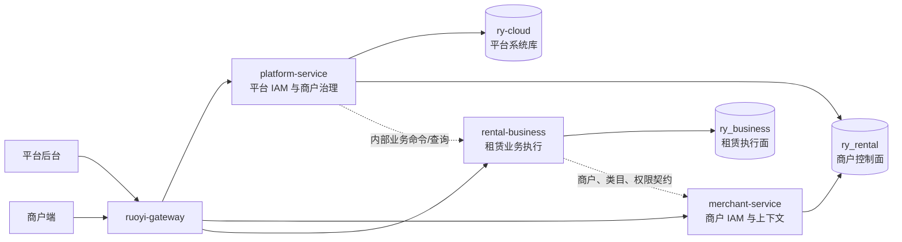

# `ry_rental` 与 `ry_business` 数据库边界设计

文档状态：当前架构基线
更新时间：2026-08-11
适用范围：`platform-service`、`merchant-service`、`rental-business` 及后续租赁领域服务

## 1. 结论

`ry_rental` 和 `ry_business` 不是主从库、读写分离库、冷热库，也不是生产库与归档库。两个数据库按业务职责拆分：

| 数据库 | 定位 | 唯一职责 |
| --- | --- | --- |
| `ry_rental` | 商户控制面 | 商户主体、认证、商户用户、角色菜单、经营范围、平台标准类目与型号、商户治理配置 |
| `ry_business` | 租赁执行面 | 仓库、商品、SN、配件、套餐、库存、客户、订单、物流、售后和业务工作流 |

必须遵守以下结论：

1. 商品、仓库、库存和订单等运行数据只能以 `ry_business` 为唯一事实源。
2. `ry_rental` 中曾与 `ry_business` 重复的 14 张业务表已经退役，后续不得重新创建。
3. 禁止双写、兼容读取、失败回退、跨库 JOIN 和跨库物理外键。
4. 表名前缀 `ry_rental_` 表示“租赁领域”，不表示物理数据库必须是 `ry_rental`。例如订单的完整物理名称是 `ry_business.ry_rental_order`。
5. `ry_rental` 这个数据库名来自早期单库模型，目前实际含义已经收敛为“商户治理库”。若以后改名，必须一次性切换并删除旧库，不建立别名库或长期兼容层。

## 2. 形成原因

项目早期将商户身份、商品、仓库、库存和订单统一设计在 `ry_rental`。建立独立 `rental-business` 服务后，迁移脚本把核心业务表复制到 `ry_business`，但没有同步删除 `ry_rental` 中的旧表，因此出现两个库都存在订单表的现象。

当前运行代码已经体现新的服务边界：

- `platform-service` 使用 `ry-cloud` 和 `ry_rental`，负责平台 IAM 与商户治理。
- `merchant-service` 只使用 `ry_rental`，负责商户身份、权限、上下文和治理配置。
- `rental-business` 只使用 `ry_business`，负责租赁业务运行数据。
- 订单 Mapper 当前读取 `ry_business.ry_rental_order`，没有合法业务路径需要读取 `ry_rental.ry_rental_order`。

因此，问题不是业务需要保存两套订单，而是早期数据库迁移缺少收尾。核心 14 张重复表已经完成退役；第 8.2 节列出的其余执行面表尚未迁移，必须按领域逐批收口。

## 3. 数据源和账号边界

| 服务 | 数据库账号 | 允许直接访问 | 禁止直接访问 |
| --- | --- | --- | --- |
| `platform-service` | `qianruo_platform` | `ry-cloud`、`ry_rental` | `ry_business` |
| `merchant-service` | `qianruo_merchant` | `ry_rental` | `ry-cloud`、`ry_business` |
| `rental-business` | `qianruo_business` | `ry_business` | `ry-cloud`、`ry_rental` |

数据库授权是服务边界的最后一道保护，不能为了减少一次内部 API 调用而扩大账号权限。平台或商户服务需要业务数据时，必须调用 `rental-business` 内部接口；`rental-business` 需要商户身份、经营类目或仓库权限时，必须调用对应内部契约或使用认证态中已经签发的可信上下文。

## 4. 总体关系

服务间只传递经过定义的 DTO、业务主键和版本信息，不传递 Mapper、数据库实体或可变对象引用。

## 5. `ry_rental` 的保留范围

### 5.1 商户主体与认证

以下表保留在 `ry_rental`，由平台治理流程维护，商户端只能通过明确授权的接口读取或提交：

- `ry_rental_member`
- `ry_rental_certification_material`
- `ry_rental_member_certification`
- `ry_rental_member_membership_history`
- `ry_rental_member_qualification`
- `ry_rental_member_qualification_history`

这些表描述“谁可以经营、当前审核状态和具备什么资格”，不描述具体订单如何履约。

### 5.2 商户用户、角色和菜单

以下表由 `merchant-service` 所有：

- `ry_rental_merchant_user`
- `ry_rental_user_member`
- `ry_rental_merchant_menu`
- `ry_rental_merchant_role`
- `ry_rental_merchant_role_menu`
- `ry_rental_merchant_user_role`
- `ry_rental_merchant_user_menu`
- `ry_rental_user_warehouse_scope`

`ry_rental_user_warehouse_scope` 只保存用户被授权的 `warehouse_id`，不拥有仓库主数据。仓库名称、地址、状态等事实必须从 `rental-business` 获取。

### 5.3 平台类目、标准型号和商户经营选择

以下表保留在 `ry_rental`：

- `ry_rental_product_class`
- `ry_rental_brand_model`
- `ry_rental_member_product_class`
- `ry_rental_member_common_model`

平台维护类目和标准型号，商户只保存经营类目与常用型号选择。`ry_business.ry_rental_product` 中的 `class_id`、`model_id` 是跨服务逻辑引用，不建立跨库外键。

### 5.4 商户治理与平台配置

以下表当前保留在 `ry_rental`：

- `ry_rental_audit_log`（租赁域统一业务审计唯一事实表）
- `ry_rental_merchant_business_audit_log`（历史重复表，已软删除停用）
- `ry_rental_merchant_oper_log`（历史请求级日志留存表，运行时不再由商户业务日志链路写入）
- `ry_rental_miniapp_auth`
- `ry_rental_promotion_invite`
- `ry_rental_service_subscription`

其中平台请求级日志仍写入 `ry-cloud.sys_oper_log`；商户业务审计统一写入 `ry_rental_audit_log`，商品、库存、订单等执行面仍以 `ry_business` 的业务流水和状态表作为业务事实来源，不能用审计日志替代业务流水。

## 6. `ry_business` 的权威范围

### 6.1 商品、仓库和套餐

- `ry_rental_warehouse`
- `ry_rental_product`
- `ry_rental_asset_sn`
- `ry_rental_accessory_item`
- `ry_rental_package_template`
- `ry_rental_package_item`
- `ry_rental_package_version`
- `ry_rental_package_component`
- `ry_rental_stock_pool`
- `ry_rental_stock_pool_compatibility`

这些表共同描述可出租资源、套餐 BOM 和共享库存约束。仓库、商品、SN 或套餐不得在 `ry_rental` 再维护一份副本。

### 6.2 库存

- `ry_rental_inventory_unit`
- `ry_rental_inventory_balance`
- `ry_rental_inventory_ledger`
- `ry_rental_inventory_reservation`
- `ry_rental_inventory_reservation_item`
- `ry_rental_inventory_transition`
- `ry_rental_inventory_pool_lock`

库存余额是当前状态，库存流水是不可变事实，预占和状态迁移必须在同一业务服务内完成。不得通过跨库事务修改库存。

### 6.3 客户、订单和物流

- `ry_rental_customer`
- `ry_rental_order`
- `ry_rental_order_item`
- `ry_rental_order_note`
- `ry_rental_logistics_order`
- `ry_rental_order_channel`
- `ry_rental_order_channel_transfer`
- `ry_rental_package_channel`
- `ry_rental_package_channel_transfer`

订单、订单明细、渠道、库存预占和物流必须在 `ry_business` 中形成闭环。订单表不允许根据请求来源切换数据库。

### 6.4 横切业务能力

- `ry_rental_idempotent_request`
- `ry_rental_file_quota_account`
- `ry_rental_file_quota_ledger`
- `ry_rental_protocol`
- `ry_rental_protocol_acceptance`

这些能力当前由 `rental-business` 实现，因此数据随服务归属 `ry_business`。平台端需要管理协议或配额时，应由 `platform-service` 接收平台请求，再通过内部接口调用 `rental-business`，不能让平台服务直接访问 `ry_business`。

## 7. 重复表退役状态

历史迁移阶段曾在两个数据库同时创建以下 14 张表。它们的权威数据已经位于
`ry_business`，本次收口迁移已删除 `ry_rental` 中的空遗留表：

- `ry_rental_accessory_item`
- `ry_rental_asset_sn`
- `ry_rental_customer`
- `ry_rental_idempotent_request`
- `ry_rental_inventory_ledger`
- `ry_rental_inventory_reservation`
- `ry_rental_logistics_order`
- `ry_rental_order`
- `ry_rental_order_item`
- `ry_rental_order_note`
- `ry_rental_package_item`
- `ry_rental_package_template`
- `ry_rental_product`
- `ry_rental_warehouse`

这些表的处置规则完全一致：

| 位置 | 状态 | 处置 |
| --- | --- | --- |
| `ry_business.*` | 权威表 | 保留并由 `rental-business` 独占 |
| `ry_rental.*` | 已退役遗留表 | 已完成数据核对并删除 |

不得将 `ry_rental` 中的旧表改称“备份表”“兼容表”或“平台查询表”。平台查询业务数据同样通过 `rental-business`，不能绕过服务边界。

退役迁移为 `database/migrations/V20260811_002__retire_ry_rental_business_duplicates.sql`，部署脚本已登记该迁移。迁移逐表检查 `ry_business` 同名权威表存在，并在发现 `ry_rental` 遗留表仍有数据时中止，禁止静默丢失数据。当前本地验证结果为 14 张表仅存在于 `ry_business`，迁移重复执行成功。

## 8. `ry_rental` 现有表的完整归类

### 8.1 保留在 `ry_rental`

| 类别 | 表 |
| --- | --- |
| 商户主体与认证 | `member`、`certification_material`、`member_certification`、`member_membership_history`、`member_qualification`、`member_qualification_history` |
| 商户 IAM | `merchant_user`、`user_member`、`merchant_menu`、`merchant_role`、`merchant_role_menu`、`merchant_user_menu`、`merchant_user_role`、`user_warehouse_scope` |
| 平台租赁主数据 | `product_class`、`brand_model` |
| 商户经营选择 | `member_product_class`、`member_common_model` |
| 商户治理配置 | `merchant_business_audit_log`、历史 `merchant_oper_log`、`miniapp_auth`、`promotion_invite`、`service_subscription` |

表中省略的统一前缀均为 `ry_rental_`。

### 8.2 执行面迁移清单与剩余项

| 类别 | 表 |
| --- | --- |
| 商品与仓库 | `warehouse`、`product`、`asset_sn`、`asset_photo`、`accessory_item`、`package_template`、`package_item` |
| 客户与订单 | `customer`、`order`、`order_item`、`order_note`、`order_edit_log` |
| 库存与仓内作业 | `inventory_ledger`、`inventory_reservation`、`inventory_snapshot`、`stocktaking`、`stocktaking_item`、`transfer_order` |
| 物流、媒体和售后 | `logistics_order`、`logistics_route`、`media_asset`、`after_sales_case`、`share_log`、`deposit_free_code` |
| 执行面基础能力 | `idempotent_request`、`audit_log` |

其中本次已经完成退役的是第 7 节列出的 14 张表；`asset_photo`、`order_edit_log`、`inventory_snapshot`、`stocktaking`、`stocktaking_item`、`transfer_order`、`logistics_route`、`media_asset`、`after_sales_case`、`share_log`、`deposit_free_code`、`audit_log` 尚未在 `ry_business` 建立权威表，因此仍保留在 `ry_rental`，不允许新增业务引用，也不能在本次迁移中直接删除。它们需要各自完成领域迁移、数据核对和接口切换后再退役。

### 8.3 后续独立领域

以下表不属于商户控制面。对应独立服务建立前，不允许继续在 `platform-service` 或 `merchant-service` 中扩展业务：

| 目标领域 | 当前表 |
| --- | --- |
| 租仓联盟 | `alliance`、`alliance_member`、`alliance_order` |
| 财务 | `finance_ledger` |
| 周转市场 | `market_post`、`market_message`、`market_report`、`market_deposit_ledger` |

这些表最终应进入各自领域数据库。若独立服务尚未建立但业务必须先运行，临时实现也只能放在执行面 `ry_business`，不能继续把 `ry_rental` 当作通用业务库。

## 9. 跨库数据关系

跨数据库只保留逻辑主键，不声明物理外键：

| `ry_business` 字段 | `ry_rental` 逻辑对象 | 校验方式 |
| --- | --- | --- |
| `tenant_id + member_id` | 商户主体 | 可信登录态和商户内部接口 |
| `merchant_user_id`、`operator_id` | 商户用户 | 登录态快照；历史记录不因用户软删除失效 |
| `class_id` | 平台产品类目 | 类目内部接口或已发布类目快照 |
| `model_id` | 平台标准型号 | 型号内部接口或已发布型号快照 |
| `warehouse_id` | 仓库主数据位于 `ry_business` | `rental-business` 本地校验；用户范围来自可信授权上下文 |

必须遵循以下调用方式：

1. 商户登录、角色、菜单、经营类目选择调用 `merchant-service`。
2. 商品、仓库、套餐、库存和订单调用 `rental-business`。
3. 平台删除类目或标准型号前，由 `platform-service` 调用 `rental-business` 的内部引用检查接口。
4. 平台查看或管理业务数据时，由 `platform-service` 暴露平台接口并调用 `rental-business` 内部契约。
5. 商户仓库权限关系保存在 `ry_rental`，但仓库有效性和业务状态由 `rental-business` 校验。

## 10. 审计、删除和事务规则

### 10.1 审计归属

| 操作类型 | 审计位置 |
| --- | --- |
| 平台 IAM 与平台治理操作 | `ry-cloud.sys_oper_log` 等平台日志 |
| 商户用户、角色、菜单和治理配置操作 | `ry_rental.ry_rental_audit_log` |
| 商品、仓库、库存、订单和物流操作 | `ry_rental.ry_rental_audit_log` + `ry_business` 业务事实表/不可变流水 |

同一个请求可以在平台请求级日志中记录一次请求信息，并在业务所有者记录一次业务事件，但不能把完整业务流水跨库复制一份。商户业务日志页面只查询 `ry_rental_audit_log`，不得读取已停用的 `ry_rental_merchant_business_audit_log` 或 `ry_rental_merchant_oper_log`。

### 10.2 软删除

运行中的应用数据统一使用 `is_delete` 软删除。删除 `ry_rental` 中已经迁移完成的整张遗留表属于数据库结构清理，不是业务数据删除，不需要为废弃表永久保留软删除兼容路径。

### 10.3 事务

- 单个业务聚合的写事务必须在 `rental-business` 和 `ry_business` 内闭环。
- 跨服务动作优先使用幂等内部命令、事件、Outbox 和状态补偿。
- 不为了实现跨库本地事务而扩大数据库账号权限。
- 必须持久化业务快照的字段应写入订单或事件快照，不能在历史查询时依赖控制面当前值。

## 11. 边界收口状态

本次已经完成：

1. 核心业务表由 `V20260803_001__rental_business_order_tables.sql` 和 `V20260804_001__rental_business_master_data.sql` 直接创建在 `ry_business`。
2. `database/mysql/01_rental_schema.sql` 中 14 张旧执行面表的创建语句已禁用，新环境不再在 `ry_rental` 创建它们。
3. `platform-service` 的标准型号引用检查改为调用 `rental-business` 内部接口。
4. 平台商户用户仓库查询和范围校验改为调用 `rental-business` 内部接口。
5. `merchant-service` 只保留仓库授权 ID，通过内部接口获取仓库详情，不再读取旧仓库表。

仍需在后续接口边界任务中完成：

1. `rental-business` 中仍有面向浏览器的 `/platform/**` Controller。平台公开接口必须迁入 `platform-service`，再调用 `rental-business` 内部契约。
2. 第 8.2 节尚未迁移的执行面表需要逐领域建立 `ry_business` 权威结构并退役。

这些偏差不能通过给平台或商户数据库账号增加 `ry_business` 权限解决。

## 12. 一次性收口步骤

### 12.1 冻结旧表

1. 在代码和 Mapper 中禁止新增对 `ry_rental` 业务遗留表的读写。
2. 增加架构测试，扫描 `platform-service` 和 `merchant-service` 对订单、商品、仓库、库存旧表的直接引用。
3. 新迁移脚本不再向 `ry_rental` 创建任何执行面表。

### 12.2 数据核对与迁移

1. 按 `tenant_id + member_id + 业务唯一键` 比较两库记录。
2. 保留原主键、创建时间、更新时间、软删除状态和业务版本。
3. `ry_business` 已有同主键但内容不同的数据必须中止迁移并输出冲突清单，禁止静默覆盖。
4. 只迁移 `ry_business` 中不存在且校验通过的记录。
5. 对订单头、明细、客户、物流、库存预占和流水做关联完整性校验。

### 12.3 切断跨库访问

1. 标准型号引用检查改为内部 API。
2. 仓库列表、仓库状态和仓库引用检查改为内部 API。
3. 用户仓库授权仍保留在 `ry_rental`，业务请求由网关签发的可信上下文携带仓库范围，`rental-business` 做最终校验。

### 12.4 删除遗留结构

第 7 节列出的 14 张重复表已经完成数据校验、接口切换和结构删除：

1. `V20260811_002__retire_ry_rental_business_duplicates.sql` 只删除明确白名单中的空遗留表。
2. 平台端和商户端不再直接引用这些表，仓库和标准型号引用校验通过 `rental-business` 内部契约完成。
3. 不创建兼容视图，不保留读取回退，不进行双写观察期。
4. 第 8.2 节剩余的未迁移表必须完成独立迁移后，才能进入下一次结构收口。

## 13. 验收标准

- `platform-service` 和 `merchant-service` 无任何对 `ry_business` 的直接数据库访问。
- `rental-business` 无任何对 `ry_rental` 或 `ry-cloud` 的直接数据库访问。
- `ry_rental` 不再存在本次已退役的仓库、商品、SN、套餐、库存、客户、订单和物流重复表。
- 尚未迁移的执行面表必须保留在第 8.2 节清单中，直到对应领域完成独立迁移和接口切换。
- 商品、订单和库存 API 的所有查询与写入只命中 `ry_business`。
- 商户登录、角色、菜单、经营类目和标准型号治理只命中 `ry_rental`。
- 标准型号删除、仓库授权、商户冻结等跨域场景通过内部契约完成并具备失败语义。
- 三个数据库账号在数据库层面无法访问禁止库。
- 不存在双写、兼容读取、失败回退或跨库 JOIN。

## 14. 与其他文档的关系

本文件是数据库物理边界的权威说明。发生冲突时：

1. 产品范围以最新 1.0 需求基线为准。
2. 服务和数据库归属以本文件为准。
3. 数据结构细节分别以[项目架构图](./项目架构图.md)、[商品与套餐库存数据结构设计](./商品与套餐库存数据结构设计.md)和正式迁移脚本为准。
4. 旧文档中“所有租赁数据归 `ry_rental`”或“后续再迁移核心业务表”的描述均视为失效。
