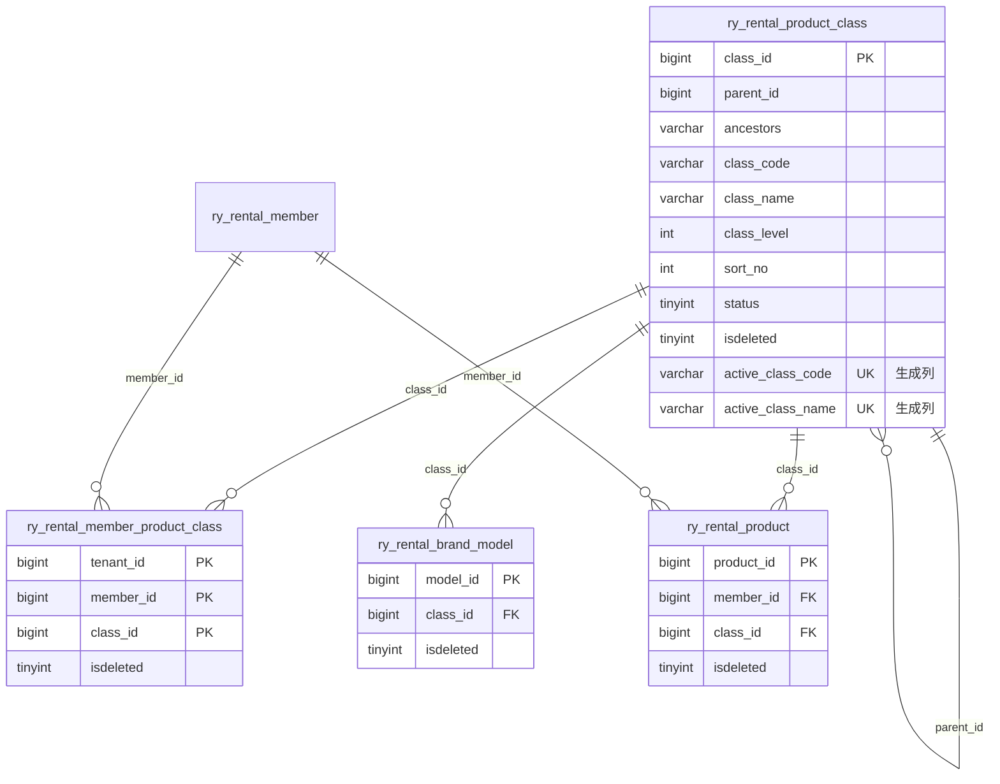

# 产品类目、接口审计与软删除设计

版本：V1.0  
更新日期：2026-07-30

本文定义平台产品类目、商户经营类目、全接口操作审计和全库软删除的统一实现。代码、数据库迁移、前端菜单和后续业务模块必须遵循本文，不再使用 `del_flag` 或物理删除。

## 1. 设计结论

1. 平台是产品类目主数据的唯一维护方，类目支持最多 8 级树形结构。
2. 商户不能创建或修改平台类目，只能选择多个正常类目作为经营范围。
3. 商户商品、标准型号、套餐和后续相关业务只能使用当前商户已选择的有效类目。
4. 平台类目表由 `platform-service` 拥有；商户经营类目关系由 `merchant-service` 按当前登录上下文维护。
5. 所有 `RestController` 公共方法统一记录成功或失败的操作日志，包括 GET 查询和公开接口。
6. 所有应用表统一使用 `isdeleted TINYINT(1) NOT NULL DEFAULT 0`；`0` 正常，`1` 删除。
7. 运行时 MyBatis 拒绝执行 `DELETE` 和 `TRUNCATE`，代码生成器也只生成软删除 SQL。

## 2. 服务与接口边界

| 能力 | 服务所有者 | 对外入口 | 权限 |
| --- | --- | --- | --- |
| 平台类目树 | `platform-service` | `GET /admin/rental/class/tree` | `platform:class:list` |
| 平台类目详情 | `platform-service` | `GET /admin/rental/class/{classId}` | `platform:class:query` |
| 平台类目新增 | `platform-service` | `POST /admin/rental/class` | `platform:class:add` |
| 平台类目修改 | `platform-service` | `PUT /admin/rental/class` | `platform:class:edit` |
| 平台类目软删除 | `platform-service` | `DELETE /admin/rental/class/{classId}` | `platform:class:remove` |
| 平台有效类目内部契约 | `platform-service` | `GET /internal/platform/product-classes` | 内部服务身份 |
| 商户可选类目 | `merchant-service` | `GET /merchant/class/options` | `merchant:class:list` |
| 商户已选类目 | `merchant-service` | `GET /merchant/class/selected` | `merchant:class:list` |
| 商户业务类目树 | `merchant-service` | `GET /merchant/class/tree` | `merchant:class:list` |
| 保存商户经营类目 | `merchant-service` | `PUT /merchant/class/selected` | `merchant:class:edit` |

商户接口不接收 `tenant_id` 或 `member_id`。`MerchantProductClassService` 只能从可信登录上下文读取归属；跨服务读取平台有效类目必须通过 `RemoteProductClassService`，不得跨服务调用 Mapper。

## 3. 数据模型

`ancestors` 保存祖先路径，`class_level` 由平台服务计算，前端不得指定可信层级。`active_class_code` 和 `active_class_name` 只在 `isdeleted = 0` 时生成业务值，软删除后为 `NULL`，用于保证有效编码及同级名称唯一且不阻碍删除后重建。`ry_rental_member_product_class` 的联合主键为 `tenant_id + member_id + class_id`，重复保存时恢复原软删除记录，不创建重复关系。

## 4. 类目业务规则

- 类目编码在未删除记录中全局唯一；同一父节点下类目名称唯一。
- 新增和移动节点时由服务端计算祖先路径与层级，禁止选择自身或后代作为父节点；移动父类目必须在同一事务中批量替换全部后代的祖先路径并修正层级。
- 父类目停用时不能新增子类目；存在有效子类目时不能停用或删除父类目。
- 商户保存经营范围前，必须重新向平台内部接口取得有效类目并校验全部主键。
- 平台停用或删除类目后，该类目立即从商户业务类目树消失；历史商品仍保留 `class_id` 以供审计，不自动改写历史数据。
- 新增或修改商户商品、标准型号、套餐时，必须调用经营范围校验；未选择的类目返回业务错误。
- 商户业务下拉框只调用 `/merchant/class/tree`，不得直接请求平台全量类目。

## 5. 全接口操作审计

`LogAspect` 环绕认证、平台、商户、文件、代码生成和任务服务中的所有 `RestController` 公共方法。显式 `@Log` 优先使用业务标题和类型；未标注的方法按 HTTP 方法推断：POST 为新增、PUT/PATCH 为修改、DELETE 为删除、GET 为查询。网关只负责转发和链路标识，不重复写业务操作日志。

审计字段至少包括：操作用户、终端类型、租户、商户、请求链路 ID、HTTP 状态码、请求方法、URL、来源 IP、操作结果、错误摘要和耗时。密码、令牌、联系方式、证件和支付信息必须脱敏或排除。平台日志写入 `sys_oper_log`，商户日志写入 `ry_rental_merchant_oper_log`；公开商户接口允许身份字段为空，但仍记录请求结果。

平台日志接收接口本身不再二次记录，避免日志写入递归。审计表不开放业务删除和清空入口；其 `isdeleted` 字段只用于合规归档流程。

## 6. 全库软删除规则

- 字段固定命名为 `isdeleted`，禁止新增 `deleted`、`is_deleted`、`delete_flag` 或 `del_flag`。
- 业务查询默认追加 `isdeleted = 0`；详情、联表、统计、导出和权限关系查询同样适用。
- 删除操作固定使用 `UPDATE ... SET isdeleted = 1`，并保留更新时间和操作人。
- 关系表重新授权时使用幂等 upsert 将 `isdeleted` 恢复为 `0`。
- 更新和软删除必须同时限制主键、数据归属和 `isdeleted = 0`，商户数据还必须包含可信 `tenant_id + member_id`。
- `PhysicalDeleteGuardInterceptor` 在 JDBC 预编译前拒绝 MyBatis 物理删除 SQL。
- 代码生成模板默认生成软删除列表、详情、更新和删除 SQL。
- `V20260730_000__isdeleted_prerequisite.sql` 先为应用表补字段、迁移旧值并彻底删除 `del_flag`；后续代码只读取 `isdeleted`。

## 7. 索引与性能

- 平台类目按 `parent_id + status + isdeleted` 查询树；有效编码和有效同级名称使用生成列唯一索引，允许保留任意数量的软删除历史记录。
- 商户注册手机号使用 `active_contact_phone` 生成列唯一索引；历史重复数据优先保留已绑定商户用户的主体，其余记录标记为软删除。
- 商户经营范围按 `member_id + isdeleted` 查询，按 `class_id + isdeleted` 支持反向治理检查。
- 商户商品使用 `member_id + class_id + status + isdeleted` 联合索引。
- 审计日志按终端、商户、时间和链路 ID 建索引；列表必须按时间倒序分页，禁止一次加载全量日志。
- 软删除会保留历史行，需通过归档任务和索引统计监控表膨胀，不允许用物理删除绕开留存策略。

## 8. 验收清单

1. 平台可新增、修改、停用和软删除多级类目，非法循环和带子节点删除被拒绝。
2. 商户只能选择平台正常类目，不能通过请求参数切换其他商户。
3. 商户 A 保存经营类目不影响商户 B；商品页只显示 A 的经营类目。
4. 平台停用类目后，商户业务树不再返回该类目。
5. GET、写操作、失败请求和公开注册接口均产生对应审计记录。
6. 敏感字段不进入日志明文，平台与商户日志分别入库。
7. 源码、Mapper、代码生成模板中不存在运行时物理删除 SQL。
8. 旧库迁移后不存在 `del_flag`，所有应用表均存在类型一致的 `isdeleted`。
9. 两端前端生产构建、后端测试和数据库迁移重复执行均通过。
