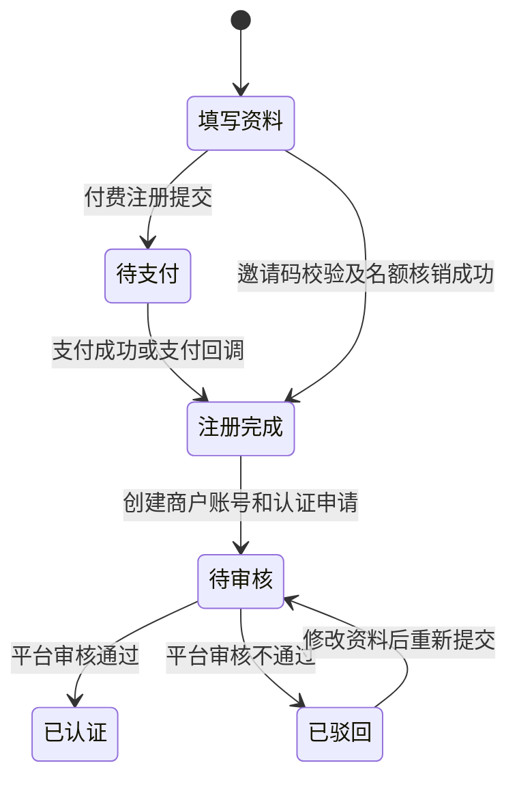

# 商户注册、等级与邀请推广设计

## 1. 功能边界

- 商户注册支持 `paid` 付费注册和 `invite` 邀请码注册，两种方式必须二选一。
- 付费注册依次经过填写资料、生成支付单、支付确认、注册完成四个状态节点。
- 邀请码注册在提交时校验邀请码和剩余名额，成功后直接注册完成，不生成支付单。
- 注册完成页只提供前往登录入口；商户审核仍沿用平台审核流程，未审核商户登录后只能查看禁用页面。
- 平台商户等级与原有主体认证类型分离。等级是经营权益配置，认证类型是主体属性，两者不能混用。

## 2. 注册状态机

付费注册在 `registration_status=awaiting_payment` 时不开通商户账号。支付确认使用支付单行锁和条件更新实现幂等，成功后才创建认证版本和商户所有者账号。

## 3. 数据结构

| 表/字段 | 用途 |
|---|---|
| `ry_rental_member.level_id` | 当前商户等级 |
| `ry_rental_member.registration_mode` | `paid` 或 `invite` |
| `ry_rental_member.registration_status` | `awaiting_payment` 或 `completed` |
| `ry_rental_member.inviter_member_id` | 邀请商户ID，服务端写入 |
| `ry_rental_merchant_level` | 等级名称、月订单要求、库存要求、邀请上限、注册费用和状态 |
| `ry_rental_registration_payment` | 注册支付单、金额、支付状态和支付时间 |
| `ry_rental_merchant_invite_code` | 一个商户一个有效邀请码及已使用名额 |
| `ry_rental_merchant_invitation` | 邀请人、被邀请人、邀请码和注册时间的不可变关系 |

所有表使用 `is_delete` 软删除。邀请码、支付单号和被邀请商户关系均有唯一索引，防止重复核销和重复统计。

## 4. 等级规则

- 默认初始化初级会员和高级会员，平台可以修改展示名称和权益要求。
- 初级会员默认邀请上限为 1，高级会员默认邀请上限为 10，最终以平台配置为准。
- `monthly_order_requirement` 和 `inventory_requirement` 保存升级要求；后续等级自动评估任务读取已完成订单统计和可用库存快照。
- 商户等级由平台管理，商户端不得自行指定 `level_id`。

## 5. 并发与安全

1. 邀请码查询使用 `SELECT ... FOR UPDATE` 锁定邀请码记录。
2. 名额核销使用 `used_count < invite_limit` 条件更新，失败即拒绝注册。
3. 邀请关系、名额核销和商户创建位于同一事务，任一步失败整体回滚。
4. `InviteCodeUtils` 使用 `SecureRandom` 生成邀请码，并由数据库唯一索引兜底防重。
5. “我的邀请”只从认证上下文读取租户和商户ID，不接受客户端指定数据归属。
6. 当前支付确认是支付渠道接入前的模拟入口；正式接入后由验签回调调用同一幂等状态机。

## 6. 接口与页面

| 终端 | 接口/页面 | 说明 |
|---|---|---|
| 公开商户端 | `POST /merchant/public/registration` | 提交付费或邀请码注册 |
| 公开商户端 | `POST /merchant/public/registration/payment/{paymentNo}/confirm` | 确认注册支付 |
| 商户端 | `GET /merchant/invitation/overview` | 查看邀请码、名额和邀请记录 |
| 平台端 | `/platform/merchant-level/**` | 商户等级增删改查 |
| 平台端 | `GET /platform/promotion/list` | 查看邀请码和邀请关系 |
| 商户页面 | `merchant/invitation` | 我的邀请 |
| 平台页面 | `rental/merchantLevel/index` | 商户等级 |
| 平台页面 | `rental/promotion/index` | 推广管理 |

数据库迁移：`V20260811_003__merchant_level_registration_invitation.sql`。
